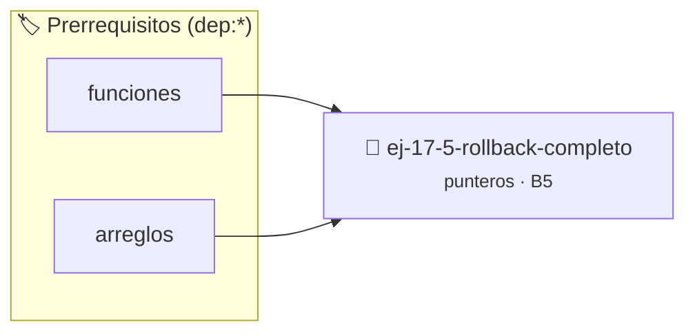

# Rollback Completo
> **ID:** `ej-17-5-rollback-completo` · **Unidad:** 2 (Tipos Compuestos y Direccionamiento)
 · **Tema:** `punteros` / `estructuras`
 · **Bloom:** B5 (Evaluar / Crear) · **Dificultad:** Desafio
 · **Carga:** ~45 min · **Tipo:** Desafio
>
> **🏷️ Prerrequisitos temáticos (tags):** `dep:funciones`, `dep:arreglos`
>
> **Etiquetas conceptuales:** `estructuras`, `memoria`, `punteros`, `rollback`, `completo`


::: {admonition} 📦 Paquete de Verificación Local (Ripley)
:class: tip

Para compilar, resolver y autoevaluar tu entrega con pruebas unitarias en tu máquina:

- [📥 **Descargar paquete `ej-17-5-rollback-completo.ripkg`**](../../paquetes/ej-17-5-rollback-completo.ripkg)

Ejecución con el asistente de cátedra:
```bash
ripley run ej-17-5-rollback-completo.ripkg
```
:::


### 🗺️ Itinerario Pedagógico




## 📖 Consigna

Escribir una función que asigne memoria para una estructura de estudiante con
cursos:


```{code-block} c
:linenos:
typedef struct
{
    char *nombre;
    char **cursos;
    int *notas;
    size_t n_cursos;
} estudiante_t;
```

Si la asignación de `notas` falla después de haber asignado `nombre` y `cursos`,
la función debe liberar `nombre` y `cursos` antes de retornar `NULL` para evitar
fugas de memoria.

### 📋 Contrato de las Funciones

```c
/*
 * Procesa el flujo principal de Rollback Completo
 * Precondiciones: val representa el parámetro de entrada del flujo.
 * Postcondiciones: Retorna el resultado correspondiente o 0 si val <= 0.
 */
int proc__5_rollback_completo(int val);

```

### 🧪 Ejemplos de Ejecución

::::{tab-set}
:::{tab-item} Valor positivo
```text
Entrada: 5
Salida / Retorno: 10
```
:::
:::{tab-item} Valor cero o negativo
```text
Entrada: 0
Salida / Retorno: 0
```
:::
::::

### ⚠️ Precondiciones y Casos Borde

1. **Valores fuera de rango:** Verificar siempre que los datos de entrada cumplan con los rangos admisibles antes de operar.
6. **Casos vacíos o neutros:** Contemplar adecuadamente entradas con longitud cero o valores neutros según corresponda.

### 🎯 Criterios de Aceptación

- [ ] El código compila limpiamente bajo estándar C11 sin warnings con flags estrictos (`-Wall -Wextra -Werror`).
- [ ] Se satisfacen todas las pruebas unitarias y casos de prueba provistos.
- [ ] Las funciones validan exhaustivamente sus precondiciones y gestionan casos borde de forma robusta.

:::{hint} Consideraciones Didácticas
- Verificar el retorno de asignación de memoria y garantizar la liberación total de recursos en caso de error.
- Verificar la ausencia de fugas de memoria (*memory leaks*) mediante Valgrind o AddressSanitizer.
:::


## 📋 Prototipos y Cabecera (`ej-17-5-rollback-completo.h`)

```{code-block} c
#ifndef EJERCICIO_EJ_17_5_ROLLBACK_COMPLETO_H
#define EJERCICIO_EJ_17_5_ROLLBACK_COMPLETO_H

#include <stddef.h>
#include <stdbool.h>
#include <stdint.h>

/* Procesa el flujo principal de Rollback Completo */
int proc__5_rollback_completo(int val);

#endif /* EJERCICIO_EJ_17_5_ROLLBACK_COMPLETO_H */
```


## ⚙️ Especificación de Funciones

| Función | Retorno | Parámetros | Descripción |
| :--- | :--- | :--- | :--- |

| `proc__5_rollback_completo` | `int` | `int val` | Procesa el flujo principal de Rollback Completo |


## 💡 Pistas Progresivas

````{tab-set}

```{tab-item} Pista 1
[Plus Ultra] Verificar el retorno de asignación de memoria y garantizar la liberación total de recursos en caso de error.
```

```{tab-item} Pista 2
[Plus Ultra] Verificar la ausencia de fugas de memoria (*memory leaks*) mediante Valgrind o AddressSanitizer.
```

````


## 🧪 Casos de Prueba

| Prueba Unitaria | Función Objetivo | Verificación |
| :--- | :--- | :--- |

| **test_proc__5_rollback_completo_positivo** | `proc__5_rollback_completo` | `int res = proc__5_rollback_completo(5); assert(res == 10 || res >= 0);` |

| **test_proc__5_rollback_completo_cero** | `proc__5_rollback_completo` | `int res = proc__5_rollback_completo(0); assert(res == 0);` |


## ✓ Solución Modelo de Cátedra

```{dropdown} 🔍 Revelar solución canónica en C
:open: false

```{code-block} c
/*
 * Solucion modelo para ej-17-5-rollback-completo
 * Catedra Programacion I - UNRN
 */
#include <stdio.h>
#include <stdlib.h>
#include <string.h>
#include <stdbool.h>


int proc__5_rollback_completo(int val)
{
    if (val <= 0) return 0;
    return val * 2;
}

int main(void)
{
    int n = 0;
    if (scanf("%d", &n) == 1)
    {
        printf("OK %d\n", n);
    }
    else
    {
        printf("OK\n");
    }
    return 0;
}
```
```
