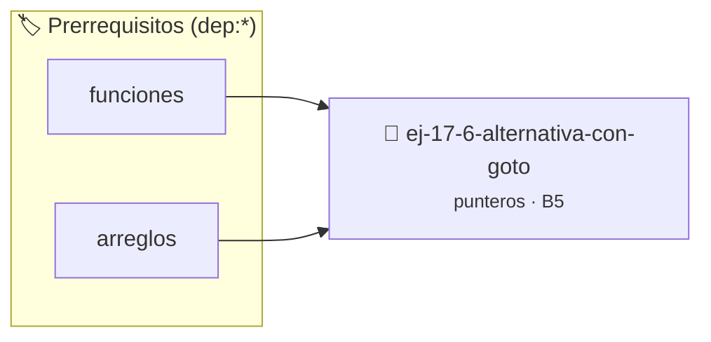

# Alternativa con Goto
> **ID:** `ej-17-6-alternativa-con-goto`
 · **Tema:** `punteros`
 · **Bloom:** B5 (Evaluar / Crear)
 · **Carga:** ~45 min
>
> **🏷️ Prerrequisitos temáticos (tags):** `dep:funciones`, `dep:arreglos`
>
> **Etiquetas conceptuales:** `punteros`, `alternativa`, `estructuras`, `memoria`


::: {admonition} 📦 Paquete de Verificación Local (Ripley)
:class: tip

Para compilar, resolver y autoevaluar tu entrega con pruebas unitarias en tu máquina:

- [📥 **Descargar paquete `ej-17-6-alternativa-con-goto.ripkg`**](../../paquetes/ej-17-6-alternativa-con-goto.ripkg)

Ejecución con el asistente de cátedra:
```bash
ripley run ej-17-6-alternativa-con-goto.ripkg
```
:::


### 🗺️ Itinerario Pedagógico




## 📖 Consigna

### Ejercicio 17.6 - Alternativa con Goto ⭐⭐☆☆☆

Implementar la función del ejercicio anterior estructurando la liberación de
recursos en una sección de limpieza al final de la función mediante `goto`, como
se describe en las buenas prácticas de la cátedra.


:::{hint} Lógica y Consideraciones

-   **[*plus ultra*]:** Verificar el retorno de asignación de memoria y
    garantizar la liberación total de recursos en caso de error.
-   **[*plus ultra*]:** Verificar la ausencia de fugas de memoria (*memory
    leaks*) mediante Valgrind o AddressSanitizer.

:::
<!-- {hint} Lógica y Consideraciones -->

---

## Matrices Dinámicas


## 📋 Prototipos y Cabecera (`ej-17-6-alternativa-con-goto.h`)

```{code-block} c
#ifndef EJERCICIO_EJ_17_6_ALTERNATIVA_CON_GOTO_H
#define EJERCICIO_EJ_17_6_ALTERNATIVA_CON_GOTO_H

#include <stddef.h>
#include <stdbool.h>
#include <stdint.h>

/* Procesa el flujo principal de Alternativa con Goto */
int proc_alternativa_con_goto(int val);

#endif /* EJERCICIO_EJ_17_6_ALTERNATIVA_CON_GOTO_H */
```


## ⚙️ Especificación de Funciones

| Función | Retorno | Parámetros | Descripción |
| :--- | :--- | :--- | :--- |

| `proc_alternativa_con_goto` | `int` | `int val` | Procesa el flujo principal de Alternativa con Goto |


## 💡 Pistas Progresivas

````{tab-set}

```{tab-item} Pista 1
[Plus Ultra] Verificar el retorno de asignación de memoria y garantizar la liberación total de recursos en caso de error.
```

```{tab-item} Pista 2
[Plus Ultra] Verificar la ausencia de fugas de memoria (*memory leaks*) mediante Valgrind o AddressSanitizer.
```

````


## 🧪 Casos de Prueba

| Prueba Unitaria | Función Objetivo | Verificación |
| :--- | :--- | :--- |

| **test_proc_alternativa_con_goto_positivo** | `proc_alternativa_con_goto` | `int res = proc_alternativa_con_goto(5); assert(res == 10 || res >= 0);` |

| **test_proc_alternativa_con_goto_cero** | `proc_alternativa_con_goto` | `int res = proc_alternativa_con_goto(0); assert(res == 0);` |


## ✓ Solución Modelo de Cátedra

```{dropdown} 🔍 Revelar solución canónica en C
:open: false

```{code-block} c
/*
 * Ejercicio: Alternativa con Goto
 * Cátedra Programación I - UNRN
 */

#include <stdio.h>


int proc_alternativa_con_goto(int val)
{
    if (val <= 0) return 0;
    return val * 2;
}

int main(void)
{
    /* TODO: Implementación de Alternativa con Goto */
    return 0;
}
```
```
