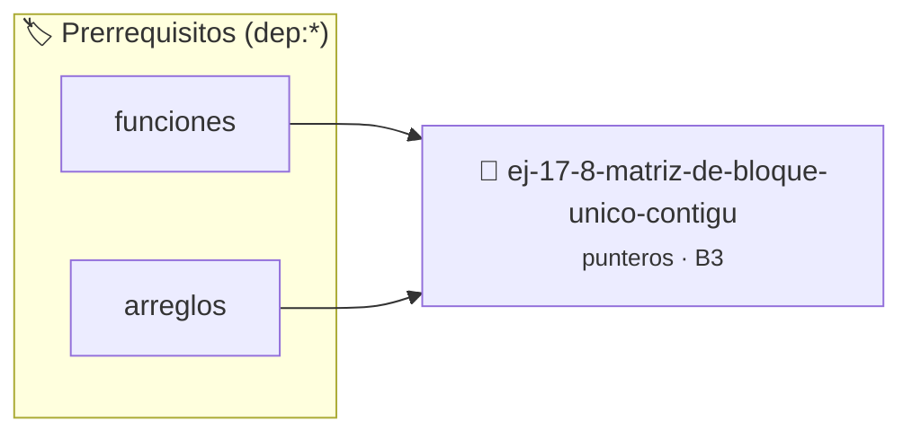

# Matriz de Bloque Único (Contigua)
> **ID:** `ej-17-8-matriz-de-bloque-unico-contigu` · **Unidad:** 2 (Tipos Compuestos y Direccionamiento)
 · **Tema:** `punteros` / `matrices_2d`
 · **Bloom:** B3 (Aplicar) · **Dificultad:** Intermedia
 · **Carga:** ~25 min · **Tipo:** Practica Guiada
>
> **🏷️ Prerrequisitos temáticos (tags):** `dep:funciones`, `dep:arreglos`
>
> **Etiquetas conceptuales:** `contigua`, `estructuras`, `unico`, `memoria`, `punteros`


::: {admonition} 📦 Paquete de Verificación Local (Ripley)
:class: tip

Para compilar, resolver y autoevaluar tu entrega con pruebas unitarias en tu máquina:

- [📥 **Descargar paquete `ej-17-8-matriz-de-bloque-unico-contigu.ripkg`**](../../paquetes/ej-17-8-matriz-de-bloque-unico-contigu.ripkg)

Ejecución con el asistente de cátedra:
```bash
ripley run ej-17-8-matriz-de-bloque-unico-contigu.ripkg
```
:::


### 🗺️ Itinerario Pedagógico




## 📖 Consigna

### Ejercicio 17.8 - Matriz de Bloque Único (Contigua) ⭐⭐⭐☆☆

Implementar funciones para crear y liberar una matriz contigua en memoria,
reservando un único bloque para todos los datos y configurando el array de
punteros a filas.


:::{hint} Lógica y Consideraciones

-   **[*plus ultra*]:** Validar punteros `NULL` recibidos como parámetro para
    evitar fallos de segmentación.
-   **[*plus ultra*]:** Implementar una versión utilizando aritmética de
    punteros en lugar de indexación directa.

:::
<!-- {hint} Lógica y Consideraciones -->

``` c
int **crear_matriz_contigua(size_t filas, size_t columnas);
void liberar_matriz_contigua(int ***ptr_matriz);
```
<!-- c -->


## 📋 Prototipos y Cabecera (`ej-17-8-matriz-de-bloque-unico-contigu.h`)

```{code-block} c
#ifndef EJERCICIO_EJ_17_8_MATRIZ_DE_BLOQUE_UNICO_CONTIGU_H
#define EJERCICIO_EJ_17_8_MATRIZ_DE_BLOQUE_UNICO_CONTIGU_H

#include <stddef.h>
#include <stdbool.h>
#include <stdint.h>

/* Procesa el flujo principal de Matriz de Bloque Único (Contigua) */
int proc_bloque_unico_contigu(int val);

#endif /* EJERCICIO_EJ_17_8_MATRIZ_DE_BLOQUE_UNICO_CONTIGU_H */
```


## ⚙️ Especificación de Funciones

| Función | Retorno | Parámetros | Descripción |
| :--- | :--- | :--- | :--- |

| `proc_bloque_unico_contigu` | `int` | `int val` | Procesa el flujo principal de Matriz de Bloque Único (Contigua) |


## 💡 Pistas Progresivas

````{tab-set}

```{tab-item} Pista 1
[Plus Ultra] Validar punteros `NULL` recibidos como parámetro para evitar fallos de segmentación.
```

```{tab-item} Pista 2
[Plus Ultra] Implementar una versión utilizando aritmética de punteros en lugar de indexación directa.
```

````


## 🧪 Casos de Prueba

| Prueba Unitaria | Función Objetivo | Verificación |
| :--- | :--- | :--- |

| **test_proc_bloque_unico_contigu_positivo** | `proc_bloque_unico_contigu` | `int res = proc_bloque_unico_contigu(5); assert(res == 10 || res >= 0);` |

| **test_proc_bloque_unico_contigu_cero** | `proc_bloque_unico_contigu` | `int res = proc_bloque_unico_contigu(0); assert(res == 0);` |


## ✓ Solución Modelo de Cátedra

```{dropdown} 🔍 Revelar solución canónica en C
:open: false

```{code-block} c
/*
 * Ejercicio: Matriz de Bloque Único (Contigua)
 * Cátedra Programación I - UNRN
 */

#include <stdio.h>


int proc_bloque_unico_contigu(int val)
{
    if (val <= 0) return 0;
    return val * 2;
}

int main(void)
{
    /* TODO: Implementación de Matriz de Bloque Único (Contigua) */
    return 0;
}
```
```
