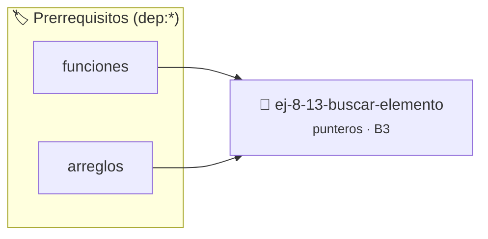

# Buscar Elemento
> **ID:** `ej-8-13-buscar-elemento`
 · **Tema:** `punteros`
 · **Bloom:** B3 (Aplicar)
 · **Carga:** ~25 min
>
> **🏷️ Prerrequisitos temáticos (tags):** `dep:funciones`, `dep:arreglos`
>
> **Etiquetas conceptuales:** `memoria`, `punteros`, `direcciones`, `buscar`, `elemento`


::: {admonition} 📦 Paquete de Verificación Local (Ripley)
:class: tip

Para compilar, resolver y autoevaluar tu entrega con pruebas unitarias en tu máquina:

- [📥 **Descargar paquete `ej-8-13-buscar-elemento.ripkg`**](../../paquetes/ej-8-13-buscar-elemento.ripkg)

Ejecución con el asistente de cátedra:
```bash
ripley run ej-8-13-buscar-elemento.ripkg
```
:::


### 🗺️ Itinerario Pedagógico




## 📖 Consigna

### Ejercicio 8.13 - Buscar Elemento ⭐⭐☆☆☆

Implementar `int* buscar_elemento(int *inicio, int *fin, int valor)` que retorne
un puntero al primer elemento igual a `valor`, o `NULL` si no se encuentra.
:::{hint} Lógica y Consideraciones

-   **[*plus ultra*]:** Validar punteros `NULL` recibidos como parámetro para
    evitar fallos de segmentación.
-   **[*plus ultra*]:** Implementar una versión utilizando aritmética de
    punteros en lugar de indexación directa.

:::
<!-- {hint} Lógica y Consideraciones -->


## 📋 Prototipos y Cabecera (`ej-8-13-buscar-elemento.h`)

```{code-block} c
#ifndef EJERCICIO_EJ_8_13_BUSCAR_ELEMENTO_H
#define EJERCICIO_EJ_8_13_BUSCAR_ELEMENTO_H

#include <stddef.h>
#include <stdbool.h>
#include <stdint.h>

/* Procesa el flujo principal de Buscar Elemento */
int proc_8_13_buscar_elemento(int val);

#endif /* EJERCICIO_EJ_8_13_BUSCAR_ELEMENTO_H */
```


## ⚙️ Especificación de Funciones

| Función | Retorno | Parámetros | Descripción |
| :--- | :--- | :--- | :--- |

| `proc_8_13_buscar_elemento` | `int` | `int val` | Procesa el flujo principal de Buscar Elemento |


## 💡 Pistas Progresivas

````{tab-set}

```{tab-item} Pista 1
[Plus Ultra] Validar punteros `NULL` recibidos como parámetro para evitar fallos de segmentación.
```

```{tab-item} Pista 2
[Plus Ultra] Implementar una versión utilizando aritmética de punteros en lugar de indexación directa.
```

````


## 🧪 Casos de Prueba

| Prueba Unitaria | Función Objetivo | Verificación |
| :--- | :--- | :--- |

| **test_proc_8_13_buscar_elemento_positivo** | `proc_8_13_buscar_elemento` | `int res = proc_8_13_buscar_elemento(5); assert(res == 10 || res >= 0);` |

| **test_proc_8_13_buscar_elemento_cero** | `proc_8_13_buscar_elemento` | `int res = proc_8_13_buscar_elemento(0); assert(res == 0);` |


## ✓ Solución Modelo de Cátedra

```{dropdown} 🔍 Revelar solución canónica en C
:open: false

```{code-block} c
/*
 * Ejercicio: Buscar Elemento
 * Cátedra Programación I - UNRN
 */

#include <stdio.h>


int proc_8_13_buscar_elemento(int val)
{
    if (val <= 0) return 0;
    return val * 2;
}

int main(void)
{
    /* TODO: Implementación de Buscar Elemento */
    return 0;
}
```
```
