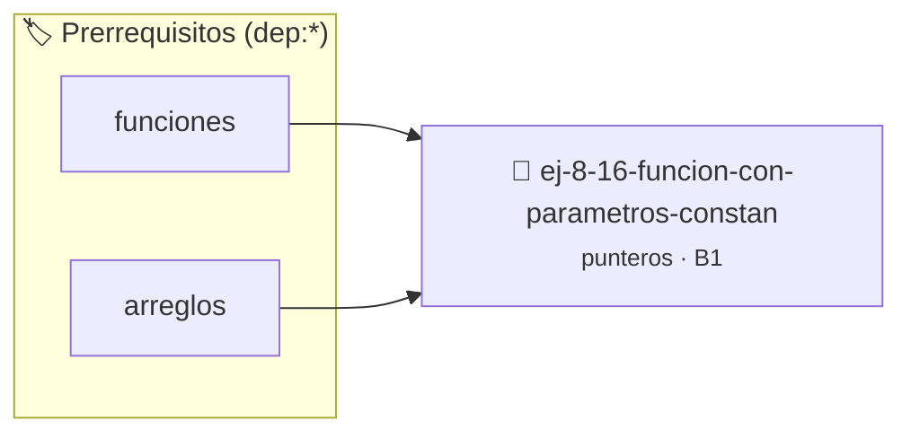

# Función con Parámetros Constantes
> **ID:** `ej-8-16-funcion-con-parametros-constan` · **Unidad:** 2 (Tipos Compuestos y Direccionamiento)
 · **Tema:** `punteros` / `funcion`
 · **Bloom:** B1 (Recordar) · **Dificultad:** Inicial
 · **Carga:** ~10 min · **Tipo:** Concepto
>
> **🏷️ Prerrequisitos temáticos (tags):** `dep:funciones`, `dep:arreglos`
>
> **Etiquetas conceptuales:** `funcion`, `memoria`, `punteros`, `direcciones`, `parametros`


::: {admonition} 📦 Paquete de Verificación Local (Ripley)
:class: tip

Para compilar, resolver y autoevaluar tu entrega con pruebas unitarias en tu máquina:

- [📥 **Descargar paquete `ej-8-16-funcion-con-parametros-constan.ripkg`**](../../paquetes/ej-8-16-funcion-con-parametros-constan.ripkg)

Ejecución con el asistente de cátedra:
```bash
ripley run ej-8-16-funcion-con-parametros-constan.ripkg
```
:::


### 🗺️ Itinerario Pedagógico




## 📖 Consigna

### Ejercicio 8.16 - Función con Parámetros Constantes ⭐⭐☆☆☆

Implementar `int maximo_arreglo(const int *arr, size_t n)` que encuentre el
máximo sin modificar el arreglo original.

**Ventaja:** El `const` documenta que la función no modifica el arreglo y
permite que el compilador detecte modificaciones accidentales.
:::{hint} Lógica y Consideraciones

-   **[*plus ultra*]:** Optimizar el acceso a memoria respetando el orden por
    filas (*row-major order*) para mejorar el uso de caché.
-   **[*plus ultra*]:** Validar que los índices ingresados se encuentren
    estrictamente dentro de los límites del contenedor.

:::
<!-- {hint} Lógica y Consideraciones -->


## 📋 Prototipos y Cabecera (`ej-8-16-funcion-con-parametros-constan.h`)

```{code-block} c
#ifndef EJERCICIO_EJ_8_16_FUNCION_CON_PARAMETROS_CONSTAN_H
#define EJERCICIO_EJ_8_16_FUNCION_CON_PARAMETROS_CONSTAN_H

#include <stddef.h>
#include <stdbool.h>
#include <stdint.h>

/* Procesa el flujo principal de Función con Parámetros Constantes */
int proc_n_parametros_constan(int val);

#endif /* EJERCICIO_EJ_8_16_FUNCION_CON_PARAMETROS_CONSTAN_H */
```


## ⚙️ Especificación de Funciones

| Función | Retorno | Parámetros | Descripción |
| :--- | :--- | :--- | :--- |

| `proc_n_parametros_constan` | `int` | `int val` | Procesa el flujo principal de Función con Parámetros Constantes |


## 💡 Pistas Progresivas

````{tab-set}

```{tab-item} Pista 1
[Plus Ultra] Optimizar el acceso a memoria respetando el orden por filas (*row-major order*) para mejorar el uso de caché.
```

```{tab-item} Pista 2
[Plus Ultra] Validar que los índices ingresados se encuentren estrictamente dentro de los límites del contenedor.
```

````


## 🧪 Casos de Prueba

| Prueba Unitaria | Función Objetivo | Verificación |
| :--- | :--- | :--- |

| **test_proc_n_parametros_constan_positivo** | `proc_n_parametros_constan` | `int res = proc_n_parametros_constan(5); assert(res == 10 || res >= 0);` |

| **test_proc_n_parametros_constan_cero** | `proc_n_parametros_constan` | `int res = proc_n_parametros_constan(0); assert(res == 0);` |


## ✓ Solución Modelo de Cátedra

```{dropdown} 🔍 Revelar solución canónica en C
:open: false

```{code-block} c
/*
 * Ejercicio: Función con Parámetros Constantes
 * Cátedra Programación I - UNRN
 */

#include <stdio.h>


int proc_n_parametros_constan(int val)
{
    if (val <= 0) return 0;
    return val * 2;
}

int main(void)
{
    /* TODO: Implementación de Función con Parámetros Constantes */
    return 0;
}
```
```
