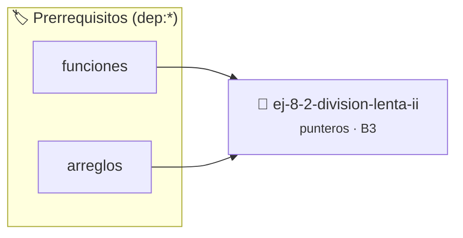

# División Lenta II
> **ID:** `ej-8-2-division-lenta-ii` · **Unidad:** 2 (Tipos Compuestos y Direccionamiento)
 · **Tema:** `punteros` / `lenta`
 · **Bloom:** B3 (Aplicar) · **Dificultad:** Intermedia
 · **Carga:** ~25 min · **Tipo:** Practica Guiada
>
> **🏷️ Prerrequisitos temáticos (tags):** `dep:funciones`, `dep:arreglos`
>
> **Etiquetas conceptuales:** `lenta`, `memoria`, `punteros`, `direcciones`, `division`


::: {admonition} 📦 Paquete de Verificación Local (Ripley)
:class: tip

Para compilar, resolver y autoevaluar tu entrega con pruebas unitarias en tu máquina:

- [📥 **Descargar paquete `ej-8-2-division-lenta-ii.ripkg`**](../../paquetes/ej-8-2-division-lenta-ii.ripkg)

Ejecución con el asistente de cátedra:
```bash
ripley run ej-8-2-division-lenta-ii.ripkg
```
:::


### 🗺️ Itinerario Pedagógico




## 📖 Consigna

### Ejercicio 8.2 - División Lenta II ⭐⭐☆☆☆

Implementar `int division_lenta(int dividendo, int divisor, int *cociente, int
*resto)`. Los resultados se devuelven modificando las variables a las que
apuntan `cociente` y `resto`.

Utilicen el retorno para indicar si la división fue correcta o no.
:::{hint} Lógica y Consideraciones

-   **[*plus ultra*]:** Implementar encapsulamiento completo manteniendo la
    definición interna oculta en el archivo `.c`.
-   **[*plus ultra*]:** Añadir una función de duplicación profunda (*deep copy*)
    para copiar la estructura de forma segura.

:::
<!-- {hint} Lógica y Consideraciones -->


## 📋 Prototipos y Cabecera (`ej-8-2-division-lenta-ii.h`)

```{code-block} c
#ifndef EJERCICIO_EJ_8_2_DIVISION_LENTA_II_H
#define EJERCICIO_EJ_8_2_DIVISION_LENTA_II_H

#include <stddef.h>
#include <stdbool.h>
#include <stdint.h>

/* Procesa el flujo principal de División Lenta II */
int proc__2_division_lenta_ii(int val);

#endif /* EJERCICIO_EJ_8_2_DIVISION_LENTA_II_H */
```


## ⚙️ Especificación de Funciones

| Función | Retorno | Parámetros | Descripción |
| :--- | :--- | :--- | :--- |

| `proc__2_division_lenta_ii` | `int` | `int val` | Procesa el flujo principal de División Lenta II |


## 💡 Pistas Progresivas

````{tab-set}

```{tab-item} Pista 1
[Plus Ultra] Implementar encapsulamiento completo manteniendo la definición interna oculta en el archivo `.c`.
```

```{tab-item} Pista 2
[Plus Ultra] Añadir una función de duplicación profunda (*deep copy*) para copiar la estructura de forma segura.
```

````


## 🧪 Casos de Prueba

| Prueba Unitaria | Función Objetivo | Verificación |
| :--- | :--- | :--- |

| **test_proc__2_division_lenta_ii_positivo** | `proc__2_division_lenta_ii` | `int res = proc__2_division_lenta_ii(5); assert(res == 10 || res >= 0);` |

| **test_proc__2_division_lenta_ii_cero** | `proc__2_division_lenta_ii` | `int res = proc__2_division_lenta_ii(0); assert(res == 0);` |


## ✓ Solución Modelo de Cátedra

```{dropdown} 🔍 Revelar solución canónica en C
:open: false

```{code-block} c
/*
 * Ejercicio: División Lenta II
 * Cátedra Programación I - UNRN
 */

#include <stdio.h>


int proc__2_division_lenta_ii(int val)
{
    if (val <= 0) return 0;
    return val * 2;
}

int main(void)
{
    /* TODO: Implementación de División Lenta II */
    return 0;
}
```
```
