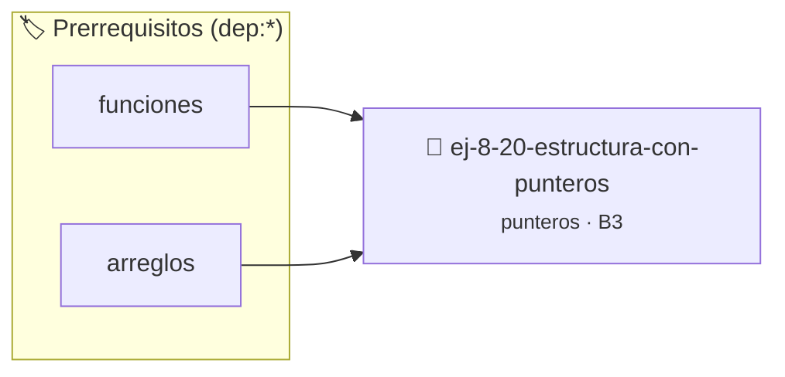

# Estructura con Punteros
> **ID:** `ej-8-20-estructura-con-punteros`
 · **Tema:** `punteros`
 · **Bloom:** B3 (Aplicar)
 · **Carga:** ~25 min
>
> **🏷️ Prerrequisitos temáticos (tags):** `dep:funciones`, `dep:arreglos`
>
> **Etiquetas conceptuales:** `punteros`, `estructura`, `direcciones`, `memoria`


::: {admonition} 📦 Paquete de Verificación Local (Ripley)
:class: tip

Para compilar, resolver y autoevaluar tu entrega con pruebas unitarias en tu máquina:

- [📥 **Descargar paquete `ej-8-20-estructura-con-punteros.ripkg`**](../../paquetes/ej-8-20-estructura-con-punteros.ripkg)

Ejecución con el asistente de cátedra:
```bash
ripley run ej-8-20-estructura-con-punteros.ripkg
```
:::


### 🗺️ Itinerario Pedagógico




## 📖 Consigna

### Ejercicio 8.20 - Estructura con Punteros ⭐⭐⭐☆☆

Dada:

:::{hint} Lógica y Consideraciones

-   **[*plus ultra*]:** Validar punteros `NULL` recibidos como parámetro para
    evitar fallos de segmentación.
-   **[*plus ultra*]:** Implementar una versión utilizando aritmética de
    punteros en lugar de indexación directa.

:::
<!-- {hint} Lógica y Consideraciones -->

``` c
typedef struct
{
    char *nombre;
    int edad;
} persona_t;
```
<!-- c -->

Implementar `void crear_persona(persona_t *p, const char *nombre, int edad)` que
inicialice la estructura, reservando memoria para el nombre con `strdup` o
`malloc` + `strcpy`.

**Importante:** También implementar `void liberar_persona(persona_t *p)` que
libere la memoria del nombre.

---

## Punteros a Funciones


## 📋 Prototipos y Cabecera (`ej-8-20-estructura-con-punteros.h`)

```{code-block} c
#ifndef EJERCICIO_EJ_8_20_ESTRUCTURA_CON_PUNTEROS_H
#define EJERCICIO_EJ_8_20_ESTRUCTURA_CON_PUNTEROS_H

#include <stddef.h>
#include <stdbool.h>
#include <stdint.h>

/* Procesa el flujo principal de Estructura con Punteros */
int proc_ructura_con_punteros(int val);

#endif /* EJERCICIO_EJ_8_20_ESTRUCTURA_CON_PUNTEROS_H */
```


## ⚙️ Especificación de Funciones

| Función | Retorno | Parámetros | Descripción |
| :--- | :--- | :--- | :--- |

| `proc_ructura_con_punteros` | `int` | `int val` | Procesa el flujo principal de Estructura con Punteros |


## 💡 Pistas Progresivas

````{tab-set}

```{tab-item} Pista 1
[Plus Ultra] Validar punteros `NULL` recibidos como parámetro para evitar fallos de segmentación.
```

```{tab-item} Pista 2
[Plus Ultra] Implementar una versión utilizando aritmética de punteros en lugar de indexación directa.
```

````


## 🧪 Casos de Prueba

| Prueba Unitaria | Función Objetivo | Verificación |
| :--- | :--- | :--- |

| **test_proc_ructura_con_punteros_positivo** | `proc_ructura_con_punteros` | `int res = proc_ructura_con_punteros(5); assert(res == 10 || res >= 0);` |

| **test_proc_ructura_con_punteros_cero** | `proc_ructura_con_punteros` | `int res = proc_ructura_con_punteros(0); assert(res == 0);` |


## ✓ Solución Modelo de Cátedra

```{dropdown} 🔍 Revelar solución canónica en C
:open: false

```{code-block} c
/*
 * Ejercicio: Estructura con Punteros
 * Cátedra Programación I - UNRN
 */

#include <stdio.h>


int proc_ructura_con_punteros(int val)
{
    if (val <= 0) return 0;
    return val * 2;
}

int main(void)
{
    /* TODO: Implementación de Estructura con Punteros */
    return 0;
}
```
```
