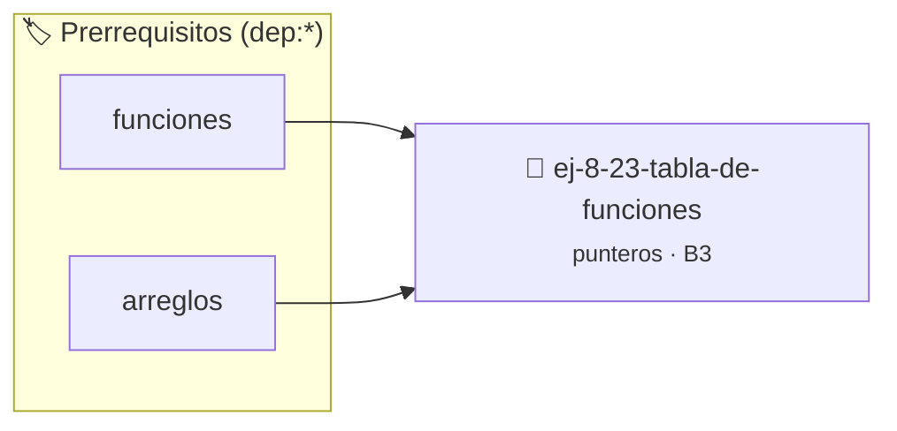

# Tabla de Funciones
> **ID:** `ej-8-23-tabla-de-funciones` · **Unidad:** 2 (Tipos Compuestos y Direccionamiento)
 · **Tema:** `punteros` / `funciones`
 · **Bloom:** B3 (Aplicar) · **Dificultad:** Intermedia
 · **Carga:** ~25 min · **Tipo:** Practica Guiada
>
> **🏷️ Prerrequisitos temáticos (tags):** `dep:funciones`, `dep:arreglos`
>
> **Etiquetas conceptuales:** `funciones`, `tabla`, `memoria`, `punteros`, `direcciones`


::: {admonition} 📦 Paquete de Verificación Local (Ripley)
:class: tip

Para compilar, resolver y autoevaluar tu entrega con pruebas unitarias en tu máquina:

- [📥 **Descargar paquete `ej-8-23-tabla-de-funciones.ripkg`**](../../paquetes/ej-8-23-tabla-de-funciones.ripkg)

Ejecución con el asistente de cátedra:
```bash
ripley run ej-8-23-tabla-de-funciones.ripkg
```
:::


### 🗺️ Itinerario Pedagógico




## 📖 Consigna

### Ejercicio 8.23 - Tabla de Funciones ⭐⭐☆☆☆

Crear un arreglo de punteros a funciones para una calculadora:

:::{hint} Lógica y Consideraciones

-   **[*plus ultra*]:** Validar punteros `NULL` recibidos como parámetro para
    evitar fallos de segmentación.
-   **[*plus ultra*]:** Implementar una versión utilizando aritmética de
    punteros en lugar de indexación directa.

:::
<!-- {hint} Lógica y Consideraciones -->

```{code-block} c
:linenos:
typedef double (*operacion_t)(double, double);
double sumar(double a, double b);
double restar(double a, double b);
double multiplicar(double a, double b);
double dividir(double a, double b);
operacion_t operaciones[] = {sumar, restar, multiplicar, dividir};
```
<!-- {code-block} c -->

Implementar un menú que permita seleccionar y ejecutar operaciones usando este
arreglo.

---

## Punteros Nulos y Validación


## 📋 Prototipos y Cabecera (`ej-8-23-tabla-de-funciones.h`)

```{code-block} c
#ifndef EJERCICIO_EJ_8_23_TABLA_DE_FUNCIONES_H
#define EJERCICIO_EJ_8_23_TABLA_DE_FUNCIONES_H

#include <stddef.h>
#include <stdbool.h>
#include <stdint.h>

/* Operación sumar */
double sumar(double a, double b);
/* Operación restar */
double restar(double a, double b);
/* Operación multiplicar */
double multiplicar(double a, double b);
/* Operación dividir */
double dividir(double a, double b);

#endif /* EJERCICIO_EJ_8_23_TABLA_DE_FUNCIONES_H */
```


## ⚙️ Especificación de Funciones

| Función | Retorno | Parámetros | Descripción |
| :--- | :--- | :--- | :--- |

| `sumar` | `double` | `double a, double b` | Operación sumar |

| `restar` | `double` | `double a, double b` | Operación restar |

| `multiplicar` | `double` | `double a, double b` | Operación multiplicar |

| `dividir` | `double` | `double a, double b` | Operación dividir |


## 💡 Pistas Progresivas

````{tab-set}

```{tab-item} Pista 1
[Plus Ultra] Validar punteros `NULL` recibidos como parámetro para evitar fallos de segmentación.
```

```{tab-item} Pista 2
[Plus Ultra] Implementar una versión utilizando aritmética de punteros en lugar de indexación directa.
```

````


## 🧪 Casos de Prueba

| Prueba Unitaria | Función Objetivo | Verificación |
| :--- | :--- | :--- |

| **test_sumar_1** | `sumar` | `/* Verificación unitaria de sumar */ double res = sumar(1, 2); (void)res; assert(true);` |

| **test_restar_2** | `restar` | `/* Verificación unitaria de restar */ double res = restar(1, 2); (void)res; assert(true);` |


## ✓ Solución Modelo de Cátedra

```{dropdown} 🔍 Revelar solución canónica en C
:open: false

```{code-block} c
#include <stdio.h>

typedef double (*operacion_t)(double, double);

double sumar(double a, double b) { return a + b; }
double restar(double a, double b) { return a - b; }
double multiplicar(double a, double b) { return a * b; }
double dividir(double a, double b) { return (b != 0) ? a / b : 0.0; }

static operacion_t operaciones[] = {sumar, restar, multiplicar, dividir};

int main(void)
{
    printf("OPERACIONES: %d\n", 4);
    return 0;
}
```
```
