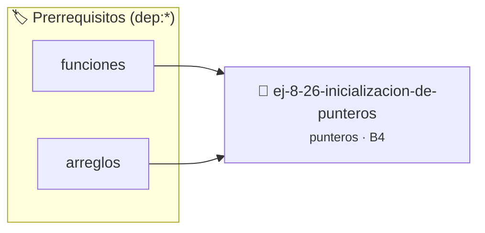

# Inicialización de Punteros
> **ID:** `ej-8-26-inicializacion-de-punteros` · **Unidad:** 2 (Tipos Compuestos y Direccionamiento)
 · **Tema:** `punteros` / `inicializacion`
 · **Bloom:** B4 (Analizar) · **Dificultad:** Avanzada
 · **Carga:** ~35 min · **Tipo:** Practica Guiada
>
> **🏷️ Prerrequisitos temáticos (tags):** `dep:funciones`, `dep:arreglos`
>
> **Etiquetas conceptuales:** `inicializacion`, `punteros`, `direcciones`, `memoria`


::: {admonition} 📦 Paquete de Verificación Local (Ripley)
:class: tip

Para compilar, resolver y autoevaluar tu entrega con pruebas unitarias en tu máquina:

- [📥 **Descargar paquete `ej-8-26-inicializacion-de-punteros.ripkg`**](../../paquetes/ej-8-26-inicializacion-de-punteros.ripkg)

Ejecución con el asistente de cátedra:
```bash
ripley run ej-8-26-inicializacion-de-punteros.ripkg
```
:::


### 🗺️ Itinerario Pedagógico




## 📖 Consigna

### Ejercicio 8.26 - Inicialización de Punteros ⭐☆☆☆☆

Demostrar el problema de punteros sin inicializar y cómo evitarlo siempre
inicializando en `NULL`:

:::{hint} Lógica y Consideraciones

-   **[*plus ultra*]:** Validar punteros `NULL` recibidos como parámetro para
    evitar fallos de segmentación.
-   **[*plus ultra*]:** Implementar una versión utilizando aritmética de
    punteros en lugar de indexación directa.

:::
<!-- {hint} Lógica y Consideraciones -->

``` c
int *p = NULL; // Buena práctica
// vs
int *p; // Peligroso: contiene basura
```
<!-- c -->
## Ejercicio 8.27 - Intercambio con Punteros ⭐☆☆☆☆

Implementá `void intercambiar(int *a, int *b)` que intercambie dos valores.

**Orientación:**
- Usá una variable temporal
- Desreferenciá con `*a` para acceder al valor
- En `main`, mostrá valores antes y después


:::{hint} Lógica y Consideraciones

-   **[*plus ultra*]:** Validar punteros `NULL` recibidos como parámetro para
    evitar fallos de segmentación.
-   **[*plus ultra*]:** Implementar una versión utilizando aritmética de
    punteros en lugar de indexación directa.

:::
<!-- {hint} Lógica y Consideraciones -->

---
## Ejercicio 8.28 - Encontrar Mayor con Puntero ⭐⭐☆☆☆

Implementá `int *mayor(int *a, int *b)` que retorne puntero al mayor de dos
números.

**Orientación:**
- Compará `*a` y `*b`
- Retorná el puntero apropiado
- En `main`, desreferenciá el resultado para mostrar el valor


:::{hint} Lógica y Consideraciones

-   **[*plus ultra*]:** Validar punteros `NULL` recibidos como parámetro para
    evitar fallos de segmentación.
-   **[*plus ultra*]:** Implementar una versión utilizando aritmética de
    punteros en lugar de indexación directa.

:::
<!-- {hint} Lógica y Consideraciones -->

---
## Ejercicio 8.29 - División con Resto ⭐⭐☆☆☆

Implementá `void dividir(int dividendo, int divisor, int *cociente, int
*resto)`.

**Orientación:**
- Usá punteros para "retornar" múltiples valores
- `*cociente = dividendo / divisor;`
- `*resto = dividendo % divisor;`
- Verificá que divisor != 0


:::{hint} Lógica y Consideraciones

-   **[*plus ultra*]:** Validar punteros `NULL` recibidos como parámetro para
    evitar fallos de segmentación.
-   **[*plus ultra*]:** Implementar una versión utilizando aritmética de
    punteros en lugar de indexación directa.

:::
<!-- {hint} Lógica y Consideraciones -->

---
## Ejercicio 8.30 - Estadísticas de Array ⭐⭐⭐☆☆

Implementá `void estadisticas(int arr[], int n, int *min, int *max, double
*prom)`.

**Orientación:**
- Recorré el array para encontrar mínimo y máximo
- Calculá promedio
- Almacená resultados en las direcciones apuntadas


:::{hint} Lógica y Consideraciones

-   **[*plus ultra*]:** Optimizar el acceso a memoria respetando el orden por
    filas (*row-major order*) para mejorar el uso de caché.
-   **[*plus ultra*]:** Validar que los índices ingresados se encuentren
    estrictamente dentro de los límites del contenedor.

:::
<!-- {hint} Lógica y Consideraciones -->

---
## Ejercicio 8.31 - Puntero al Medio ⭐⭐⭐☆☆

Implementá `int *elemento_medio(int arr[], int n)` que retorne puntero al
elemento del medio.

**Orientación:**
- Si n es impar: retorna `&arr[n/2]`
- Si n es par: retorna `&arr[n/2 - 1]` (o el que prefieras)
- En `main`, modificá el elemento usando el puntero retornado


:::{hint} Lógica y Consideraciones

-   **[*plus ultra*]:** Validar punteros `NULL` recibidos como parámetro para
    evitar fallos de segmentación.
-   **[*plus ultra*]:** Implementar una versión utilizando aritmética de
    punteros en lugar de indexación directa.

:::
<!-- {hint} Lógica y Consideraciones -->

---
## Ejercicio 8.32 - Recorrer Array con Punteros ⭐⭐⭐☆☆

Implementá `int suma_array(int *arr, int n)` usando **aritmética de punteros**.

**Orientación:**
- No uses índices `[]`
- Usá `*arr` para acceder al primer elemento
- Incrementá el puntero: `arr++` para avanzar
- Recorré: `for (int *p = arr; p < arr + n; p++)`


:::{hint} Lógica y Consideraciones

-   **[*plus ultra*]:** Validar punteros `NULL` recibidos como parámetro para
    evitar fallos de segmentación.
-   **[*plus ultra*]:** Implementar una versión utilizando aritmética de
    punteros en lugar de indexación directa.

:::
<!-- {hint} Lógica y Consideraciones -->

---
## Ejercicio 8.33 - Invertir Array In-Place ⭐⭐⭐☆☆

Implementá `void invertir(int *arr, int n)` usando dos punteros.

**Orientación:**
- Puntero `inicio` apunta al primer elemento
- Puntero `fin` apunta al último
- Intercambiá valores y mové punteros hacia el centro
- Detené cuando `inicio >= fin`


:::{hint} Lógica y Consideraciones

-   **[*plus ultra*]:** Validar punteros `NULL` recibidos como parámetro para
    evitar fallos de segmentación.
-   **[*plus ultra*]:** Implementar una versión utilizando aritmética de
    punteros en lugar de indexación directa.

:::
<!-- {hint} Lógica y Consideraciones -->

---
## Ejercicio 8.34 - Buscar Valor en Array ⭐⭐⭐☆☆

Implementá `int *buscar(int *arr, int n, int valor)` que retorne puntero al
elemento encontrado o NULL.

**Orientación:**
- Recorré con puntero
- Si encontrás el valor, retorná puntero a esa posición
- Si no lo encontrás, retorná NULL
- En `main`, verificá NULL antes de desreferenciar


:::{hint} Lógica y Consideraciones

-   **[*plus ultra*]:** Validar punteros `NULL` recibidos como parámetro para
    evitar fallos de segmentación.
-   **[*plus ultra*]:** Implementar una versión utilizando aritmética de
    punteros en lugar de indexación directa.

:::
<!-- {hint} Lógica y Consideraciones -->

---
## Ejercicio 8.35 - Copiar String ⭐⭐⭐⭐☆

Implementá `void copiar_string(char *dest, const char *src)` usando punteros.

**Orientación:**
- Copiá carácter por carácter: `*dest++ = *src++`
- Detené al encontrar '\0'
- Usá `const` para src (no debe modificarse)
- **Cuidado:** asumí que dest tiene espacio suficiente


:::{hint} Lógica y Consideraciones

-   **[*plus ultra*]:** Validar punteros `NULL` recibidos como parámetro para
    evitar fallos de segmentación.
-   **[*plus ultra*]:** Implementar una versión utilizando aritmética de
    punteros en lugar de indexación directa.

:::
<!-- {hint} Lógica y Consideraciones -->

---
## Ejercicio 8.36 - Longitud de String ⭐⭐⭐⭐☆

Implementá `int longitud_string(const char *str)` usando punteros.

**Orientación:**
- Contá caracteres hasta '\0'
- Versión 1: `while (*str++) count++;`
- Versión 2: `return str_fin - str_inicio;` (aritmética de punteros)


:::{hint} Lógica y Consideraciones

-   **[*plus ultra*]:** Validar punteros `NULL` recibidos como parámetro para
    evitar fallos de segmentación.
-   **[*plus ultra*]:** Implementar una versión utilizando aritmética de
    punteros en lugar de indexación directa.

:::
<!-- {hint} Lógica y Consideraciones -->

---
## Ejercicio 8.37 - Concatenar Strings ⭐⭐⭐⭐☆

Implementá `void concatenar(char *dest, const char *src)` usando punteros.

**Orientación:**
- Avanzá `dest` hasta '\0'
- Copiá `src` desde esa posición
- Asegurate de copiar el '\0' final


:::{hint} Lógica y Consideraciones

-   **[*plus ultra*]:** Validar punteros `NULL` recibidos como parámetro para
    evitar fallos de segmentación.
-   **[*plus ultra*]:** Implementar una versión utilizando aritmética de
    punteros en lugar de indexación directa.

:::
<!-- {hint} Lógica y Consideraciones -->

---
## Ejercicio 8.38 - Comparar Strings ⭐⭐⭐⭐☆

Implementá `int comparar_strings(const char *s1, const char *s2)` usando
punteros.

**Orientación:**
- Retorná: negativo si s1 < s2, 0 si iguales, positivo si s1 > s2
- Compará carácter por carácter
- Detené al encontrar diferencia o '\0'
- Retorná `*s1 - *s2` en el primer carácter diferente


:::{hint} Lógica y Consideraciones

-   **[*plus ultra*]:** Validar punteros `NULL` recibidos como parámetro para
    evitar fallos de segmentación.
-   **[*plus ultra*]:** Implementar una versión utilizando aritmética de
    punteros en lugar de indexación directa.

:::
<!-- {hint} Lógica y Consideraciones -->

---
## Ejercicio 8.39 - Buscar Subcadena ⭐⭐⭐⭐☆

Implementá `char *buscar_subcadena(const char *texto, const char *patron)`.

**Orientación:**
- Retorná puntero a primera aparición de patron en texto
- Retorná NULL si no se encuentra
- Compará subcadenas en cada posición


:::{hint} Lógica y Consideraciones

-   **[*plus ultra*]:** Validar punteros `NULL` recibidos como parámetro para
    evitar fallos de segmentación.
-   **[*plus ultra*]:** Implementar una versión utilizando aritmética de
    punteros en lugar de indexación directa.

:::
<!-- {hint} Lógica y Consideraciones -->

---
## Ejercicio 8.40 - Eliminar Espacios ⭐⭐⭐⭐☆

Implementá `void eliminar_espacios(char *str)` que elimine espacios in-place.

**Orientación:**
- Usá dos punteros: uno para leer, otro para escribir
- Copiá solo caracteres no-espacio
- Terminá con '\0'


:::{hint} Lógica y Consideraciones

-   **[*plus ultra*]:** Validar punteros `NULL` recibidos como parámetro para
    evitar fallos de segmentación.
-   **[*plus ultra*]:** Implementar una versión utilizando aritmética de
    punteros en lugar de indexación directa.

:::
<!-- {hint} Lógica y Consideraciones -->

---
## Ejercicio 8.41 - Matriz como Puntero a Puntero ⭐⭐⭐⭐⭐

Implementá funciones para trabajar con matriz dinámica (`int **matriz`):
- `int **crear_matriz(int filas, int cols)`
- `void liberar_matriz(int **matriz, int filas)`
- `void mostrar_matriz(int **matriz, int filas, int cols)`

**Orientación:**
- `crear_matriz`: asigna array de punteros, luego cada fila
- Verificá cada `malloc`
- `liberar_matriz`: libera filas primero, luego el array de punteros


:::{hint} Lógica y Consideraciones

-   **[*plus ultra*]:** Validar punteros `NULL` recibidos como parámetro para
    evitar fallos de segmentación.
-   **[*plus ultra*]:** Implementar una versión utilizando aritmética de
    punteros en lugar de indexación directa.

:::
<!-- {hint} Lógica y Consideraciones -->

---
## Ejercicio 8.42 - Rotación de Array ⭐⭐⭐⭐⭐

Implementá `void rotar_izquierda(int *arr, int n, int k)` usando punteros.

**Orientación:**
- k posiciones hacia la izquierda
- Guardá los primeros k elementos temporalmente
- Mové el resto hacia adelante
- Colocá los guardados al final
- Optimización: `k = k % n`


:::{hint} Lógica y Consideraciones

-   **[*plus ultra*]:** Validar punteros `NULL` recibidos como parámetro para
    evitar fallos de segmentación.
-   **[*plus ultra*]:** Implementar una versión utilizando aritmética de
    punteros en lugar de indexación directa.

:::
<!-- {hint} Lógica y Consideraciones -->

---
## Ejercicio 8.43 - Transponer Matriz ⭐⭐⭐⭐⭐

Implementá `void transponer(int **matriz, int filas, int cols, int
***resultado)`.

**Orientación:**
- Crea una nueva matriz `cols × filas`
- `resultado[j][i] = matriz[i][j]`
- Usá triple puntero para modificar puntero en función llamadora


:::{hint} Lógica y Consideraciones

-   **[*plus ultra*]:** Validar punteros `NULL` recibidos como parámetro para
    evitar fallos de segmentación.
-   **[*plus ultra*]:** Implementar una versión utilizando aritmética de
    punteros en lugar de indexación directa.

:::
<!-- {hint} Lógica y Consideraciones -->

---
## Ejercicio 8.44 - Ordenamiento con Función Comparadora ⭐⭐⭐⭐⭐

Implementá `void ordenar(int *arr, int n, int (*comparar)(int, int))`.

**Orientación:**
- Recibe puntero a función comparadora
- La función comparadora retorna: <0 si a<b, 0 si iguales, >0 si a>b
- Implementá bubble sort usando la función comparadora
- En `main`, pasá funciones para orden ascendente/descendente


:::{hint} Lógica y Consideraciones

-   **[*plus ultra*]:** Validar punteros `NULL` recibidos como parámetro para
    evitar fallos de segmentación.
-   **[*plus ultra*]:** Implementar una versión utilizando aritmética de
    punteros en lugar de indexación directa.

:::
<!-- {hint} Lógica y Consideraciones -->

---
## Ejercicio 8.45 - Rotación e Inversión con Aritmética de Punteros ⭐⭐⭐⭐⭐

Implementá funciones para manipular secuencias de enteros usando exclusivamente aritmética de punteros:
- `void invertir_rango(int *inicio, int *fin)`: invierte los elementos entre los punteros `inicio` y `fin`.
- `void rotar_derecha(int *arr, size_t n, size_t k)`: rota el arreglo `k` posiciones a la derecha reutilizando la función de inversión.
- `void particionar(int *inicio, int *fin, int pivote, int **pos_pivote)`: reorganiza los elementos menores al pivote a la izquierda y mayores a la derecha.

**Orientación:**
- Usá punteros para avanzar (`ptr++`) y retroceder (`ptr--`) hasta que se crucen
- No uses corchetes `[]` dentro de las funciones de manipulación
- Actualizá `*pos_pivote` con la dirección final de división

:::{hint} Lógica y Consideraciones

-   **[*plus ultra*]:** Validar punteros `NULL` recibidos como parámetro para evitar fallos de segmentación.
-   **[*plus ultra*]:** Escribir aserciones con `assert()` verificando casos con arreglos de tamaño par, impar y de un solo elemento.

:::
<!-- {hint} Lógica y Consideraciones -->

---
## Ejercicio 8.46 - Parser de Argumentos ⭐⭐⭐⭐⭐

Implementá un parser que procese argumentos de línea de comandos con flags:

:::{hint} Lógica y Consideraciones

-   **[*plus ultra*]:** Validar punteros `NULL` recibidos como parámetro para
    evitar fallos de segmentación.
-   **[*plus ultra*]:** Implementar una versión utilizando aritmética de
    punteros en lugar de indexación directa.

:::
<!-- {hint} Lógica y Consideraciones -->

```
./programa -n 100 -s "texto" -v
```

**Orientación:**
- Recorré `argv` con punteros
- Detectá flags con `-`
- Si flag requiere valor, avanzá al siguiente `argv`
- Almacená valores parseados en estructura
- Manejá flags booleanos (presencia indica true)

---

## Notas Finales

:::{danger} Peligros Comunes con Punteros

- **Desreferenciar NULL:** Siempre verificá antes: `if (ptr != NULL)`
- **Punteros colgantes:** No uses memoria después de `free`
- **Fugas de memoria:** Cada `malloc` debe tener su `free`
- **Buffer overflow:** Verificá límites al escribir en arrays
- **Aritmética incorrecta:** `ptr + 1` avanza `sizeof(tipo)` bytes, no 1 byte

:::
<!-- {danger} Peligros Comunes con Punteros -->

:::{tip} Buenas Prácticas

- **Inicializá punteros:** `int *ptr = NULL;`
- **Después de free:** `ptr = NULL;` para evitar uso accidental
- **const para proteger:** `const int *ptr` previene modificación
- **Valgrind es tu amigo:** Detecta leaks y accesos inválidos

:::
<!-- {tip} Buenas Prácticas -->

:::{note} Compilación y Testing

``` bash
# Compilar con máximas advertencias
gcc -Wall -Wextra -Werror -std=c99 programa.c -o programa

# Verificar memoria con Valgrind
valgrind --leak-check=full ./programa
```
<!-- bash -->

:::
<!-- {note} Compilación y Testing -->

Estas consignas cubren conceptos fundamentales y avanzados de punteros:
aritmética, paso por referencia, punteros a funciones, estructuras dinámicas, y
gestión de memoria.


## 📋 Prototipos y Cabecera (`ej-8-26-inicializacion-de-punteros.h`)

```{code-block} c
#ifndef EJERCICIO_EJ_8_26_INICIALIZACION_DE_PUNTEROS_H
#define EJERCICIO_EJ_8_26_INICIALIZACION_DE_PUNTEROS_H

#include <stddef.h>
#include <stdbool.h>
#include <stdint.h>

/* Procesa el flujo principal de Inicialización de Punteros */
int proc_lizacion_de_punteros(int val);

#endif /* EJERCICIO_EJ_8_26_INICIALIZACION_DE_PUNTEROS_H */
```


## ⚙️ Especificación de Funciones

| Función | Retorno | Parámetros | Descripción |
| :--- | :--- | :--- | :--- |

| `proc_lizacion_de_punteros` | `int` | `int val` | Procesa el flujo principal de Inicialización de Punteros |


## 💡 Pistas Progresivas

````{tab-set}

```{tab-item} Pista 1
[Plus Ultra] Validar punteros `NULL` recibidos como parámetro para evitar fallos de segmentación.
```

```{tab-item} Pista 2
[Plus Ultra] Implementar una versión utilizando aritmética de punteros en lugar de indexación directa.
```

```{tab-item} Pista 3
[Plus Ultra] Validar punteros `NULL` recibidos como parámetro para evitar fallos de segmentación.
```

```{tab-item} Pista 4
[Plus Ultra] Implementar una versión utilizando aritmética de punteros en lugar de indexación directa.
```

```{tab-item} Pista 5
[Plus Ultra] Validar punteros `NULL` recibidos como parámetro para evitar fallos de segmentación.
```

```{tab-item} Pista 6
[Plus Ultra] Implementar una versión utilizando aritmética de punteros en lugar de indexación directa.
```

```{tab-item} Pista 7
[Plus Ultra] Validar punteros `NULL` recibidos como parámetro para evitar fallos de segmentación.
```

```{tab-item} Pista 8
[Plus Ultra] Implementar una versión utilizando aritmética de punteros en lugar de indexación directa.
```

```{tab-item} Pista 9
[Plus Ultra] Optimizar el acceso a memoria respetando el orden por filas (*row-major order*) para mejorar el uso de caché.
```

```{tab-item} Pista 10
[Plus Ultra] Validar que los índices ingresados se encuentren estrictamente dentro de los límites del contenedor.
```

```{tab-item} Pista 11
[Plus Ultra] Validar punteros `NULL` recibidos como parámetro para evitar fallos de segmentación.
```

```{tab-item} Pista 12
[Plus Ultra] Implementar una versión utilizando aritmética de punteros en lugar de indexación directa.
```

```{tab-item} Pista 13
[Plus Ultra] Validar punteros `NULL` recibidos como parámetro para evitar fallos de segmentación.
```

```{tab-item} Pista 14
[Plus Ultra] Implementar una versión utilizando aritmética de punteros en lugar de indexación directa.
```

```{tab-item} Pista 15
[Plus Ultra] Validar punteros `NULL` recibidos como parámetro para evitar fallos de segmentación.
```

```{tab-item} Pista 16
[Plus Ultra] Implementar una versión utilizando aritmética de punteros en lugar de indexación directa.
```

```{tab-item} Pista 17
[Plus Ultra] Validar punteros `NULL` recibidos como parámetro para evitar fallos de segmentación.
```

```{tab-item} Pista 18
[Plus Ultra] Implementar una versión utilizando aritmética de punteros en lugar de indexación directa.
```

```{tab-item} Pista 19
[Plus Ultra] Validar punteros `NULL` recibidos como parámetro para evitar fallos de segmentación.
```

```{tab-item} Pista 20
[Plus Ultra] Implementar una versión utilizando aritmética de punteros en lugar de indexación directa.
```

```{tab-item} Pista 21
[Plus Ultra] Validar punteros `NULL` recibidos como parámetro para evitar fallos de segmentación.
```

```{tab-item} Pista 22
[Plus Ultra] Implementar una versión utilizando aritmética de punteros en lugar de indexación directa.
```

```{tab-item} Pista 23
[Plus Ultra] Validar punteros `NULL` recibidos como parámetro para evitar fallos de segmentación.
```

```{tab-item} Pista 24
[Plus Ultra] Implementar una versión utilizando aritmética de punteros en lugar de indexación directa.
```

```{tab-item} Pista 25
[Plus Ultra] Validar punteros `NULL` recibidos como parámetro para evitar fallos de segmentación.
```

```{tab-item} Pista 26
[Plus Ultra] Implementar una versión utilizando aritmética de punteros en lugar de indexación directa.
```

```{tab-item} Pista 27
[Plus Ultra] Validar punteros `NULL` recibidos como parámetro para evitar fallos de segmentación.
```

```{tab-item} Pista 28
[Plus Ultra] Implementar una versión utilizando aritmética de punteros en lugar de indexación directa.
```

```{tab-item} Pista 29
[Plus Ultra] Validar punteros `NULL` recibidos como parámetro para evitar fallos de segmentación.
```

```{tab-item} Pista 30
[Plus Ultra] Implementar una versión utilizando aritmética de punteros en lugar de indexación directa.
```

```{tab-item} Pista 31
[Plus Ultra] Validar punteros `NULL` recibidos como parámetro para evitar fallos de segmentación.
```

```{tab-item} Pista 32
[Plus Ultra] Implementar una versión utilizando aritmética de punteros en lugar de indexación directa.
```

```{tab-item} Pista 33
[Plus Ultra] Validar punteros `NULL` recibidos como parámetro para evitar fallos de segmentación.
```

```{tab-item} Pista 34
[Plus Ultra] Implementar una versión utilizando aritmética de punteros en lugar de indexación directa.
```

```{tab-item} Pista 35
[Plus Ultra] Validar punteros `NULL` recibidos como parámetro para evitar fallos de segmentación.
```

```{tab-item} Pista 36
[Plus Ultra] Implementar una versión utilizando aritmética de punteros en lugar de indexación directa.
```

```{tab-item} Pista 37
[Plus Ultra] Validar punteros `NULL` recibidos como parámetro para evitar fallos de segmentación.
```

```{tab-item} Pista 38
[Plus Ultra] Implementar una versión utilizando aritmética de punteros en lugar de indexación directa.
```

```{tab-item} Pista 39
[Plus Ultra] Validar punteros `NULL` recibidos como parámetro para evitar fallos de segmentación.
```

```{tab-item} Pista 40
[Plus Ultra] Escribir aserciones con `assert()` verificando casos con arreglos de tamaño par, impar y de un solo elemento.
```

```{tab-item} Pista 41
[Plus Ultra] Validar punteros `NULL` recibidos como parámetro para evitar fallos de segmentación.
```

```{tab-item} Pista 42
[Plus Ultra] Implementar una versión utilizando aritmética de punteros en lugar de indexación directa.
```

```{tab-item} Pista 43
**Inicializá punteros:** `int *ptr = NULL;`
```

```{tab-item} Pista 44
**Después de free:** `ptr = NULL;` para evitar uso accidental
```

```{tab-item} Pista 45
**const para proteger:** `const int *ptr` previene modificación
```

```{tab-item} Pista 46
**Valgrind es tu amigo:** Detecta leaks y accesos inválidos
```

````


## 🧪 Casos de Prueba

| Prueba Unitaria | Función Objetivo | Verificación |
| :--- | :--- | :--- |

| **test_proc_lizacion_de_punteros_positivo** | `proc_lizacion_de_punteros` | `int res = proc_lizacion_de_punteros(5); assert(res == 10 || res >= 0);` |

| **test_proc_lizacion_de_punteros_cero** | `proc_lizacion_de_punteros` | `int res = proc_lizacion_de_punteros(0); assert(res == 0);` |


## ✓ Solución Modelo de Cátedra

```{dropdown} 🔍 Revelar solución canónica en C
:open: false

```{code-block} c
/*
 * Ejercicio: Inicialización de Punteros
 * Cátedra Programación I - UNRN
 */

#include <stdio.h>


int proc_lizacion_de_punteros(int val)
{
    if (val <= 0) return 0;
    return val * 2;
}

int main(void)
{
    /* TODO: Implementación de Inicialización de Punteros */
    return 0;
}
```
```
