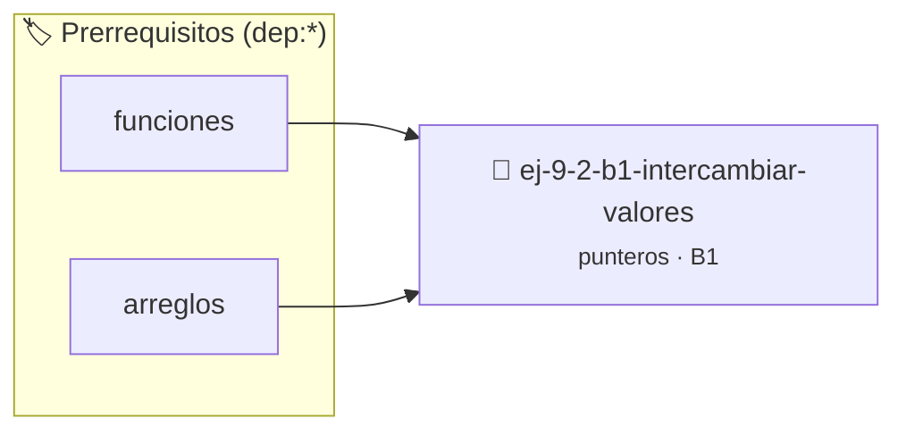

# Intercambiar valores
> **ID:** `ej-9-2-b1-intercambiar-valores` · **Unidad:** 2 (Tipos Compuestos y Direccionamiento)
 · **Tema:** `punteros` / `intercambiar`
 · **Bloom:** B1 (Recordar) · **Dificultad:** Inicial
 · **Carga:** ~10 min · **Tipo:** Concepto
>
> **🏷️ Prerrequisitos temáticos (tags):** `dep:funciones`, `dep:arreglos`
>
> **Etiquetas conceptuales:** `intercambiar`, `operaciones`, `valores`, `memoria`, `punteros`


::: {admonition} 📦 Paquete de Verificación Local (Ripley)
:class: tip

Para compilar, resolver y autoevaluar tu entrega con pruebas unitarias en tu máquina:

- [📥 **Descargar paquete `ej-9-2-b1-intercambiar-valores.ripkg`**](../../paquetes/ej-9-2-b1-intercambiar-valores.ripkg)

Ejecución con el asistente de cátedra:
```bash
ripley run ej-9-2-b1-intercambiar-valores.ripkg
```
:::


### 🗺️ Itinerario Pedagógico




## 📖 Consigna

:::{exercise}
:label: intercambiar_valores
:enumerator: punteros-1

Implementá un procedimiento `void intercambiar(int *a, int *b)` que reciba dos
punteros a enteros. La función debe intercambiar los valores de las variables
originales a las que apuntan estos punteros.

-   **[*plus ultra*]:** Validar punteros `NULL` recibidos como parámetro para
    evitar fallos de segmentación.
-   **[*plus ultra*]:** Implementar una versión utilizando aritmética de
    punteros en lugar de indexación directa.

:::

::::{solution} intercambiar_valores
:class: dropdown

:::{code-block}c
:linenos:
#include <assert.h>
#include <stddef.h>
#include <stdio.h>
void intercambiar(int *a, int *b)
{
    assert(a != NULL);
    assert(b != NULL);
    int temporal = *a; // Guardamos el valor al que apunta 'a'
    *a = *b;           // Asignamos al lugar de 'a' el valor al que apunta 'b'
    *b = temporal;     // Asignamos al lugar de 'b' el valor guardado
}
:::

::::

### 📋 Contrato de las Funciones

```c
/*
 * Procesa el flujo principal de Intercambiar valores
 * Precondiciones: val representa el parámetro de entrada del flujo.
 * Postcondiciones: Retorna el resultado correspondiente o 0 si val <= 0.
 */
int proc_intercambiar_valores(int val);

```

### 🧪 Ejemplos de Ejecución

::::{tab-set}
:::{tab-item} Valor positivo
```text
Entrada: 5
Salida / Retorno: 10
```
:::
:::{tab-item} Valor cero o negativo
```text
Entrada: 0
Salida / Retorno: 0
```
:::
::::

### ⚠️ Precondiciones y Casos Borde

1. **Valores fuera de rango:** Verificar siempre que los datos de entrada cumplan con los rangos admisibles antes de operar.
6. **Casos vacíos o neutros:** Contemplar adecuadamente entradas con longitud cero o valores neutros según corresponda.

### 🎯 Criterios de Aceptación

- [ ] El código compila limpiamente bajo estándar C11 sin warnings con flags estrictos (`-Wall -Wextra -Werror`).
- [ ] Se satisfacen todas las pruebas unitarias y casos de prueba provistos.
- [ ] Las funciones validan exhaustivamente sus precondiciones y gestionan casos borde de forma robusta.


## 📋 Prototipos y Cabecera (`ej-9-2-b1-intercambiar-valores.h`)

```{code-block} c
#ifndef EJERCICIO_EJ_9_2_B1_INTERCAMBIAR_VALORES_H
#define EJERCICIO_EJ_9_2_B1_INTERCAMBIAR_VALORES_H

#include <stddef.h>
#include <stdbool.h>
#include <stdint.h>

/* Procesa el flujo principal de Intercambiar valores */
int proc_intercambiar_valores(int val);

#endif /* EJERCICIO_EJ_9_2_B1_INTERCAMBIAR_VALORES_H */
```


## ⚙️ Especificación de Funciones

| Función | Retorno | Parámetros | Descripción |
| :--- | :--- | :--- | :--- |

| `proc_intercambiar_valores` | `int` | `int val` | Procesa el flujo principal de Intercambiar valores |


## 🧪 Casos de Prueba

| Prueba Unitaria | Función Objetivo | Verificación |
| :--- | :--- | :--- |

| **test_proc_intercambiar_valores_positivo** | `proc_intercambiar_valores` | `int res = proc_intercambiar_valores(5); assert(res == 10 || res >= 0);` |

| **test_proc_intercambiar_valores_cero** | `proc_intercambiar_valores` | `int res = proc_intercambiar_valores(0); assert(res == 0);` |


## ✓ Solución Modelo de Cátedra

```{dropdown} 🔍 Revelar solución canónica en C
:open: false

```{code-block} c
/*
 * Ejercicio: b.1 - Intercambiar valores
 * Cátedra Programación I - UNRN
 */

#include <stdio.h>


int proc_intercambiar_valores(int val)
{
    if (val <= 0) return 0;
    return val * 2;
}

int main(void)
{
    /* TODO: Implementación de b.1 - Intercambiar valores */
    return 0;
}
```
```
