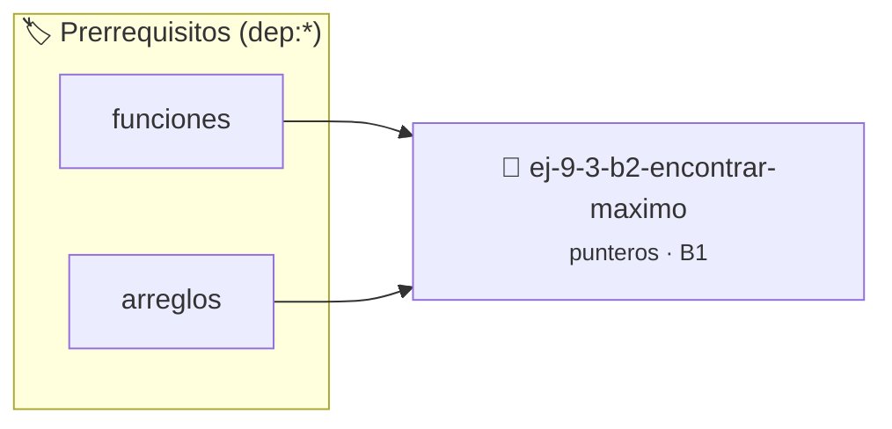

# Encontrar máximo
> **ID:** `ej-9-3-b2-encontrar-maximo` · **Unidad:** 2 (Tipos Compuestos y Direccionamiento)
 · **Tema:** `punteros` / `encontrar`
 · **Bloom:** B1 (Recordar) · **Dificultad:** Inicial
 · **Carga:** ~10 min · **Tipo:** Concepto
>
> **🏷️ Prerrequisitos temáticos (tags):** `dep:funciones`, `dep:arreglos`
>
> **Etiquetas conceptuales:** `encontrar`, `maximo`, `operaciones`, `memoria`, `punteros`


::: {admonition} 📦 Paquete de Verificación Local (Ripley)
:class: tip

Para compilar, resolver y autoevaluar tu entrega con pruebas unitarias en tu máquina:

- [📥 **Descargar paquete `ej-9-3-b2-encontrar-maximo.ripkg`**](../../paquetes/ej-9-3-b2-encontrar-maximo.ripkg)

Ejecución con el asistente de cátedra:
```bash
ripley run ej-9-3-b2-encontrar-maximo.ripkg
```
:::


### 🗺️ Itinerario Pedagógico




## 📖 Consigna

### Ejercicio 9.3 - b.2 - Encontrar máximo ⭐⭐☆☆☆

:::{exercise}
:label: encontrar_maximo
:enumerator: funciones-1

Escribí una función `int encontrar_maximo(const int *arreglo, size_t n)` que
reciba un puntero al inicio de un arreglo de enteros (marcado como `const` para
no modificarlo) y su tamaño. La función debe recorrer el arreglo usando el
puntero y devolver el valor del elemento más grande.

-   **[*plus ultra*]:** Validar punteros `NULL` recibidos como parámetro para
    evitar fallos de segmentación.
-   **[*plus ultra*]:** Implementar una versión utilizando aritmética de
    punteros en lugar de indexación directa.

:::
<!-- {exercise} -->

::::{solution} encontrar_maximo
:class: dropdown

:::{code-block}c
:linenos:
#include <assert.h>
#include <stddef.h>
#include <stdio.h>
int encontrar_maximo(const int *arreglo, size_t n)
{
    assert(arreglo != NULL);
    if (n == 0)
    {
        return 0; // O un valor de error apropiado
    }
    int maximo = *arreglo; // Suponemos que el primer elemento es el máximo
    // Avanzamos el puntero por el resto del arreglo
    for (size_t i = 1; i < n; i++)
    {
        // Usamos aritmética de punteros para acceder al siguiente elemento
        if (*(arreglo + i) > maximo)
        {
            maximo = *(arreglo + i);
        }
    }
    return maximo;
}
:::
<!-- {code-block}c -->

::::
<!-- {solution} encontrar_maximo -->


## 📋 Prototipos y Cabecera (`ej-9-3-b2-encontrar-maximo.h`)

```{code-block} c
#ifndef EJERCICIO_EJ_9_3_B2_ENCONTRAR_MAXIMO_H
#define EJERCICIO_EJ_9_3_B2_ENCONTRAR_MAXIMO_H

#include <stddef.h>
#include <stdbool.h>
#include <stdint.h>

/* Procesa el flujo principal de Encontrar máximo */
int proc__b2_encontrar_maximo(int val);

#endif /* EJERCICIO_EJ_9_3_B2_ENCONTRAR_MAXIMO_H */
```


## ⚙️ Especificación de Funciones

| Función | Retorno | Parámetros | Descripción |
| :--- | :--- | :--- | :--- |

| `proc__b2_encontrar_maximo` | `int` | `int val` | Procesa el flujo principal de Encontrar máximo |


## 🧪 Casos de Prueba

| Prueba Unitaria | Función Objetivo | Verificación |
| :--- | :--- | :--- |

| **test_proc__b2_encontrar_maximo_positivo** | `proc__b2_encontrar_maximo` | `int res = proc__b2_encontrar_maximo(5); assert(res == 10 || res >= 0);` |

| **test_proc__b2_encontrar_maximo_cero** | `proc__b2_encontrar_maximo` | `int res = proc__b2_encontrar_maximo(0); assert(res == 0);` |


## ✓ Solución Modelo de Cátedra

```{dropdown} 🔍 Revelar solución canónica en C
:open: false

```{code-block} c
/*
 * Ejercicio: b.2 - Encontrar máximo
 * Cátedra Programación I - UNRN
 */

#include <stdio.h>


int proc__b2_encontrar_maximo(int val)
{
    if (val <= 0) return 0;
    return val * 2;
}

int main(void)
{
    /* TODO: Implementación de b.2 - Encontrar máximo */
    return 0;
}
```
```
