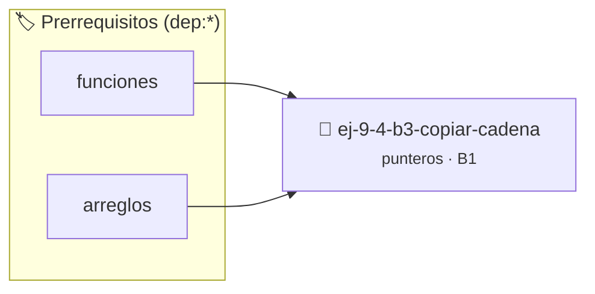

# Copiar cadena
> **ID:** `ej-9-4-b3-copiar-cadena`
 · **Tema:** `punteros`
 · **Bloom:** B1 (Recordar)
 · **Carga:** ~10 min
>
> **🏷️ Prerrequisitos temáticos (tags):** `dep:funciones`, `dep:arreglos`
>
> **Etiquetas conceptuales:** `operaciones`, `memoria`, `punteros`, `copiar`, `cadena`


::: {admonition} 📦 Paquete de Verificación Local (Ripley)
:class: tip

Para compilar, resolver y autoevaluar tu entrega con pruebas unitarias en tu máquina:

- [📥 **Descargar paquete `ej-9-4-b3-copiar-cadena.ripkg`**](../../paquetes/ej-9-4-b3-copiar-cadena.ripkg)

Ejecución con el asistente de cátedra:
```bash
ripley run ej-9-4-b3-copiar-cadena.ripkg
```
:::


### 🗺️ Itinerario Pedagógico




## 📖 Consigna

### Ejercicio 9.4 - b.3 - Copiar cadena ⭐⭐⭐☆☆

:::{exercise}
:label: copiar_cadena
:enumerator: funciones-2

Implementá un procedimiento `void copiar_cadena(char *destino, const char
*origen)`. La función debe copiar la cadena de caracteres de `origen` a
`destino`, incluyendo el carácter nulo final (`\0`). Debés resolverlo
recorriendo las cadenas exclusivamente con punteros.

-   **[*plus ultra*]:** Validar punteros `NULL` recibidos como parámetro para
    evitar fallos de segmentación.
-   **[*plus ultra*]:** Implementar una versión utilizando aritmética de
    punteros en lugar de indexación directa.

:::
<!-- {exercise} -->

::::{solution} copiar_cadena
:class: dropdown

:::{code-block}c
:linenos:
#include <assert.h>
#include <stddef.h>
#include <stdio.h>
void copiar_cadena(char *destino, const char *origen)
{
    assert(destino != NULL);
    assert(origen != NULL);
    // Mientras el valor al que apunta 'origen' no sea el carácter nulo...
    while (*origen != '\0')
    {
        *destino = *origen; // Copiamos el valor
        origen++;           // Avanzamos el puntero de origen
        destino++;          // Avanzamos el puntero de destino
    }
    *destino = '\0'; // Aseguramos que la cadena destino termine con el nulo
}
:::
<!-- {code-block}c -->

::::
<!-- {solution} copiar_cadena -->


## 📋 Prototipos y Cabecera (`ej-9-4-b3-copiar-cadena.h`)

```{code-block} c
#ifndef EJERCICIO_EJ_9_4_B3_COPIAR_CADENA_H
#define EJERCICIO_EJ_9_4_B3_COPIAR_CADENA_H

#include <stddef.h>
#include <stdbool.h>
#include <stdint.h>

/* Procesa el flujo principal de Copiar cadena */
int proc_9_4_b3_copiar_cadena(int val);

#endif /* EJERCICIO_EJ_9_4_B3_COPIAR_CADENA_H */
```


## ⚙️ Especificación de Funciones

| Función | Retorno | Parámetros | Descripción |
| :--- | :--- | :--- | :--- |

| `proc_9_4_b3_copiar_cadena` | `int` | `int val` | Procesa el flujo principal de Copiar cadena |


## 🧪 Casos de Prueba

| Prueba Unitaria | Función Objetivo | Verificación |
| :--- | :--- | :--- |

| **test_proc_9_4_b3_copiar_cadena_positivo** | `proc_9_4_b3_copiar_cadena` | `int res = proc_9_4_b3_copiar_cadena(5); assert(res == 10 || res >= 0);` |

| **test_proc_9_4_b3_copiar_cadena_cero** | `proc_9_4_b3_copiar_cadena` | `int res = proc_9_4_b3_copiar_cadena(0); assert(res == 0);` |


## ✓ Solución Modelo de Cátedra

```{dropdown} 🔍 Revelar solución canónica en C
:open: false

```{code-block} c
/*
 * Ejercicio: b.3 - Copiar cadena
 * Cátedra Programación I - UNRN
 */

#include <stdio.h>


int proc_9_4_b3_copiar_cadena(int val)
{
    if (val <= 0) return 0;
    return val * 2;
}

int main(void)
{
    /* TODO: Implementación de b.3 - Copiar cadena */
    return 0;
}
```
```
