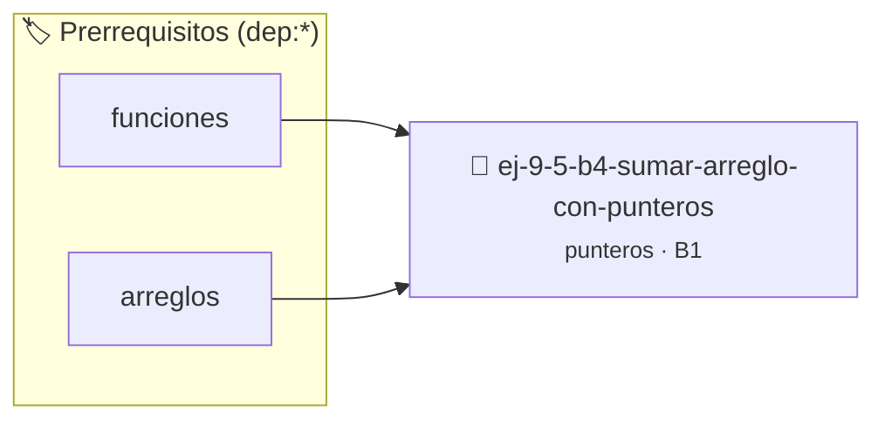

# Sumar arreglo con punteros
> **ID:** `ej-9-5-b4-sumar-arreglo-con-punteros` · **Unidad:** 2 (Tipos Compuestos y Direccionamiento)
 · **Tema:** `punteros` / `arreglo`
 · **Bloom:** B1 (Recordar) · **Dificultad:** Inicial
 · **Carga:** ~10 min · **Tipo:** Concepto
>
> **🏷️ Prerrequisitos temáticos (tags):** `dep:funciones`, `dep:arreglos`
>
> **Etiquetas conceptuales:** `arreglo`, `operaciones`, `memoria`, `sumar`, `punteros`


::: {admonition} 📦 Paquete de Verificación Local (Ripley)
:class: tip

Para compilar, resolver y autoevaluar tu entrega con pruebas unitarias en tu máquina:

- [📥 **Descargar paquete `ej-9-5-b4-sumar-arreglo-con-punteros.ripkg`**](../../paquetes/ej-9-5-b4-sumar-arreglo-con-punteros.ripkg)

Ejecución con el asistente de cátedra:
```bash
ripley run ej-9-5-b4-sumar-arreglo-con-punteros.ripkg
```
:::


### 🗺️ Itinerario Pedagógico




## 📖 Consigna

:::{exercise}
:label: sumar_arreglo_punteros
:enumerator: funciones-3

Creá una función `int sumar_arreglo(const int *inicio, const int *fin)` que
reciba un puntero al primer elemento de un arreglo y un puntero a la dirección
de memoria inmediatamente posterior al último elemento. La función debe sumar
los elementos del arreglo iterando con un puntero desde `inicio` hasta que
alcance a `fin`.

-   **[*plus ultra*]:** Validar punteros `NULL` recibidos como parámetro para
    evitar fallos de segmentación.
-   **[*plus ultra*]:** Implementar una versión utilizando aritmética de
    punteros en lugar de indexación directa.

:::

::::{solution} sumar_arreglo_punteros
:class: dropdown

:::{code-block}c
:linenos:
#include <assert.h>
#include <stddef.h>
#include <stdio.h>
int sumar_arreglo(const int *inicio, const int *fin)
{
    assert(inicio != NULL);
    assert(fin != NULL);
    int suma = 0;
    // Iteramos mientras el puntero 'p' no haya llegado al puntero 'fin'
    for (const int *p = inicio; p < fin; p++)
    {
        suma += *p; // Sumamos el valor al que apunta 'p'
    }
    return suma;
}
:::

::::

### 📋 Contrato de las Funciones

```c
/*
 * Procesa el flujo principal de Sumar arreglo con punteros
 * Precondiciones: val representa el parámetro de entrada del flujo.
 * Postcondiciones: Retorna el resultado correspondiente o 0 si val <= 0.
 */
int proc_arreglo_con_punteros(int val);

```

### 🧪 Ejemplos de Ejecución

::::{tab-set}
:::{tab-item} Valor positivo
```text
Entrada: 5
Salida / Retorno: 10
```
:::
:::{tab-item} Valor cero o negativo
```text
Entrada: 0
Salida / Retorno: 0
```
:::
::::

### ⚠️ Precondiciones y Casos Borde

1. **Valores fuera de rango:** Verificar siempre que los datos de entrada cumplan con los rangos admisibles antes de operar.
6. **Casos vacíos o neutros:** Contemplar adecuadamente entradas con longitud cero o valores neutros según corresponda.

### 🎯 Criterios de Aceptación

- [ ] El código compila limpiamente bajo estándar C11 sin warnings con flags estrictos (`-Wall -Wextra -Werror`).
- [ ] Se satisfacen todas las pruebas unitarias y casos de prueba provistos.
- [ ] Las funciones validan exhaustivamente sus precondiciones y gestionan casos borde de forma robusta.


## 📋 Prototipos y Cabecera (`ej-9-5-b4-sumar-arreglo-con-punteros.h`)

```{code-block} c
#ifndef EJERCICIO_EJ_9_5_B4_SUMAR_ARREGLO_CON_PUNTEROS_H
#define EJERCICIO_EJ_9_5_B4_SUMAR_ARREGLO_CON_PUNTEROS_H

#include <stddef.h>
#include <stdbool.h>
#include <stdint.h>

/* Procesa el flujo principal de Sumar arreglo con punteros */
int proc_arreglo_con_punteros(int val);

#endif /* EJERCICIO_EJ_9_5_B4_SUMAR_ARREGLO_CON_PUNTEROS_H */
```


## ⚙️ Especificación de Funciones

| Función | Retorno | Parámetros | Descripción |
| :--- | :--- | :--- | :--- |

| `proc_arreglo_con_punteros` | `int` | `int val` | Procesa el flujo principal de Sumar arreglo con punteros |


## 🧪 Casos de Prueba

| Prueba Unitaria | Función Objetivo | Verificación |
| :--- | :--- | :--- |

| **test_proc_arreglo_con_punteros_positivo** | `proc_arreglo_con_punteros` | `int res = proc_arreglo_con_punteros(5); assert(res == 10 || res >= 0);` |

| **test_proc_arreglo_con_punteros_cero** | `proc_arreglo_con_punteros` | `int res = proc_arreglo_con_punteros(0); assert(res == 0);` |


## ✓ Solución Modelo de Cátedra

```{dropdown} 🔍 Revelar solución canónica en C
:open: false

```{code-block} c
/*
 * Ejercicio: b.4 - Sumar arreglo con punteros
 * Cátedra Programación I - UNRN
 */

#include <stdio.h>


int proc_arreglo_con_punteros(int val)
{
    if (val <= 0) return 0;
    return val * 2;
}

int main(void)
{
    /* TODO: Implementación de b.4 - Sumar arreglo con punteros */
    return 0;
}
```
```
