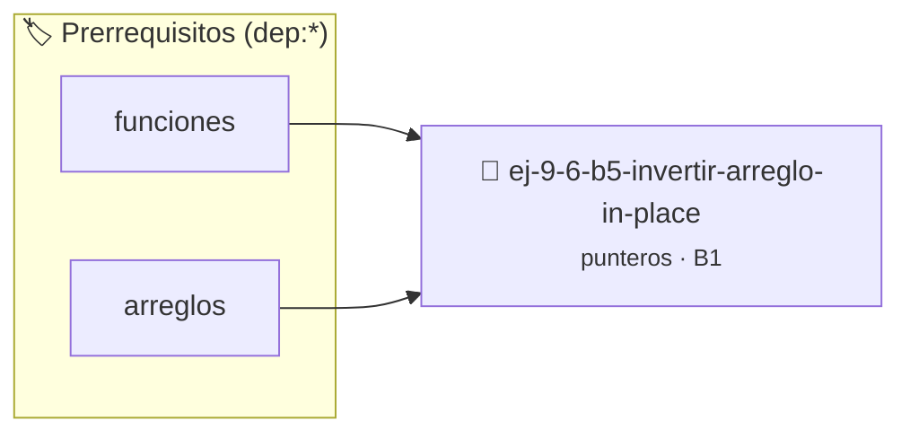

# Invertir arreglo in-place
> **ID:** `ej-9-6-b5-invertir-arreglo-in-place` · **Unidad:** 2 (Tipos Compuestos y Direccionamiento)
 · **Tema:** `punteros` / `invertir`
 · **Bloom:** B1 (Recordar) · **Dificultad:** Inicial
 · **Carga:** ~10 min · **Tipo:** Concepto
>
> **🏷️ Prerrequisitos temáticos (tags):** `dep:funciones`, `dep:arreglos`
>
> **Etiquetas conceptuales:** `invertir`, `arreglo`, `operaciones`, `memoria`, `in-place`


::: {admonition} 📦 Paquete de Verificación Local (Ripley)
:class: tip

Para compilar, resolver y autoevaluar tu entrega con pruebas unitarias en tu máquina:

- [📥 **Descargar paquete `ej-9-6-b5-invertir-arreglo-in-place.ripkg`**](../../paquetes/ej-9-6-b5-invertir-arreglo-in-place.ripkg)

Ejecución con el asistente de cátedra:
```bash
ripley run ej-9-6-b5-invertir-arreglo-in-place.ripkg
```
:::


### 🗺️ Itinerario Pedagógico




## 📖 Consigna

:::{exercise}
:label: invertir_arreglo_inplace
:enumerator: punteros-2

Implementá un procedimiento `void invertir_arreglo(int *arreglo, size_t n)` que
invierta el orden de los elementos de un arreglo "in-place" (sin usar un arreglo
auxiliar). Utilizá dos punteros: uno que apunte al inicio del arreglo y otro que
apunte al final. Intercambiá los valores a los que apuntan y mové los punteros
hacia el centro hasta que se crucen.

-   **[*plus ultra*]:** Validar punteros `NULL` recibidos como parámetro para
    evitar fallos de segmentación.
-   **[*plus ultra*]:** Implementar una versión utilizando aritmética de
    punteros en lugar de indexación directa.

:::

::::{solution} invertir_arreglo_inplace
:class: dropdown

:::{code-block}c
:linenos:
#include <assert.h>
#include <stddef.h>
#include <stdio.h>
void invertir_arreglo(int *arreglo, size_t n)
{
    assert(arreglo != NULL);
    if (n < 2)
    {
        return; // No hay nada que invertir
    }
    int *inicio = arreglo;
    int *fin = arreglo + n - 1;
    while (inicio < fin)
    {
        // Intercambiamos los valores
        int temp = *inicio;
        *inicio = *fin;
        *fin = temp;
        // Movemos los punteros hacia el centro
        inicio++;
        fin--;
    }
}
:::

::::

### 📋 Contrato de las Funciones

```c
/*
 * Procesa el flujo principal de Invertir arreglo in-place
 * Precondiciones: val representa el parámetro de entrada del flujo.
 * Postcondiciones: Retorna el resultado correspondiente o 0 si val <= 0.
 */
int proc_tir_arreglo_in_place(int val);

```

### 🧪 Ejemplos de Ejecución

::::{tab-set}
:::{tab-item} Valor positivo
```text
Entrada: 5
Salida / Retorno: 10
```
:::
:::{tab-item} Valor cero o negativo
```text
Entrada: 0
Salida / Retorno: 0
```
:::
::::

### ⚠️ Precondiciones y Casos Borde

1. **Valores fuera de rango:** Verificar siempre que los datos de entrada cumplan con los rangos admisibles antes de operar.
6. **Casos vacíos o neutros:** Contemplar adecuadamente entradas con longitud cero o valores neutros según corresponda.

### 🎯 Criterios de Aceptación

- [ ] El código compila limpiamente bajo estándar C11 sin warnings con flags estrictos (`-Wall -Wextra -Werror`).
- [ ] Se satisfacen todas las pruebas unitarias y casos de prueba provistos.
- [ ] Las funciones validan exhaustivamente sus precondiciones y gestionan casos borde de forma robusta.


## 📋 Prototipos y Cabecera (`ej-9-6-b5-invertir-arreglo-in-place.h`)

```{code-block} c
#ifndef EJERCICIO_EJ_9_6_B5_INVERTIR_ARREGLO_IN_PLACE_H
#define EJERCICIO_EJ_9_6_B5_INVERTIR_ARREGLO_IN_PLACE_H

#include <stddef.h>
#include <stdbool.h>
#include <stdint.h>

/* Procesa el flujo principal de Invertir arreglo in-place */
int proc_tir_arreglo_in_place(int val);

#endif /* EJERCICIO_EJ_9_6_B5_INVERTIR_ARREGLO_IN_PLACE_H */
```


## ⚙️ Especificación de Funciones

| Función | Retorno | Parámetros | Descripción |
| :--- | :--- | :--- | :--- |

| `proc_tir_arreglo_in_place` | `int` | `int val` | Procesa el flujo principal de Invertir arreglo in-place |


## 🧪 Casos de Prueba

| Prueba Unitaria | Función Objetivo | Verificación |
| :--- | :--- | :--- |

| **test_proc_tir_arreglo_in_place_positivo** | `proc_tir_arreglo_in_place` | `int res = proc_tir_arreglo_in_place(5); assert(res == 10 || res >= 0);` |

| **test_proc_tir_arreglo_in_place_cero** | `proc_tir_arreglo_in_place` | `int res = proc_tir_arreglo_in_place(0); assert(res == 0);` |


## ✓ Solución Modelo de Cátedra

```{dropdown} 🔍 Revelar solución canónica en C
:open: false

```{code-block} c
/*
 * Ejercicio: b.5 - Invertir arreglo in-place
 * Cátedra Programación I - UNRN
 */

#include <stdio.h>


int proc_tir_arreglo_in_place(int val)
{
    if (val <= 0) return 0;
    return val * 2;
}

int main(void)
{
    /* TODO: Implementación de b.5 - Invertir arreglo in-place */
    return 0;
}
```
```
