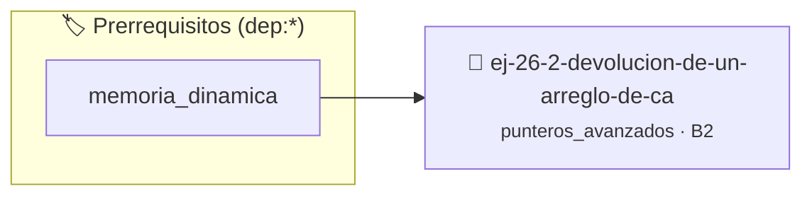

# Devolución de un Arreglo de Cadenas (Tokenizer)
> **ID:** `ej-26-2-devolucion-de-un-arreglo-de-ca`
 · **Tema:** `punteros_avanzados`
 · **Bloom:** B2 (Comprender)
 · **Carga:** ~15 min
>
> **🏷️ Prerrequisitos temáticos (tags):** `dep:memoria_dinamica`
>
> **Etiquetas conceptuales:** `cadenas`, `arreglo`, `doble_puntero`, `devolucion`, `punteros_funcion`


::: {admonition} 📦 Paquete de Verificación Local (Ripley)
:class: tip

Para compilar, resolver y autoevaluar tu entrega con pruebas unitarias en tu máquina:

- [📥 **Descargar paquete `ej-26-2-devolucion-de-un-arreglo-de-ca.ripkg`**](../../paquetes/ej-26-2-devolucion-de-un-arreglo-de-ca.ripkg)

Ejecución con el asistente de cátedra:
```bash
ripley run ej-26-2-devolucion-de-un-arreglo-de-ca.ripkg
```
:::


### 🗺️ Itinerario Pedagógico




## 📖 Consigna

### Ejercicio 26.2 - Devolución de un Arreglo de Cadenas (Tokenizer) ⭐⭐⭐☆☆

Reimplementar el ejercicio de "Tokenización" para que la función devuelva un
`char**` (un arreglo de cadenas terminado en `NULL`) alojado dinámicamente. La
función debe ser `char** dividir_cadena(const char *s, const char
*delimitador)`.

**Lógica y Consideraciones:**
- **Memoria**: La función es responsable de reservar memoria tanto para el
  arreglo de punteros (`char**`) como para cada una de las cadenas (tokens)
  individuales.
- **Liberación**: Se debe crear una función `void liberar_tokens(char **tokens)`
  que recorra el arreglo y libere cada cadena, y finalmente libere el arreglo de
  punteros.


:::{hint} Lógica y Consideraciones

-   **[*plus ultra*]:** Validar punteros `NULL` recibidos como parámetro para
    evitar fallos de segmentación.
-   **[*plus ultra*]:** Implementar una versión utilizando aritmética de
    punteros en lugar de indexación directa.

:::
<!-- {hint} Lógica y Consideraciones -->

---

## Punteros a Función

Un puntero a función almacena la dirección de memoria de una función ejecutable.
Permite pasar funciones como argumentos a otras funciones, creando código más
genérico y extensible.


## 📋 Prototipos y Cabecera (`ej-26-2-devolucion-de-un-arreglo-de-ca.h`)

```{code-block} c
#ifndef EJERCICIO_EJ_26_2_DEVOLUCION_DE_UN_ARREGLO_DE_CA_H
#define EJERCICIO_EJ_26_2_DEVOLUCION_DE_UN_ARREGLO_DE_CA_H

#include <stddef.h>
#include <stdbool.h>
#include <stdint.h>

/* Procesa el flujo principal de Devolución de un Arreglo de Cadenas (Tokenizer) */
int proc__de_un_arreglo_de_ca(int val);

#endif /* EJERCICIO_EJ_26_2_DEVOLUCION_DE_UN_ARREGLO_DE_CA_H */
```


## ⚙️ Especificación de Funciones

| Función | Retorno | Parámetros | Descripción |
| :--- | :--- | :--- | :--- |

| `proc__de_un_arreglo_de_ca` | `int` | `int val` | Procesa el flujo principal de Devolución de un Arreglo de Cadenas (Tokenizer) |


## 💡 Pistas Progresivas

````{tab-set}

```{tab-item} Pista 1
[Plus Ultra] Validar punteros `NULL` recibidos como parámetro para evitar fallos de segmentación.
```

```{tab-item} Pista 2
[Plus Ultra] Implementar una versión utilizando aritmética de punteros en lugar de indexación directa.
```

````


## 🧪 Casos de Prueba

| Prueba Unitaria | Función Objetivo | Verificación |
| :--- | :--- | :--- |

| **test_proc__de_un_arreglo_de_ca_positivo** | `proc__de_un_arreglo_de_ca` | `int res = proc__de_un_arreglo_de_ca(5); assert(res == 10 || res >= 0);` |

| **test_proc__de_un_arreglo_de_ca_cero** | `proc__de_un_arreglo_de_ca` | `int res = proc__de_un_arreglo_de_ca(0); assert(res == 0);` |


## ✓ Solución Modelo de Cátedra

```{dropdown} 🔍 Revelar solución canónica en C
:open: false

```{code-block} c
/*
 * Ejercicio: Devolución de un Arreglo de Cadenas (Tokenizer)
 * Cátedra Programación I - UNRN
 */

#include <stdio.h>


int proc__de_un_arreglo_de_ca(int val)
{
    if (val <= 0) return 0;
    return val * 2;
}

int main(void)
{
    /* TODO: Implementación de Devolución de un Arreglo de Cadenas (Tokenizer) */
    return 0;
}
```
```
