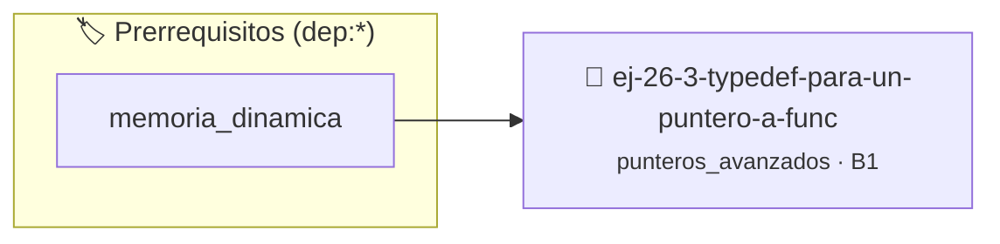

# Typedef para un Puntero a Función
> **ID:** `ej-26-3-typedef-para-un-puntero-a-func`
 · **Tema:** `punteros_avanzados`
 · **Bloom:** B1 (Recordar)
 · **Carga:** ~10 min
>
> **🏷️ Prerrequisitos temáticos (tags):** `dep:memoria_dinamica`
>
> **Etiquetas conceptuales:** `doble_puntero`, `funcion`, `punteros_funcion`, `puntero`, `avanzados`


::: {admonition} 📦 Paquete de Verificación Local (Ripley)
:class: tip

Para compilar, resolver y autoevaluar tu entrega con pruebas unitarias en tu máquina:

- [📥 **Descargar paquete `ej-26-3-typedef-para-un-puntero-a-func.ripkg`**](../../paquetes/ej-26-3-typedef-para-un-puntero-a-func.ripkg)

Ejecución con el asistente de cátedra:
```bash
ripley run ej-26-3-typedef-para-un-puntero-a-func.ripkg
```
:::


### 🗺️ Itinerario Pedagógico




## 📖 Consigna

### Ejercicio 26.3 - Typedef para un Puntero a Función ⭐⭐⭐☆☆

Definir un tipo llamado `operacion_aritmetica_t` usando `typedef` que represente
un puntero a una función que toma dos enteros y devuelve un entero.

**Sintaxis:**
`typedef int (*operacion_aritmetica_t)(int, int);`
- `int (*...)`: El puntero devuelve un `int`.
- `operacion_aritmetica_t`: Es el nuevo nombre del tipo.
- `(int, int)`: El puntero apunta a una función que toma dos `int` como
  parámetros.
:::{hint} Lógica y Consideraciones

-   **[*plus ultra*]:** Validar punteros `NULL` recibidos como parámetro para
    evitar fallos de segmentación.
-   **[*plus ultra*]:** Implementar una versión utilizando aritmética de
    punteros en lugar de indexación directa.

:::
<!-- {hint} Lógica y Consideraciones -->


## 📋 Prototipos y Cabecera (`ej-26-3-typedef-para-un-puntero-a-func.h`)

```{code-block} c
#ifndef EJERCICIO_EJ_26_3_TYPEDEF_PARA_UN_PUNTERO_A_FUNC_H
#define EJERCICIO_EJ_26_3_TYPEDEF_PARA_UN_PUNTERO_A_FUNC_H

#include <stddef.h>
#include <stdbool.h>
#include <stdint.h>

/* Procesa el flujo principal de Typedef para un Puntero a Función */
int proc_ra_un_puntero_a_func(int val);

#endif /* EJERCICIO_EJ_26_3_TYPEDEF_PARA_UN_PUNTERO_A_FUNC_H */
```


## ⚙️ Especificación de Funciones

| Función | Retorno | Parámetros | Descripción |
| :--- | :--- | :--- | :--- |

| `proc_ra_un_puntero_a_func` | `int` | `int val` | Procesa el flujo principal de Typedef para un Puntero a Función |


## 💡 Pistas Progresivas

````{tab-set}

```{tab-item} Pista 1
[Plus Ultra] Validar punteros `NULL` recibidos como parámetro para evitar fallos de segmentación.
```

```{tab-item} Pista 2
[Plus Ultra] Implementar una versión utilizando aritmética de punteros en lugar de indexación directa.
```

````


## 🧪 Casos de Prueba

| Prueba Unitaria | Función Objetivo | Verificación |
| :--- | :--- | :--- |

| **test_proc_ra_un_puntero_a_func_positivo** | `proc_ra_un_puntero_a_func` | `int res = proc_ra_un_puntero_a_func(5); assert(res == 10 || res >= 0);` |

| **test_proc_ra_un_puntero_a_func_cero** | `proc_ra_un_puntero_a_func` | `int res = proc_ra_un_puntero_a_func(0); assert(res == 0);` |


## ✓ Solución Modelo de Cátedra

```{dropdown} 🔍 Revelar solución canónica en C
:open: false

```{code-block} c
/*
 * Ejercicio: Typedef para un Puntero a Función
 * Cátedra Programación I - UNRN
 */

#include <stdio.h>


int proc_ra_un_puntero_a_func(int val)
{
    if (val <= 0) return 0;
    return val * 2;
}

int main(void)
{
    /* TODO: Implementación de Typedef para un Puntero a Función */
    return 0;
}
```
```
