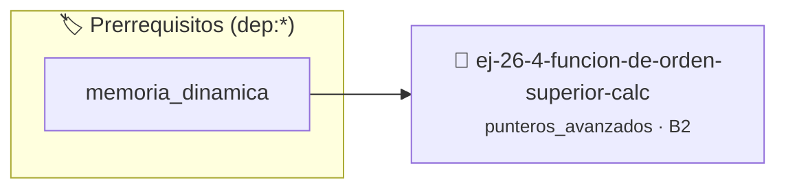

# Función de Orden Superior (Calculadora)
> **ID:** `ej-26-4-funcion-de-orden-superior-calc` · **Unidad:** 3 (Memoria Dinámica y Persistencia)
 · **Tema:** `punteros_avanzados` / `orden`
 · **Bloom:** B2 (Comprender) · **Dificultad:** Inicial
 · **Carga:** ~15 min · **Tipo:** Practica Guiada
>
> **🏷️ Prerrequisitos temáticos (tags):** `dep:memoria_dinamica`
>
> **Etiquetas conceptuales:** `orden`, `doble_puntero`, `funcion`, `punteros_funcion`, `avanzados`


::: {admonition} 📦 Paquete de Verificación Local (Ripley)
:class: tip

Para compilar, resolver y autoevaluar tu entrega con pruebas unitarias en tu máquina:

- [📥 **Descargar paquete `ej-26-4-funcion-de-orden-superior-calc.ripkg`**](../../paquetes/ej-26-4-funcion-de-orden-superior-calc.ripkg)

Ejecución con el asistente de cátedra:
```bash
ripley run ej-26-4-funcion-de-orden-superior-calc.ripkg
```
:::


### 🗺️ Itinerario Pedagógico




## 📖 Consigna

### Ejercicio 26.4 - Función de Orden Superior (Calculadora) ⭐⭐☆☆☆

Escribir una función `int calculadora(int a, int b, operacion_aritmetica_t
operacion)` que reciba dos números y un puntero a una función de operación. La
función `calculadora` debe invocar la función pasada como argumento y devolver
su resultado.

**Lógica y Consideraciones:**
- **Invocación**: Dentro de `calculadora`, se llama a la función a través del
  puntero: `return operacion(a, b);`.
- **Uso**: En `main`, se pueden definir funciones `sumar(int, int)` y
  `restar(int, int)` y pasarlas a `calculadora`.
  - `calculadora(10, 5, sumar);` // Devuelve 15
  - `calculadora(10, 5, restar);` // Devuelve 5
:::{hint} Lógica y Consideraciones

-   **[*plus ultra*]:** Validar punteros `NULL` recibidos como parámetro para
    evitar fallos de segmentación.
-   **[*plus ultra*]:** Implementar una versión utilizando aritmética de
    punteros en lugar de indexación directa.

:::
<!-- {hint} Lógica y Consideraciones -->


## 📋 Prototipos y Cabecera (`ej-26-4-funcion-de-orden-superior-calc.h`)

```{code-block} c
#ifndef EJERCICIO_EJ_26_4_FUNCION_DE_ORDEN_SUPERIOR_CALC_H
#define EJERCICIO_EJ_26_4_FUNCION_DE_ORDEN_SUPERIOR_CALC_H

#include <stddef.h>
#include <stdbool.h>
#include <stdint.h>

/* Procesa el flujo principal de Función de Orden Superior (Calculadora) */
int proc__orden_superior_calc(int val);

#endif /* EJERCICIO_EJ_26_4_FUNCION_DE_ORDEN_SUPERIOR_CALC_H */
```


## ⚙️ Especificación de Funciones

| Función | Retorno | Parámetros | Descripción |
| :--- | :--- | :--- | :--- |

| `proc__orden_superior_calc` | `int` | `int val` | Procesa el flujo principal de Función de Orden Superior (Calculadora) |


## 💡 Pistas Progresivas

````{tab-set}

```{tab-item} Pista 1
[Plus Ultra] Validar punteros `NULL` recibidos como parámetro para evitar fallos de segmentación.
```

```{tab-item} Pista 2
[Plus Ultra] Implementar una versión utilizando aritmética de punteros en lugar de indexación directa.
```

````


## 🧪 Casos de Prueba

| Prueba Unitaria | Función Objetivo | Verificación |
| :--- | :--- | :--- |

| **test_proc__orden_superior_calc_positivo** | `proc__orden_superior_calc` | `int res = proc__orden_superior_calc(5); assert(res == 10 || res >= 0);` |

| **test_proc__orden_superior_calc_cero** | `proc__orden_superior_calc` | `int res = proc__orden_superior_calc(0); assert(res == 0);` |


## ✓ Solución Modelo de Cátedra

```{dropdown} 🔍 Revelar solución canónica en C
:open: false

```{code-block} c
/*
 * Ejercicio: Función de Orden Superior (Calculadora)
 * Cátedra Programación I - UNRN
 */

#include <stdio.h>


int proc__orden_superior_calc(int val)
{
    if (val <= 0) return 0;
    return val * 2;
}

int main(void)
{
    /* TODO: Implementación de Función de Orden Superior (Calculadora) */
    return 0;
}
```
```
