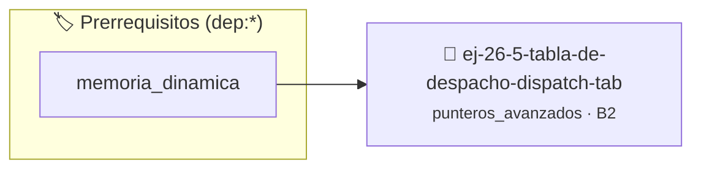

# Tabla de Despacho (Dispatch Table)
> **ID:** `ej-26-5-tabla-de-despacho-dispatch-tab`
 · **Tema:** `punteros_avanzados`
 · **Bloom:** B2 (Comprender)
 · **Carga:** ~15 min
>
> **🏷️ Prerrequisitos temáticos (tags):** `dep:memoria_dinamica`
>
> **Etiquetas conceptuales:** `despacho`, `doble_puntero`, `punteros_funcion`, `tabla`, `table`


::: {admonition} 📦 Paquete de Verificación Local (Ripley)
:class: tip

Para compilar, resolver y autoevaluar tu entrega con pruebas unitarias en tu máquina:

- [📥 **Descargar paquete `ej-26-5-tabla-de-despacho-dispatch-tab.ripkg`**](../../paquetes/ej-26-5-tabla-de-despacho-dispatch-tab.ripkg)

Ejecución con el asistente de cátedra:
```bash
ripley run ej-26-5-tabla-de-despacho-dispatch-tab.ripkg
```
:::


### 🗺️ Itinerario Pedagógico




## 📖 Consigna

### Ejercicio 26.5 - Tabla de Despacho (Dispatch Table) ⭐⭐☆☆☆

Crear una "tabla de despacho" para la calculadora. Esto consiste en un arreglo
de punteros a función. El programa debe permitir al usuario elegir una operación
(ej. 0 para sumar, 1 para restar) y usar ese índice para llamar a la función
correcta desde el arreglo.

**Lógica y Consideraciones:**
- **Arreglo**: `operacion_aritmetica_t operaciones[] = {sumar, restar,
  multiplicar, dividir};`
- **Llamada**: `int resultado = operaciones[opcion](a, b);`
- **Ventaja**: Reemplaza una estructura `switch` o `if-else` larga por una
  simple indexación de arreglo, lo que hace el código más compacto y extensible.

:::{hint} Lógica y Consideraciones

-   **[*plus ultra*]:** Validar punteros `NULL` recibidos como parámetro para
    evitar fallos de segmentación.
-   **[*plus ultra*]:** Implementar una versión utilizando aritmética de
    punteros en lugar de indexación directa.

:::
<!-- {hint} Lógica y Consideraciones -->


## 📋 Prototipos y Cabecera (`ej-26-5-tabla-de-despacho-dispatch-tab.h`)

```{code-block} c
#ifndef EJERCICIO_EJ_26_5_TABLA_DE_DESPACHO_DISPATCH_TAB_H
#define EJERCICIO_EJ_26_5_TABLA_DE_DESPACHO_DISPATCH_TAB_H

#include <stddef.h>
#include <stdbool.h>
#include <stdint.h>

/* Procesa el flujo principal de Tabla de Despacho (Dispatch Table) */
int proc_espacho_dispatch_tab(int val);

#endif /* EJERCICIO_EJ_26_5_TABLA_DE_DESPACHO_DISPATCH_TAB_H */
```


## ⚙️ Especificación de Funciones

| Función | Retorno | Parámetros | Descripción |
| :--- | :--- | :--- | :--- |

| `proc_espacho_dispatch_tab` | `int` | `int val` | Procesa el flujo principal de Tabla de Despacho (Dispatch Table) |


## 💡 Pistas Progresivas

````{tab-set}

```{tab-item} Pista 1
[Plus Ultra] Validar punteros `NULL` recibidos como parámetro para evitar fallos de segmentación.
```

```{tab-item} Pista 2
[Plus Ultra] Implementar una versión utilizando aritmética de punteros en lugar de indexación directa.
```

````


## 🧪 Casos de Prueba

| Prueba Unitaria | Función Objetivo | Verificación |
| :--- | :--- | :--- |

| **test_proc_espacho_dispatch_tab_positivo** | `proc_espacho_dispatch_tab` | `int res = proc_espacho_dispatch_tab(5); assert(res == 10 || res >= 0);` |

| **test_proc_espacho_dispatch_tab_cero** | `proc_espacho_dispatch_tab` | `int res = proc_espacho_dispatch_tab(0); assert(res == 0);` |


## ✓ Solución Modelo de Cátedra

```{dropdown} 🔍 Revelar solución canónica en C
:open: false

```{code-block} c
/*
 * Ejercicio: Tabla de Despacho (Dispatch Table)
 * Cátedra Programación I - UNRN
 */

#include <stdio.h>


int proc_espacho_dispatch_tab(int val)
{
    if (val <= 0) return 0;
    return val * 2;
}

int main(void)
{
    /* TODO: Implementación de Tabla de Despacho (Dispatch Table) */
    return 0;
}
```
```
