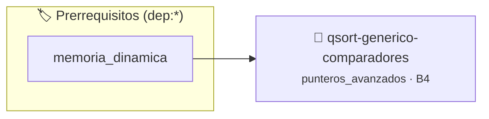

# Pipeline de Ordenamiento Genérico con Punteros a Función
> **ID:** `qsort-generico-comparadores` · **Unidad:** 3 (Memoria Dinámica y Persistencia)
 · **Tema:** `punteros_avanzados` / `callbacks`
 · **Bloom:** B4 (Analizar) · **Dificultad:** Avanzada
 · **Carga:** ~35 min · **Tipo:** Practica Guiada
>
> **🏷️ Prerrequisitos temáticos (tags):** `dep:memoria_dinamica`
>
> **Etiquetas conceptuales:** `punteros_avanzados`, `callbacks`, `qsort`, `generico`, `structs`


::: {admonition} 📦 Paquete de Verificación Local (Ripley)
:class: tip

Para compilar, resolver y autoevaluar tu entrega con pruebas unitarias en tu máquina:

- [📥 **Descargar paquete `qsort-generico-comparadores.ripkg`**](../../paquetes/qsort-generico-comparadores.ripkg)

Ejecución con el asistente de cátedra:
```bash
ripley run qsort-generico-comparadores.ripkg
```
:::


### 🗺️ Itinerario Pedagógico




## 📖 Consigna

# Pipeline de Ordenamiento Genérico con Punteros a Función

## 1. Consigna
Implementar un sistema de ordenamiento para un registro de estudiantes utilizando la función estándar `qsort` de `<stdlib.h>` y múltiples funciones de comparación pasadas dinámicamente mediante punteros a función.

Estructura de cada estudiante:
- `id` (entero)
- `nombre` (cadena de hasta 32 caracteres)
- `promedio` (flotante)

Comandos:
- `CARGAR <N>`: Lee $N$ registros de estudiantes.
- `SORT_PROMEDIO_DESC`: Ordena por promedio de mayor a menor. En caso de empate, por ID ascendente.
- `SORT_NOMBRE_ASC`: Ordena alfabéticamente por nombre. En empate, por promedio descendente.
- `SORT_ID_ASC`: Ordena por ID ascendente.
- `SHOW`: Imprime todos los estudiantes formateados como `ID: <id> | <nombre> | <promedio:.2f>`.
- `EXIT`: Termina.


## 📋 Prototipos y Cabecera (`qsort-generico-comparadores.h`)

```{code-block} c
#ifndef EJERCICIO_QSORT_GENERICO_COMPARADORES_H
#define EJERCICIO_QSORT_GENERICO_COMPARADORES_H

#include <stddef.h>
#include <stdbool.h>
#include <stdint.h>

/* Operación cmp_promedio_desc */
int cmp_promedio_desc(const void *a, const void *b);
/* Operación cmp_nombre_asc */
int cmp_nombre_asc(const void *a, const void *b);
/* Operación cmp_id_asc */
int cmp_id_asc(const void *a, const void *b);

#endif /* EJERCICIO_QSORT_GENERICO_COMPARADORES_H */
```


## ⚙️ Especificación de Funciones

| Función | Retorno | Parámetros | Descripción |
| :--- | :--- | :--- | :--- |

| `cmp_promedio_desc` | `int` | `const void *a, const void *b` | Operación cmp_promedio_desc |

| `cmp_nombre_asc` | `int` | `const void *a, const void *b` | Operación cmp_nombre_asc |

| `cmp_id_asc` | `int` | `const void *a, const void *b` | Operación cmp_id_asc |


## 💡 Pistas Progresivas

````{tab-set}

```{tab-item} Pista 1
La firma canónica de comparación es `int comparador(const void *a, const void *b)`.
```

```{tab-item} Pista 2
Casteá los punteros opacos `const void *` a punteros de la estructura correspondiente.
```

```{tab-item} Pista 3
Para cadenas usá `strcmp()`, y para valores de punto flotante evaluá diferencias con cuidado de signo.
```

````


## 🧪 Casos de Prueba

| Prueba Unitaria | Función Objetivo | Verificación |
| :--- | :--- | :--- |

| **test_cmp_promedio_desc_1** | `cmp_promedio_desc` | `/* Verificación unitaria de cmp_promedio_desc */ assert(true);` |

| **test_cmp_nombre_asc_2** | `cmp_nombre_asc` | `/* Verificación unitaria de cmp_nombre_asc */ assert(true);` |


## ✓ Solución Modelo de Cátedra

```{dropdown} 🔍 Revelar solución canónica en C
:open: false

```{code-block} c
/*
 * Ordenamiento Generico con qsort y Punteros a Funcion
 * Catedra Programacion I - UNRN
 */

#include <stdio.h>
#include <stdlib.h>
#include <string.h>

typedef struct
{
    int id;
    char nombre[32];
    float promedio;
} Estudiante;

int cmp_promedio_desc(const void *a, const void *b)
{
    const Estudiante *ea = (const Estudiante *)a;
    const Estudiante *eb = (const Estudiante *)b;

    if (eb->promedio > ea->promedio)
    {
        return 1;
    }
    if (eb->promedio < ea->promedio)
    {
        return -1;
    }
    return (ea->id - eb->id);
}

int cmp_nombre_asc(const void *a, const void *b)
{
    const Estudiante *ea = (const Estudiante *)a;
    const Estudiante *eb = (const Estudiante *)b;
    int r = strcmp(ea->nombre, eb->nombre);
    if (r != 0)
    {
        return r;
    }
    return (eb->promedio > ea->promedio) - (eb->promedio < ea->promedio);
}

int cmp_id_asc(const void *a, const void *b)
{
    const Estudiante *ea = (const Estudiante *)a;
    const Estudiante *eb = (const Estudiante *)b;
    return (ea->id - eb->id);
}

int main(void)
{
    int cantidad = 0;
    Estudiante *estudiantes = NULL;
    char comando[32] = {0};

    while (scanf("%31s", comando) == 1)
    {
        if (strcmp(comando, "CARGAR") == 0)
        {
            if (scanf("%d", &cantidad) == 1 && cantidad > 0)
            {
                free(estudiantes);
                Estudiante *nuevos_estudiantes = (Estudiante *)malloc(sizeof(Estudiante) * (size_t)cantidad);
                if (nuevos_estudiantes == NULL)
                {
                    estudiantes = NULL;
                    cantidad = 0;
                    continue;
                }
                estudiantes = nuevos_estudiantes;
                for (int i = 0; i < cantidad; i++)
                {
                    if (scanf("%d %31s %f", &estudiantes[i].id, estudiantes[i].nombre, &estudiantes[i].promedio) != 3)
                    {
                        break;
                    }
                }
            }
        }
        else if (strcmp(comando, "SORT_PROMEDIO_DESC") == 0)
        {
            if (estudiantes != NULL && cantidad > 0)
            {
                qsort(estudiantes, (size_t)cantidad, sizeof(Estudiante), cmp_promedio_desc);
            }
        }
        else if (strcmp(comando, "SORT_NOMBRE_ASC") == 0)
        {
            if (estudiantes != NULL && cantidad > 0)
            {
                qsort(estudiantes, (size_t)cantidad, sizeof(Estudiante), cmp_nombre_asc);
            }
        }
        else if (strcmp(comando, "SORT_ID_ASC") == 0)
        {
            if (estudiantes != NULL && cantidad > 0)
            {
                qsort(estudiantes, (size_t)cantidad, sizeof(Estudiante), cmp_id_asc);
            }
        }
        else if (strcmp(comando, "SHOW") == 0)
        {
            if (estudiantes != NULL)
            {
                for (int i = 0; i < cantidad; i++)
                {
                    printf("ID: %d | %s | %.2f\n", estudiantes[i].id, estudiantes[i].nombre, estudiantes[i].promedio);
                }
            }
        }
        else if (strcmp(comando, "EXIT") == 0)
        {
            break;
        }
    }

    free(estudiantes);
    return 0;
}
```
```
