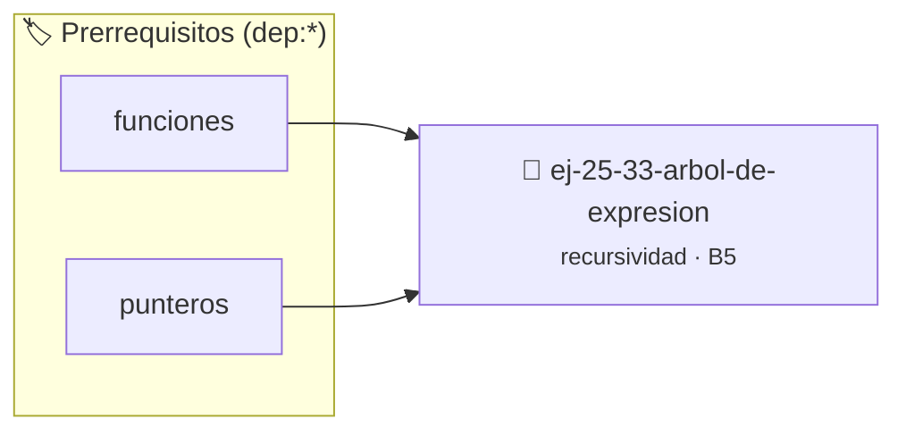

# Árbol de Expresión
> **ID:** `ej-25-33-arbol-de-expresion`
 · **Tema:** `recursividad`
 · **Bloom:** B5 (Evaluar / Crear)
 · **Carga:** ~45 min
>
> **🏷️ Prerrequisitos temáticos (tags):** `dep:funciones`, `dep:punteros`
>
> **Etiquetas conceptuales:** `recursividad`, `expresion`, `induccion`, `arbol`, `algoritmos`


::: {admonition} 📦 Paquete de Verificación Local (Ripley)
:class: tip

Para compilar, resolver y autoevaluar tu entrega con pruebas unitarias en tu máquina:

- [📥 **Descargar paquete `ej-25-33-arbol-de-expresion.ripkg`**](../../paquetes/ej-25-33-arbol-de-expresion.ripkg)

Ejecución con el asistente de cátedra:
```bash
ripley run ej-25-33-arbol-de-expresion.ripkg
```
:::


### 🗺️ Itinerario Pedagógico




## 📖 Consigna

### Ejercicio 25.33 - Árbol de Expresión ⭐⭐⭐⭐⭐

Evaluá una expresión matemática representada como árbol binario.

**Orientación:**
- Nodos hoja: números
- Nodos internos: operadores (+, -, *, /)
- Evaluación postorden: evaluar izquierdo, derecho, aplicar operador


:::{hint} Lógica y Consideraciones

-   **[*plus ultra*]:** Verificar el retorno de asignación de memoria y
    garantizar la liberación total de recursos en caso de error.
-   **[*plus ultra*]:** Verificar la ausencia de fugas de memoria (*memory
    leaks*) mediante Valgrind o AddressSanitizer.

:::
<!-- {hint} Lógica y Consideraciones -->

---

## Notas Finales

:::{tip} Anatomía de una Función Recursiva

1. **Caso(s) Base:** Condición de terminación
2. **Caso Recursivo:** Llamada a sí misma con problema más pequeño
3. **Convergencia:** Cada llamada debe acercar al caso base

```{code-block} c
:linenos:
int funcion_recursiva(parametros)
{
    // 1. Caso base
    if (condicion_terminacion)
    {
        return valor_base;
    }
    // 2. Caso recursivo
    // Procesar actual
    // Llamada recursiva con problema reducido
    return combinar(procesar_actual, funcion_recursiva(problema_mas_pequeno));
}
```
<!-- {code-block} c -->

:::
<!-- {tip} Anatomía de una Función Recursiva -->

:::{warning} Peligros de la Recursión

1. **Stack Overflow:**
   - Recursión muy profunda consume toda la pila
   - Límite típico: ~1000-10000 llamadas
   - Solución: iteración o tail recursion

2. **Duplicación de Trabajo:**
   - Fibonacci naive: recalcula subproblemas
   - Solución: memoización o programación dinámica

3. **Overhead:**
   - Cada llamada tiene costo (guardar estado)
   - Para problemas simples, iteración es más eficiente

4. **Difícil de Debuggear:**
   - Stack trace largo y confuso
   - Usá prints para ver qué está pasando

:::
<!-- {warning} Peligros de la Recursión -->

:::{note} Tipos de Recursión

**Recursión Simple:**
``` c
int suma(int n)
{
    if (n == 0)
        return 0;
    return n + suma(n - 1); // Una llamada recursiva
}
```
<!-- c -->

**Recursión Múltiple:**
``` c
int fibonacci(int n)
{
    if (n <= 1)
        return n;
    return fibonacci(n - 1) + fibonacci(n - 2); // Dos llamadas
}
```
<!-- c -->

**Recursión de Cola (Tail Recursion):**
``` c
int suma_tail(int n, int acumulador)
{
    if (n == 0)
        return acumulador;
    return suma_tail(n - 1, acumulador + n); // Llamada al final
}
// Puede optimizarse a lazo por el compilador
```
<!-- c -->

**Recursión Mutua:**
```{code-block} c
:linenos:
bool es_par(int n);
bool es_impar(int n);
bool es_par(int n)
{
    if (n == 0)
        return true;
    return es_impar(n - 1);
}
bool es_impar(int n)
{
    if (n == 0)
        return false;
    return es_par(n - 1);
}
```
<!-- {code-block} c -->

:::
<!-- {note} Tipos de Recursión -->

:::{tip} Divide y Conquista

Patrón común en recursión:

1. **Divide:** Partir problema en subproblemas
2. **Conquista:** Resolver subproblemas recursivamente
3. **Combina:** Unir soluciones de subproblemas

**Ejemplos:**
- MergeSort: dividir array, ordenar mitades, fusionar
- QuickSort: particionar, ordenar particiones
- Búsqueda binaria: dividir rango, buscar en mitad apropiada

**Complejidad típica:** O(n log n) para n elementos

:::
<!-- {tip} Divide y Conquista -->

:::{note} Recursión vs Iteración

| Aspecto | Recursión | Iteración |
|---------|-----------|-----------|
| Claridad | Más natural para problemas recursivos | Puede ser más verbosa |
| Memoria | Usa stack (limitado) | Usa variables locales |
| Velocidad | Overhead de llamadas | Generalmente más rápida |
| Debugging | Más difícil | Más fácil |

**Cuándo usar recursión:**
- Problema naturalmente recursivo (árboles, grafos)
- Código más claro y conciso
- Profundidad manejable

**Cuándo usar iteración:**
- Muchas iteraciones (riesgo de stack overflow)
- Performance crítica
- Problema naturalmente iterativo

:::
<!-- {note} Recursión vs Iteración -->

:::{tip} Optimización con Memoización

**Patrón:**
```{code-block} c
:linenos:
#define MAX 1000
int memo[MAX];
void inicializar()
{
    for (int i = 0; i < MAX; i++)
        memo[i] = -1;
}
int funcion(int n)
{
    if (n <= caso_base)
        return valor_base;
    if (memo[n] != -1)
        return memo[n];    // Ya calculado
    memo[n] = calcular(n); // Calcular y cachear
    return memo[n];
}
```
<!-- {code-block} c -->

**Ventaja:** Evita recalcular subproblemas
**Ejemplo:** Fibonacci de O(2^n) a O(n)

:::
<!-- {tip} Optimización con Memoización -->

Estas consignas cubren desde recursión básica hasta algoritmos avanzados de
backtracking y divide y conquista, desarrollando pensamiento recursivo esencial.


## 📋 Prototipos y Cabecera (`ej-25-33-arbol-de-expresion.h`)

```{code-block} c
#ifndef EJERCICIO_EJ_25_33_ARBOL_DE_EXPRESION_H
#define EJERCICIO_EJ_25_33_ARBOL_DE_EXPRESION_H

#include <stddef.h>
#include <stdbool.h>
#include <stdint.h>

/* Procesa el flujo principal de Árbol de Expresión */
int proc_3_arbol_de_expresion(int val);

#endif /* EJERCICIO_EJ_25_33_ARBOL_DE_EXPRESION_H */
```


## ⚙️ Especificación de Funciones

| Función | Retorno | Parámetros | Descripción |
| :--- | :--- | :--- | :--- |

| `proc_3_arbol_de_expresion` | `int` | `int val` | Procesa el flujo principal de Árbol de Expresión |


## 💡 Pistas Progresivas

````{tab-set}

```{tab-item} Pista 1
[Plus Ultra] Verificar el retorno de asignación de memoria y garantizar la liberación total de recursos en caso de error.
```

```{tab-item} Pista 2
[Plus Ultra] Verificar la ausencia de fugas de memoria (*memory leaks*) mediante Valgrind o AddressSanitizer.
```

```{tab-item} Pista 3
**Caso(s) Base:** Condición de terminación
```

```{tab-item} Pista 4
**Caso Recursivo:** Llamada a sí misma con problema más pequeño
```

```{tab-item} Pista 5
**Convergencia:** Cada llamada debe acercar al caso base ```{code-block} c :linenos: int funcion_recursiva(parametros) { // 1. Caso base if (condicion_terminacion) { return valor_base; } // 2. Caso recursivo // Procesar actual // Llamada recursiva con problema reducido return combinar(procesar_actual, funcion_recursiva(problema_mas_pequeno)); } ``` <!-- {code-block} c -->
```

```{tab-item} Pista 6
**Divide:** Partir problema en subproblemas
```

```{tab-item} Pista 7
**Conquista:** Resolver subproblemas recursivamente
```

```{tab-item} Pista 8
**Combina:** Unir soluciones de subproblemas **Ejemplos:**
```

```{tab-item} Pista 9
MergeSort: dividir array, ordenar mitades, fusionar
```

```{tab-item} Pista 10
QuickSort: particionar, ordenar particiones
```

```{tab-item} Pista 11
Búsqueda binaria: dividir rango, buscar en mitad apropiada **Complejidad típica:** O(n log n) para n elementos
```

````


## 🧪 Casos de Prueba

| Prueba Unitaria | Función Objetivo | Verificación |
| :--- | :--- | :--- |

| **test_proc_3_arbol_de_expresion_positivo** | `proc_3_arbol_de_expresion` | `int res = proc_3_arbol_de_expresion(5); assert(res == 10 || res >= 0);` |

| **test_proc_3_arbol_de_expresion_cero** | `proc_3_arbol_de_expresion` | `int res = proc_3_arbol_de_expresion(0); assert(res == 0);` |


## ✓ Solución Modelo de Cátedra

```{dropdown} 🔍 Revelar solución canónica en C
:open: false

```{code-block} c
/*
 * Solucion modelo para ej-25-33-arbol-de-expresion
 * Catedra Programacion I - UNRN
 */
#include <stdio.h>
#include <stdlib.h>
#include <string.h>
#include <stdbool.h>


int proc_3_arbol_de_expresion(int val)
{
    if (val <= 0) return 0;
    return val * 2;
}

int main(void)
{
    int n = 0;
    if (scanf("%d", &n) == 1)
    {
        printf("OK %d\n", n);
    }
    else
    {
        printf("OK\n");
    }
    return 0;
}
```
```
