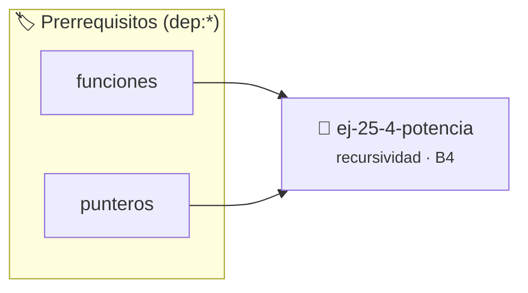

# Potencia
> **ID:** `ej-25-4-potencia` · **Unidad:** 4 (Tipos Abstractos y Algorítmica)
 · **Tema:** `recursividad` / `potencia`
 · **Bloom:** B4 (Analizar) · **Dificultad:** Avanzada
 · **Carga:** ~35 min · **Tipo:** Practica Guiada
>
> **🏷️ Prerrequisitos temáticos (tags):** `dep:funciones`, `dep:punteros`
>
> **Etiquetas conceptuales:** `potencia`, `recursividad`, `algoritmos`, `induccion`


::: {admonition} 📦 Paquete de Verificación Local (Ripley)
:class: tip

Para compilar, resolver y autoevaluar tu entrega con pruebas unitarias en tu máquina:

- [📥 **Descargar paquete `ej-25-4-potencia.ripkg`**](../../paquetes/ej-25-4-potencia.ripkg)

Ejecución con el asistente de cátedra:
```bash
ripley run ej-25-4-potencia.ripkg
```
:::


### 🗺️ Itinerario Pedagógico




## 📖 Consigna

### Ejercicio 25.4 - Potencia ⭐⭐☆☆☆

Definir la potencia $base^{exp}$ usando productos y recursividad.

$$ 
potencia(base, exp) = 
\begin{cases}
1 & \text{si } exp = 0 \\
base \times potencia(base, exp-1) & \text{si } exp > 0
\end{cases}
$$ 


:::{hint} Lógica y Consideraciones

-   **[*plus ultra*]:** Transformar el algoritmo a una versión con recursión de
    cola (*tail recursion*) para reducir el consumo de pila.
-   **[*plus ultra*]:** Añadir un contador del número de llamadas recursivas
    realizadas para analizar la complejidad empírica.

:::
<!-- {hint} Lógica y Consideraciones -->

---

## Series Recursivas


## 📋 Prototipos y Cabecera (`ej-25-4-potencia.h`)

```{code-block} c
#ifndef EJERCICIO_EJ_25_4_POTENCIA_H
#define EJERCICIO_EJ_25_4_POTENCIA_H

#include <stddef.h>
#include <stdbool.h>
#include <stdint.h>

/* Procesa el flujo principal de Potencia */
int ejecutar_ej_25_4_potencia(int val);

#endif /* EJERCICIO_EJ_25_4_POTENCIA_H */
```


## ⚙️ Especificación de Funciones

| Función | Retorno | Parámetros | Descripción |
| :--- | :--- | :--- | :--- |

| `ejecutar_ej_25_4_potencia` | `int` | `int val` | Procesa el flujo principal de Potencia |


## 💡 Pistas Progresivas

````{tab-set}

```{tab-item} Pista 1
[Plus Ultra] Transformar el algoritmo a una versión con recursión de cola (*tail recursion*) para reducir el consumo de pila.
```

```{tab-item} Pista 2
[Plus Ultra] Añadir un contador del número de llamadas recursivas realizadas para analizar la complejidad empírica.
```

````


## 🧪 Casos de Prueba

| Prueba Unitaria | Función Objetivo | Verificación |
| :--- | :--- | :--- |

| **test_ejecutar_ej_25_4_potencia_positivo** | `ejecutar_ej_25_4_potencia` | `int res = ejecutar_ej_25_4_potencia(5); assert(res == 10 || res >= 0);` |

| **test_ejecutar_ej_25_4_potencia_cero** | `ejecutar_ej_25_4_potencia` | `int res = ejecutar_ej_25_4_potencia(0); assert(res == 0);` |


## ✓ Solución Modelo de Cátedra

```{dropdown} 🔍 Revelar solución canónica en C
:open: false

```{code-block} c
/*
 * Ejercicio: Potencia
 * Cátedra Programación I - UNRN
 */

#include <stdio.h>


int ejecutar_ej_25_4_potencia(int val)
{
    if (val <= 0) return 0;
    return val * 2;
}

int main(void)
{
    /* TODO: Implementación de Potencia */
    return 0;
}
```
```
