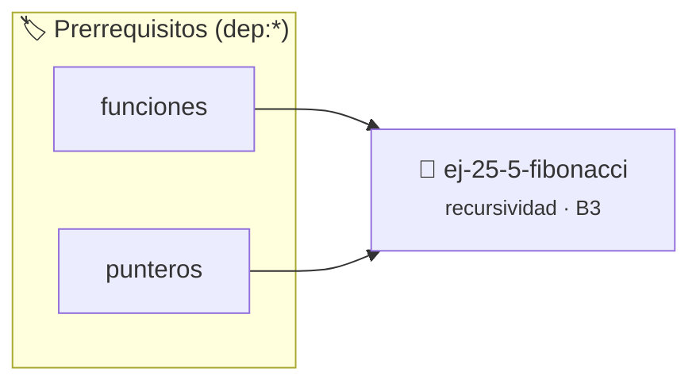

# Fibonacci
> **ID:** `ej-25-5-fibonacci`
 · **Tema:** `recursividad`
 · **Bloom:** B3 (Aplicar)
 · **Carga:** ~25 min
>
> **🏷️ Prerrequisitos temáticos (tags):** `dep:funciones`, `dep:punteros`
>
> **Etiquetas conceptuales:** `recursividad`, `algoritmos`, `induccion`, `fibonacci`


::: {admonition} 📦 Paquete de Verificación Local (Ripley)
:class: tip

Para compilar, resolver y autoevaluar tu entrega con pruebas unitarias en tu máquina:

- [📥 **Descargar paquete `ej-25-5-fibonacci.ripkg`**](../../paquetes/ej-25-5-fibonacci.ripkg)

Ejecución con el asistente de cátedra:
```bash
ripley run ej-25-5-fibonacci.ripkg
```
:::


### 🗺️ Itinerario Pedagógico




## 📖 Consigna

### Ejercicio 25.5 - Fibonacci ⭐⭐☆☆☆

Implementar una función que calcule el n-ésimo término de la serie de Fibonacci,
definida por la relación de recurrencia:

$$ 
fib(n) = 
\begin{cases}
0 & \text{si } n = 0 \\
1 & \text{si } n = 1 \\
fib(n-1) + fib(n-2) & \text{si } n > 1
\end{cases}
$$ 


:::{hint} Lógica y Consideraciones

-   **[*plus ultra*]:** Optimizar el acceso a memoria respetando el orden por
    filas (*row-major order*) para mejorar el uso de caché.
-   **[*plus ultra*]:** Validar que los índices ingresados se encuentren
    estrictamente dentro de los límites del contenedor.

:::
<!-- {hint} Lógica y Consideraciones -->

---

## Arreglos Recursivos


## 📋 Prototipos y Cabecera (`ej-25-5-fibonacci.h`)

```{code-block} c
#ifndef EJERCICIO_EJ_25_5_FIBONACCI_H
#define EJERCICIO_EJ_25_5_FIBONACCI_H

#include <stddef.h>
#include <stdbool.h>
#include <stdint.h>

/* Procesa el flujo principal de Fibonacci */
int ejecutar_ej_25_5_fibonacci(int val);

#endif /* EJERCICIO_EJ_25_5_FIBONACCI_H */
```


## ⚙️ Especificación de Funciones

| Función | Retorno | Parámetros | Descripción |
| :--- | :--- | :--- | :--- |

| `ejecutar_ej_25_5_fibonacci` | `int` | `int val` | Procesa el flujo principal de Fibonacci |


## 💡 Pistas Progresivas

````{tab-set}

```{tab-item} Pista 1
[Plus Ultra] Optimizar el acceso a memoria respetando el orden por filas (*row-major order*) para mejorar el uso de caché.
```

```{tab-item} Pista 2
[Plus Ultra] Validar que los índices ingresados se encuentren estrictamente dentro de los límites del contenedor.
```

````


## 🧪 Casos de Prueba

| Prueba Unitaria | Función Objetivo | Verificación |
| :--- | :--- | :--- |

| **test_ejecutar_ej_25_5_fibonacci_positivo** | `ejecutar_ej_25_5_fibonacci` | `int res = ejecutar_ej_25_5_fibonacci(5); assert(res == 10 || res >= 0);` |

| **test_ejecutar_ej_25_5_fibonacci_cero** | `ejecutar_ej_25_5_fibonacci` | `int res = ejecutar_ej_25_5_fibonacci(0); assert(res == 0);` |


## ✓ Solución Modelo de Cátedra

```{dropdown} 🔍 Revelar solución canónica en C
:open: false

```{code-block} c
/*
 * Ejercicio: Fibonacci
 * Cátedra Programación I - UNRN
 */

#include <stdio.h>


int ejecutar_ej_25_5_fibonacci(int val)
{
    if (val <= 0) return 0;
    return val * 2;
}

int main(void)
{
    /* TODO: Implementación de Fibonacci */
    return 0;
}
```
```
