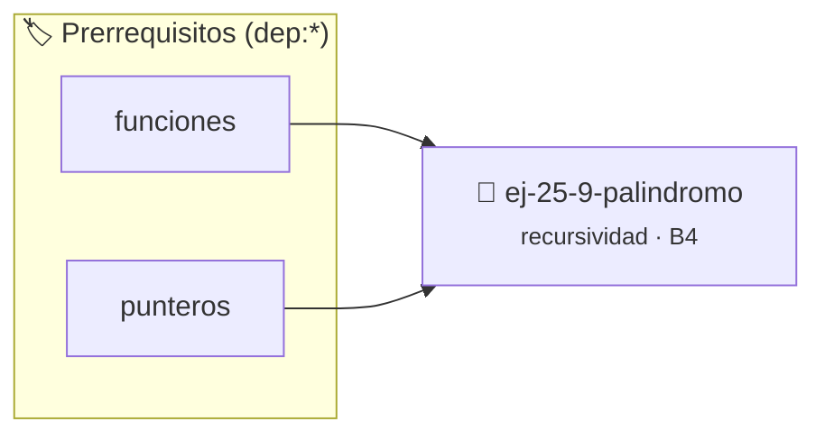

# Palíndromo
> **ID:** `ej-25-9-palindromo` · **Unidad:** 4 (Tipos Abstractos y Algorítmica)
 · **Tema:** `recursividad` / `palindromo`
 · **Bloom:** B4 (Analizar) · **Dificultad:** Avanzada
 · **Carga:** ~35 min · **Tipo:** Practica Guiada
>
> **🏷️ Prerrequisitos temáticos (tags):** `dep:funciones`, `dep:punteros`
>
> **Etiquetas conceptuales:** `palindromo`, `recursividad`, `algoritmos`, `induccion`


::: {admonition} 📦 Paquete de Verificación Local (Ripley)
:class: tip

Para compilar, resolver y autoevaluar tu entrega con pruebas unitarias en tu máquina:

- [📥 **Descargar paquete `ej-25-9-palindromo.ripkg`**](../../paquetes/ej-25-9-palindromo.ripkg)

Ejecución con el asistente de cátedra:
```bash
ripley run ej-25-9-palindromo.ripkg
```
:::


### 🗺️ Itinerario Pedagógico




## 📖 Consigna

Implementá una función recursiva en C que determine si una cadena de caracteres es un palíndromo (se lee igual de izquierda a derecha que de derecha a izquierda).

**Lógica recursiva:**
1. **Caso Base:** Una cadena vacía o de un solo carácter es un palíndromo.
2. **Paso Recursivo:** La cadena es un palíndromo si su primer y último carácter coinciden, y la subcadena interior comprendida entre ellos también es un palíndromo.

### 📋 Contrato de las Funciones

```c
/*
 * Determina recursivamente si una subcadena es palíndromo.
 * Precondiciones: 'str' debe ser un puntero válido no nulo a una cadena terminada en '\0'.
 *                 'inicio' y 'fin' son índices válidos dentro del rango de la cadena.
 * Postcondiciones: Retorna 1 si es palíndromo, o 0 si no lo es.
 */
int es_palindromo(const char *str, int inicio, int fin);
```

### 🧪 Ejemplos de Ejecución

::::{tab-set}
:::{tab-item} Caso Palíndromo
```text
Entrada: "neuquen"
Salida / Retorno: 1
```
:::
:::{tab-item} Caso No Palíndromo
```text
Entrada: "algoritmo"
Salida / Retorno: 0
```
:::
:::{tab-item} Caso Base Unitario
```text
Entrada: "a"
Salida / Retorno: 1
```
:::
::::

### ⚠️ Precondiciones y Casos Borde

1. **Punteros nulos:** Validar que el puntero `str` recibido no sea `NULL`.
2. **Cadena vacía o cruce de índices:** Si `inicio >= fin`, se alcanzó el caso base con éxito (retorna 1).
3. **Terminación nula:** Asegurar que la cadena esté debidamente terminada en `\0`.
4. **Valores fuera de rango:** Verificar que los índices `inicio` y `fin` no sean negativos ni excedan la longitud de la cadena.

### 🎯 Criterios de Aceptación

- [ ] El código compila limpiamente bajo estándar C11 sin warnings con flags estrictos (`-Wall -Wextra -Werror`).
- [ ] La solución utiliza recursividad explícita sin utilizar lazos iterativos (`for`, `while`, `do-while`).
- [ ] Valida punteros nulos y gestiona adecuadamente cadenas vacías y de longitud par o impar.
- [ ] Satisface las pruebas unitarias provistas.

:::{hint} Consideraciones Didácticas
- Garantizar la terminación con `\0` y verificar los límites de los índices antes de indexar.
- Pensar el caso base cuando los índices se cruzan (`inicio >= fin`).
:::


## 📋 Prototipos y Cabecera (`ej-25-9-palindromo.h`)

```{code-block} c
#ifndef EJERCICIO_EJ_25_9_PALINDROMO_H
#define EJERCICIO_EJ_25_9_PALINDROMO_H

#include <stddef.h>
#include <stdbool.h>
#include <stdint.h>

/* Procesa el flujo principal de Palíndromo */
int ejecutar_ej_25_9_palindromo(int val);

#endif /* EJERCICIO_EJ_25_9_PALINDROMO_H */
```


## ⚙️ Especificación de Funciones

| Función | Retorno | Parámetros | Descripción |
| :--- | :--- | :--- | :--- |

| `ejecutar_ej_25_9_palindromo` | `int` | `int val` | Procesa el flujo principal de Palíndromo |


## 💡 Pistas Progresivas

````{tab-set}

```{tab-item} Pista 1
[Plus Ultra] Garantizar la terminación con `\0` y prevenir desbordamientos de búfer validando la capacidad máxima.
```

```{tab-item} Pista 2
[Plus Ultra] Soportar la lectura de cadenas con espacios y múltiples líneas de manera robusta.
```

```{tab-item} Pista 3
[Plus Ultra] Transformar el algoritmo a una versión con recursión de cola (*tail recursion*) para reducir el consumo de pila.
```

```{tab-item} Pista 4
[Plus Ultra] Añadir un contador del número de llamadas recursivas realizadas para analizar la complejidad empírica.
```

```{tab-item} Pista 5
[Plus Ultra] Transformar el algoritmo a una versión con recursión de cola (*tail recursion*) para reducir el consumo de pila.
```

```{tab-item} Pista 6
[Plus Ultra] Añadir un contador del número de llamadas recursivas realizadas para analizar la complejidad empírica.
```

```{tab-item} Pista 7
[Plus Ultra] Validar estrictamente los datos de entrada para manejar valores fuera de rango o tipos inválidos.
```

```{tab-item} Pista 8
[Plus Ultra] Permitir el procesamiento interactivo continuo mediante un lazo hasta que el usuario elija finalizar.
```

```{tab-item} Pista 9
[Plus Ultra] Transformar el algoritmo a una versión con recursión de cola (*tail recursion*) para reducir el consumo de pila.
```

```{tab-item} Pista 10
[Plus Ultra] Añadir un contador del número de llamadas recursivas realizadas para analizar la complejidad empírica.
```

```{tab-item} Pista 11
[Plus Ultra] Garantizar la terminación con `\0` y prevenir desbordamientos de búfer validando la capacidad máxima.
```

```{tab-item} Pista 12
[Plus Ultra] Soportar la lectura de cadenas con espacios y múltiples líneas de manera robusta.
```

```{tab-item} Pista 13
[Plus Ultra] Transformar el algoritmo a una versión con recursión de cola (*tail recursion*) para reducir el consumo de pila.
```

```{tab-item} Pista 14
[Plus Ultra] Añadir un contador del número de llamadas recursivas realizadas para analizar la complejidad empírica.
```

```{tab-item} Pista 15
[Plus Ultra] Optimizar el acceso a memoria respetando el orden por filas (*row-major order*) para mejorar el uso de caché.
```

```{tab-item} Pista 16
[Plus Ultra] Validar que los índices ingresados se encuentren estrictamente dentro de los límites del contenedor.
```

```{tab-item} Pista 17
[Plus Ultra] Optimizar el acceso a memoria respetando el orden por filas (*row-major order*) para mejorar el uso de caché.
```

```{tab-item} Pista 18
[Plus Ultra] Validar que los índices ingresados se encuentren estrictamente dentro de los límites del contenedor.
```

```{tab-item} Pista 19
[Plus Ultra] Implementar encapsulamiento completo manteniendo la definición interna oculta en el archivo `.c`.
```

```{tab-item} Pista 20
[Plus Ultra] Añadir una función de duplicación profunda (*deep copy*) para copiar la estructura de forma segura.
```

```{tab-item} Pista 21
[Plus Ultra] Optimizar el acceso a memoria respetando el orden por filas (*row-major order*) para mejorar el uso de caché.
```

```{tab-item} Pista 22
[Plus Ultra] Validar que los índices ingresados se encuentren estrictamente dentro de los límites del contenedor.
```

```{tab-item} Pista 23
[Plus Ultra] Garantizar la terminación con `\0` y prevenir desbordamientos de búfer validando la capacidad máxima.
```

```{tab-item} Pista 24
[Plus Ultra] Soportar la lectura de cadenas con espacios y múltiples líneas de manera robusta.
```

```{tab-item} Pista 25
[Plus Ultra] Garantizar la terminación con `\0` y prevenir desbordamientos de búfer validando la capacidad máxima.
```

```{tab-item} Pista 26
[Plus Ultra] Soportar la lectura de cadenas con espacios y múltiples líneas de manera robusta.
```

```{tab-item} Pista 27
[Plus Ultra] Garantizar la terminación con `\0` y prevenir desbordamientos de búfer validando la capacidad máxima.
```

```{tab-item} Pista 28
[Plus Ultra] Soportar la lectura de cadenas con espacios y múltiples líneas de manera robusta.
```

```{tab-item} Pista 29
[Plus Ultra] Validar estrictamente los datos de entrada para manejar valores fuera de rango o tipos inválidos.
```

```{tab-item} Pista 30
[Plus Ultra] Permitir el procesamiento interactivo continuo mediante un lazo hasta que el usuario elija finalizar.
```

```{tab-item} Pista 31
[Plus Ultra] Optimizar el acceso a memoria respetando el orden por filas (*row-major order*) para mejorar el uso de caché.
```

```{tab-item} Pista 32
[Plus Ultra] Validar que los índices ingresados se encuentren estrictamente dentro de los límites del contenedor.
```

```{tab-item} Pista 33
[Plus Ultra] Optimizar el acceso a memoria respetando el orden por filas (*row-major order*) para mejorar el uso de caché.
```

```{tab-item} Pista 34
[Plus Ultra] Validar que los índices ingresados se encuentren estrictamente dentro de los límites del contenedor.
```

```{tab-item} Pista 35
[Plus Ultra] Validar estrictamente los datos de entrada para manejar valores fuera de rango o tipos inválidos.
```

```{tab-item} Pista 36
[Plus Ultra] Permitir el procesamiento interactivo continuo mediante un lazo hasta que el usuario elija finalizar.
```

```{tab-item} Pista 37
[Plus Ultra] Optimizar el acceso a memoria respetando el orden por filas (*row-major order*) para mejorar el uso de caché.
```

```{tab-item} Pista 38
[Plus Ultra] Validar que los índices ingresados se encuentren estrictamente dentro de los límites del contenedor.
```

```{tab-item} Pista 39
[Plus Ultra] Validar estrictamente los datos de entrada para manejar valores fuera de rango o tipos inválidos.
```

```{tab-item} Pista 40
[Plus Ultra] Permitir el procesamiento interactivo continuo mediante un lazo hasta que el usuario elija finalizar.
```

```{tab-item} Pista 41
[Plus Ultra] Transformar el algoritmo a una versión con recursión de cola (*tail recursion*) para reducir el consumo de pila.
```

```{tab-item} Pista 42
[Plus Ultra] Añadir un contador del número de llamadas recursivas realizadas para analizar la complejidad empírica.
```

```{tab-item} Pista 43
[Plus Ultra] Validar estrictamente los datos de entrada para manejar valores fuera de rango o tipos inválidos.
```

```{tab-item} Pista 44
[Plus Ultra] Permitir el procesamiento interactivo continuo mediante un lazo hasta que el usuario elija finalizar.
```

````


## 🧪 Casos de Prueba

| Prueba Unitaria | Función Objetivo | Verificación |
| :--- | :--- | :--- |

| **test_ejecutar_ej_25_9_palindromo_positivo** | `ejecutar_ej_25_9_palindromo` | `int res = ejecutar_ej_25_9_palindromo(5); assert(res == 10 || res >= 0);` |

| **test_ejecutar_ej_25_9_palindromo_cero** | `ejecutar_ej_25_9_palindromo` | `int res = ejecutar_ej_25_9_palindromo(0); assert(res == 0);` |


## ✓ Solución Modelo de Cátedra

```{dropdown} 🔍 Revelar solución canónica en C
:open: false

```{code-block} c
/*
 * Solucion modelo para ej-25-9-palindromo
 * Catedra Programacion I - UNRN
 */
#include <stdio.h>
#include <stdlib.h>
#include <string.h>
#include <stdbool.h>


int ejecutar_ej_25_9_palindromo(int val)
{
    if (val <= 0) return 0;
    return val * 2;
}

int main(void)
{
    int n = 0;
    if (scanf("%d", &n) == 1)
    {
        printf("OK %d\n", n);
    }
    else
    {
        printf("OK\n");
    }
    return 0;
}
```
```
