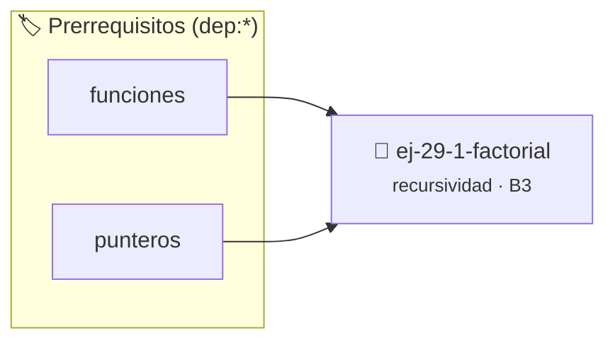

# Factorial
> **ID:** `ej-29-1-factorial`
 · **Tema:** `recursividad`
 · **Bloom:** B3 (Aplicar)
 · **Carga:** ~25 min
>
> **🏷️ Prerrequisitos temáticos (tags):** `dep:funciones`, `dep:punteros`
>
> **Etiquetas conceptuales:** `factorial`, `recursividad`, `avanzados`, `backtracking`


::: {admonition} 📦 Paquete de Verificación Local (Ripley)
:class: tip

Para compilar, resolver y autoevaluar tu entrega con pruebas unitarias en tu máquina:

- [📥 **Descargar paquete `ej-29-1-factorial.ripkg`**](../../paquetes/ej-29-1-factorial.ripkg)

Ejecución con el asistente de cátedra:
```bash
ripley run ej-29-1-factorial.ripkg
```
:::


### 🗺️ Itinerario Pedagógico




## 📖 Consigna

### Ejercicio 29.1 - Factorial ⭐⭐☆☆☆

Implementar la función factorial de forma recursiva siguiendo la definición
matemática.


:::{hint} Lógica y Consideraciones

-   **[*plus ultra*]:** Diseñar la función para devolver un código de estado de
    error e informar el resultado mediante parámetros de salida.
-   **[*plus ultra*]:** Documentar la función con etiquetas Doxygen
    especificando precondiciones y postcondiciones.

:::
<!-- {hint} Lógica y Consideraciones -->

``` c
long int factorial(int n);
```
<!-- c -->

**Definición recursiva:**

$$
n! = \begin{cases} 
1 & \text{si } n = 0 \\
n \times (n-1)! & \text{si } n > 0
\end{cases}
$$

**Casos de prueba:**
- `factorial(0)` → 1
- `factorial(5)` → 120
- `factorial(10)` → 3628800


## 📋 Prototipos y Cabecera (`ej-29-1-factorial.h`)

```{code-block} c
#ifndef EJERCICIO_EJ_29_1_FACTORIAL_H
#define EJERCICIO_EJ_29_1_FACTORIAL_H

#include <stddef.h>
#include <stdbool.h>
#include <stdint.h>

/* Procesa el flujo principal de Factorial */
int ejecutar_ej_29_1_factorial(int val);

#endif /* EJERCICIO_EJ_29_1_FACTORIAL_H */
```


## ⚙️ Especificación de Funciones

| Función | Retorno | Parámetros | Descripción |
| :--- | :--- | :--- | :--- |

| `ejecutar_ej_29_1_factorial` | `int` | `int val` | Procesa el flujo principal de Factorial |


## 💡 Pistas Progresivas

````{tab-set}

```{tab-item} Pista 1
[Plus Ultra] Diseñar la función para devolver un código de estado de error e informar el resultado mediante parámetros de salida.
```

```{tab-item} Pista 2
[Plus Ultra] Documentar la función con etiquetas Doxygen especificando precondiciones y postcondiciones.
```

````


## 🧪 Casos de Prueba

| Prueba Unitaria | Función Objetivo | Verificación |
| :--- | :--- | :--- |

| **test_ejecutar_ej_29_1_factorial_positivo** | `ejecutar_ej_29_1_factorial` | `int res = ejecutar_ej_29_1_factorial(5); assert(res == 10 || res >= 0);` |

| **test_ejecutar_ej_29_1_factorial_cero** | `ejecutar_ej_29_1_factorial` | `int res = ejecutar_ej_29_1_factorial(0); assert(res == 0);` |


## ✓ Solución Modelo de Cátedra

```{dropdown} 🔍 Revelar solución canónica en C
:open: false

```{code-block} c
/*
 * Ejercicio: Factorial
 * Cátedra Programación I - UNRN
 */

#include <stdio.h>


int ejecutar_ej_29_1_factorial(int val)
{
    if (val <= 0) return 0;
    return val * 2;
}

int main(void)
{
    /* TODO: Implementación de Factorial */
    return 0;
}
```
```
