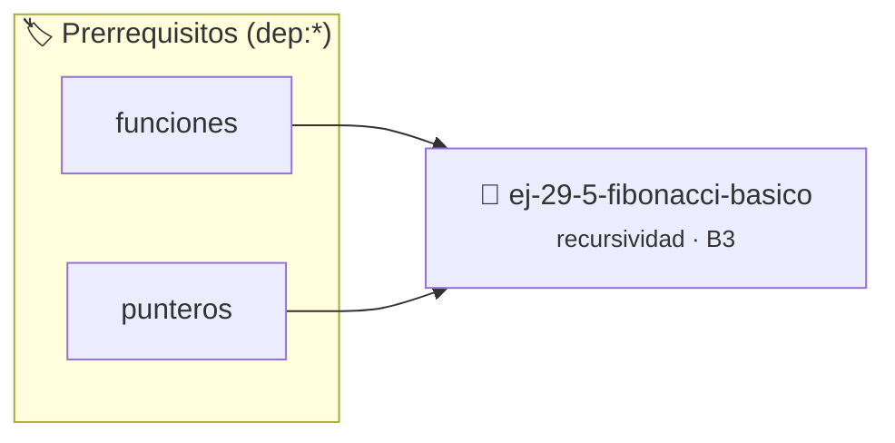

# Fibonacci Básico
> **ID:** `ej-29-5-fibonacci-basico` · **Unidad:** 4 (Tipos Abstractos y Algorítmica)
 · **Tema:** `recursividad` / `series_numericas`
 · **Bloom:** B3 (Aplicar) · **Dificultad:** Intermedia
 · **Carga:** ~25 min · **Tipo:** Practica Guiada
>
> **🏷️ Prerrequisitos temáticos (tags):** `dep:funciones`, `dep:punteros`
>
> **Etiquetas conceptuales:** `recursividad`, `backtracking`, `basico`, `fibonacci`, `avanzados`


::: {admonition} 📦 Paquete de Verificación Local (Ripley)
:class: tip

Para compilar, resolver y autoevaluar tu entrega con pruebas unitarias en tu máquina:

- [📥 **Descargar paquete `ej-29-5-fibonacci-basico.ripkg`**](../../paquetes/ej-29-5-fibonacci-basico.ripkg)

Ejecución con el asistente de cátedra:
```bash
ripley run ej-29-5-fibonacci-basico.ripkg
```
:::


### 🗺️ Itinerario Pedagógico




## 📖 Consigna

### Ejercicio 29.5 - Fibonacci Básico ⭐☆☆☆☆

Implementar la secuencia de Fibonacci recursivamente.


:::{hint} Lógica y Consideraciones

-   **[*plus ultra*]:** Validar estrictamente los datos de entrada para manejar
    valores fuera de rango o tipos inválidos.
-   **[*plus ultra*]:** Permitir el procesamiento interactivo continuo mediante
    un lazo hasta que el usuario elija finalizar.

:::
<!-- {hint} Lógica y Consideraciones -->

``` c
long int fibonacci(int n);
```
<!-- c -->

**Ecuación de recurrencia:**

$$
F(n) = \begin{cases}
0 & \text{si } n = 0 \\
1 & \text{si } n = 1 \\
F(n-1) + F(n-2) & \text{si } n > 1
\end{cases}
$$


## 📋 Prototipos y Cabecera (`ej-29-5-fibonacci-basico.h`)

```{code-block} c
#ifndef EJERCICIO_EJ_29_5_FIBONACCI_BASICO_H
#define EJERCICIO_EJ_29_5_FIBONACCI_BASICO_H

#include <stddef.h>
#include <stdbool.h>
#include <stdint.h>

/* Procesa el flujo principal de Fibonacci Básico */
int proc_9_5_fibonacci_basico(int val);

#endif /* EJERCICIO_EJ_29_5_FIBONACCI_BASICO_H */
```


## ⚙️ Especificación de Funciones

| Función | Retorno | Parámetros | Descripción |
| :--- | :--- | :--- | :--- |

| `proc_9_5_fibonacci_basico` | `int` | `int val` | Procesa el flujo principal de Fibonacci Básico |


## 💡 Pistas Progresivas

````{tab-set}

```{tab-item} Pista 1
[Plus Ultra] Validar estrictamente los datos de entrada para manejar valores fuera de rango o tipos inválidos.
```

```{tab-item} Pista 2
[Plus Ultra] Permitir el procesamiento interactivo continuo mediante un lazo hasta que el usuario elija finalizar.
```

````


## 🧪 Casos de Prueba

| Prueba Unitaria | Función Objetivo | Verificación |
| :--- | :--- | :--- |

| **test_proc_9_5_fibonacci_basico_positivo** | `proc_9_5_fibonacci_basico` | `int res = proc_9_5_fibonacci_basico(5); assert(res == 10 || res >= 0);` |

| **test_proc_9_5_fibonacci_basico_cero** | `proc_9_5_fibonacci_basico` | `int res = proc_9_5_fibonacci_basico(0); assert(res == 0);` |


## ✓ Solución Modelo de Cátedra

```{dropdown} 🔍 Revelar solución canónica en C
:open: false

```{code-block} c
/*
 * Ejercicio: Fibonacci Básico
 * Cátedra Programación I - UNRN
 */

#include <stdio.h>


int proc_9_5_fibonacci_basico(int val)
{
    if (val <= 0) return 0;
    return val * 2;
}

int main(void)
{
    /* TODO: Implementación de Fibonacci Básico */
    return 0;
}
```
```
