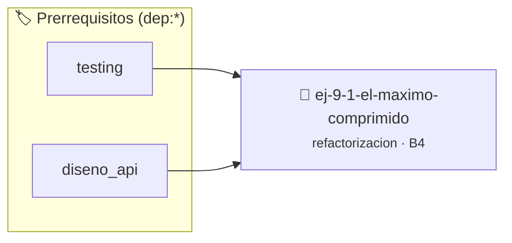

# El Máximo Comprimido
> **ID:** `ej-9-1-el-maximo-comprimido` · **Unidad:** 5 (Ingeniería de Software y Calidad en C)
 · **Tema:** `refactorizacion` / `clean_code`
 · **Bloom:** B4 (Analizar) · **Dificultad:** Avanzada
 · **Carga:** ~35 min · **Tipo:** Practica Guiada
>
> **🏷️ Prerrequisitos temáticos (tags):** `dep:testing`, `dep:diseno_api`
>
> **Etiquetas conceptuales:** `clean_code`, `refactorizacion`, `maximo`, `fundamentos`, `comprimido`


::: {admonition} 📦 Paquete de Verificación Local (Ripley)
:class: tip

Para compilar, resolver y autoevaluar tu entrega con pruebas unitarias en tu máquina:

- [📥 **Descargar paquete `ej-9-1-el-maximo-comprimido.ripkg`**](../../paquetes/ej-9-1-el-maximo-comprimido.ripkg)

Ejecución con el asistente de cátedra:
```bash
ripley run ej-9-1-el-maximo-comprimido.ripkg
```
:::


### 🗺️ Itinerario Pedagógico




## 📖 Consigna

:::{exercise}
:label: ej-ref-maximo-comprimido
Analizá y refactorizá la siguiente función que utiliza el operador ternario
prohibido y nombres crípticos:

``` c
int f(int a,int b){return(a>b)?a:b;}
```

-   **[*plus ultra*]:** Implementar `int obtener_mayor(int primer_numero, int
    segundo_numero)` con estilo Allman y `if-else`.
-   **[*plus ultra*]:** Escribir pruebas unitarias con `assert()` para números
    positivos, negativos e iguales.

:::

:::{solution} ej-ref-maximo-comprimido
:class: dropdown
**Diagnóstico:**
- Violación de la [Regla 0x1007h](../../reglas/1_control.md#0x1007h): uso del
  operador ternario `?:`.
- Violación de la [Regla 0x000Bh](../../reglas/0_sintaxis.md#0x000bh): llaves en
  la misma línea (no es Allman).
- Violación de la [Regla 0x0007h](../../reglas/0_sintaxis.md#0x0007h):
  identificadores de una letra `f, a, b`.

**Código Refactorizado:**
```{code-block} c
:linenos:
#include <assert.h>

int obtener_mayor(int primer_numero, int segundo_numero)
{
    if (primer_numero > segundo_numero)
    {
        return primer_numero;
    }
    else
    {
        return segundo_numero;
    }
}

void test_obtener_mayor(void)
{
    assert(obtener_mayor(10, 5) == 10);
    assert(obtener_mayor(-3, -8) == -3);
    assert(obtener_mayor(7, 7) == 7);
}

```

:::

---

### 📋 Contrato de las Funciones

```c
/*
 * Operación obtener_mayor
 * Precondiciones: Parámetros dentro del dominio válido de la operación.
 * Postcondiciones: Retorna el valor procesado.
 */
int obtener_mayor(int primer_numero, int segundo_numero);

/*
 * Operación test_obtener_mayor
 * Precondiciones: Parámetros dentro del dominio válido de la operación.
 * Postcondiciones: Retorna el valor procesado.
 */
void test_obtener_mayor(void);

```

### 🧪 Ejemplos de Ejecución

::::{tab-set}
:::{tab-item} Caso general
```text
val = 10
Retorno esperado calculado
```
:::
:::{tab-item} Caso límite
```text
val = 0
Retorno 0 o manejo de borde
```
:::
::::

### ⚠️ Precondiciones y Casos Borde

1. **Valores fuera de rango:** Verificar siempre que los datos de entrada cumplan con los rangos admisibles antes de operar.
6. **Casos vacíos o neutros:** Contemplar adecuadamente entradas con longitud cero o valores neutros según corresponda.

### 🎯 Criterios de Aceptación

- [ ] El código compila limpiamente bajo estándar C11 sin warnings con flags estrictos (`-Wall -Wextra -Werror`).
- [ ] Se satisfacen todas las pruebas unitarias y casos de prueba provistos.
- [ ] Las funciones validan exhaustivamente sus precondiciones y gestionan casos borde de forma robusta.


## 📋 Prototipos y Cabecera (`ej-9-1-el-maximo-comprimido.h`)

```{code-block} c
#ifndef EJERCICIO_EJ_9_1_EL_MAXIMO_COMPRIMIDO_H
#define EJERCICIO_EJ_9_1_EL_MAXIMO_COMPRIMIDO_H

#include <stddef.h>
#include <stdbool.h>
#include <stdint.h>

/* Operación obtener_mayor */
int obtener_mayor(int primer_numero, int segundo_numero);
/* Operación test_obtener_mayor */
void test_obtener_mayor(void);

#endif /* EJERCICIO_EJ_9_1_EL_MAXIMO_COMPRIMIDO_H */
```


## ⚙️ Especificación de Funciones

| Función | Retorno | Parámetros | Descripción |
| :--- | :--- | :--- | :--- |

| `obtener_mayor` | `int` | `int primer_numero, int segundo_numero` | Operación obtener_mayor |

| `test_obtener_mayor` | `void` | `void` | Operación test_obtener_mayor |


## 🧪 Casos de Prueba

| Prueba Unitaria | Función Objetivo | Verificación |
| :--- | :--- | :--- |

| **test_obtener_mayor_1** | `obtener_mayor` | `/* Verificación unitaria de obtener_mayor */ int res = obtener_mayor(1, 2); (void)res; assert(true);` |

| **test_test_obtener_mayor_2** | `test_obtener_mayor` | `/* Verificación unitaria de test_obtener_mayor */ test_obtener_mayor(); assert(true);` |


## ✓ Solución Modelo de Cátedra

```{dropdown} 🔍 Revelar solución canónica en C
:open: false

```{code-block} c
#include <assert.h>

int obtener_mayor(int primer_numero, int segundo_numero)
{
    if (primer_numero > segundo_numero)
    {
        return primer_numero;
    }
    else
    {
        return segundo_numero;
    }
}

void test_obtener_mayor(void)
{
    assert(obtener_mayor(10, 5) == 10);
    assert(obtener_mayor(-3, -8) == -3);
    assert(obtener_mayor(7, 7) == 7);
}

int main(void)
{
    return 0;
}
```
```
