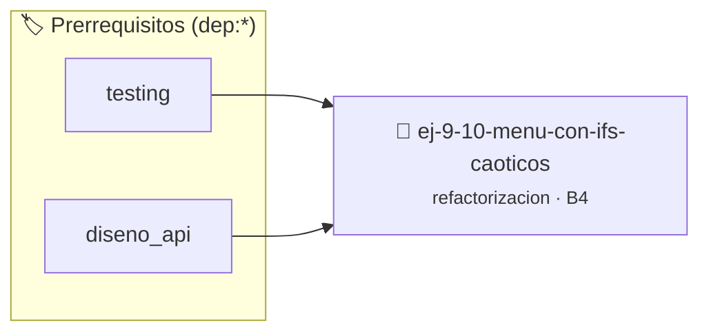

# Menú con Ifs Caóticos
> **ID:** `ej-9-10-menu-con-ifs-caoticos` · **Unidad:** 5 (Ingeniería de Software y Calidad en C)
 · **Tema:** `refactorizacion` / `clean_code`
 · **Bloom:** B4 (Analizar) · **Dificultad:** Avanzada
 · **Carga:** ~35 min · **Tipo:** Practica Guiada
>
> **🏷️ Prerrequisitos temáticos (tags):** `dep:testing`, `dep:diseno_api`
>
> **Etiquetas conceptuales:** `clean_code`, `refactorizacion`, `caoticos`, `fundamentos`


::: {admonition} 📦 Paquete de Verificación Local (Ripley)
:class: tip

Para compilar, resolver y autoevaluar tu entrega con pruebas unitarias en tu máquina:

- [📥 **Descargar paquete `ej-9-10-menu-con-ifs-caoticos.ripkg`**](../../paquetes/ej-9-10-menu-con-ifs-caoticos.ripkg)

Ejecución con el asistente de cátedra:
```bash
ripley run ej-9-10-menu-con-ifs-caoticos.ripkg
```
:::


### 🗺️ Itinerario Pedagógico




## 📖 Consigna

:::{exercise}
:label: ej-ref-menu-ifs
Refactorizá la siguiente selección de opciones a una estructura `switch` clara
con cláusula `default` ([Regla 0x1003h](../../reglas/1_control.md#0x1003h)):

```{code-block} c
:linenos:
double operacion(int op, double a, double b)
{
    if (op == 1) {
        return a + b;
    } else if (op == 2) {
        return a - b;
    } else if (op == 3) {
        return a * b;
    } else if (op == 4) {
        if (b != 0) return a / b;
        else return 0;
    } else {
        return 0;
    }
}

```

-   **[*plus ultra*]:** Manejar el error de división por cero y opción inválida
    mediante un puntero booleano `bool *ok`.
-   **[*plus ultra*]:** Definir un `enum` con los códigos de operación.

:::

:::{solution} ej-ref-menu-ifs
:class: dropdown
**Código Refactorizado:**
```{code-block} c
:linenos:
#include <assert.h>
#include <stdbool.h>

typedef enum
{
    OP_SUMAR = 1,
    OP_RESTAR = 2,
    OP_MULTIPLICAR = 3,
    OP_DIVIDIR = 4
} tipo_operacion_t;

double calcular_operacion(tipo_operacion_t operacion, double a, double b, bool *exito)
{
    if (exito == NULL)
    {
        return 0.0;
    }
    *exito = true;
    switch (operacion)
    {
        case OP_SUMAR:
            return a + b;
        case OP_RESTAR:
            return a - b;
        case OP_MULTIPLICAR:
            return a * b;
        case OP_DIVIDIR:
            if (b == 0.0)
            {
                *exito = false;
                return 0.0;
            }
            return a / b;
        default:
            *exito = false;
            return 0.0;
    }
}

void test_operaciones(void)
{
    bool ok = false;
    assert(calcular_operacion(OP_SUMAR, 3.0, 4.0, &ok) == 7.0 && ok);
    assert(calcular_operacion(OP_DIVIDIR, 10.0, 2.0, &ok) == 5.0 && ok);
    calcular_operacion(OP_DIVIDIR, 10.0, 0.0, &ok);
    assert(!ok);
}

```

:::

---

### 📋 Contrato de las Funciones

```c
/*
 * Operación operacion
 * Precondiciones: Parámetros dentro del dominio válido de la operación.
 * Postcondiciones: Retorna el valor procesado.
 */
double operacion(int op, double a, double b);

```

### 🧪 Ejemplos de Ejecución

::::{tab-set}
:::{tab-item} Caso general
```text
val = 10
Retorno esperado calculado
```
:::
:::{tab-item} Caso límite
```text
val = 0
Retorno 0 o manejo de borde
```
:::
::::

### ⚠️ Precondiciones y Casos Borde

1. **Valores fuera de rango:** Verificar siempre que los datos de entrada cumplan con los rangos admisibles antes de operar.
6. **Casos vacíos o neutros:** Contemplar adecuadamente entradas con longitud cero o valores neutros según corresponda.

### 🎯 Criterios de Aceptación

- [ ] El código compila limpiamente bajo estándar C11 sin warnings con flags estrictos (`-Wall -Wextra -Werror`).
- [ ] Se satisfacen todas las pruebas unitarias y casos de prueba provistos.
- [ ] Las funciones validan exhaustivamente sus precondiciones y gestionan casos borde de forma robusta.


## 📋 Prototipos y Cabecera (`ej-9-10-menu-con-ifs-caoticos.h`)

```{code-block} c
#ifndef EJERCICIO_EJ_9_10_MENU_CON_IFS_CAOTICOS_H
#define EJERCICIO_EJ_9_10_MENU_CON_IFS_CAOTICOS_H

#include <stddef.h>
#include <stdbool.h>
#include <stdint.h>

/* Operación operacion */
double operacion(int op, double a, double b);

#endif /* EJERCICIO_EJ_9_10_MENU_CON_IFS_CAOTICOS_H */
```


## ⚙️ Especificación de Funciones

| Función | Retorno | Parámetros | Descripción |
| :--- | :--- | :--- | :--- |

| `operacion` | `double` | `int op, double a, double b` | Operación operacion |


## 🧪 Casos de Prueba

| Prueba Unitaria | Función Objetivo | Verificación |
| :--- | :--- | :--- |

| **test_operacion_1** | `operacion` | `/* Verificación unitaria de operacion */ double res = operacion(1, 2, 3); (void)res; assert(true);` |


## ✓ Solución Modelo de Cátedra

```{dropdown} 🔍 Revelar solución canónica en C
:open: false

```{code-block} c
double operacion(int op, double a, double b)
{
    if (op == 1) {
        return a + b;
    } else if (op == 2) {
        return a - b;
    } else if (op == 3) {
        return a * b;
    } else if (op == 4) {
        if (b != 0) return a / b;
        else return 0;
    } else {
        return 0;
    }
}

int main(void)
{
    return 0;
}
```
```
