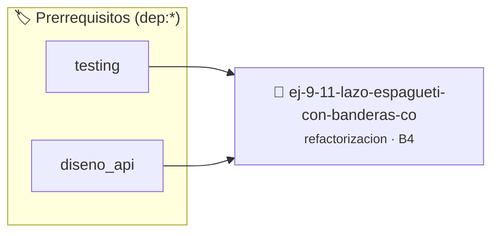

# Lazo Espagueti con Banderas Confusas
> **ID:** `ej-9-11-lazo-espagueti-con-banderas-co`
 · **Tema:** `refactorizacion`
 · **Bloom:** B4 (Analizar)
 · **Carga:** ~35 min
>
> **🏷️ Prerrequisitos temáticos (tags):** `dep:testing`, `dep:diseno_api`
>
> **Etiquetas conceptuales:** `clean_code`, `confusas`, `refactorizacion`, `fundamentos`, `banderas`


::: {admonition} 📦 Paquete de Verificación Local (Ripley)
:class: tip

Para compilar, resolver y autoevaluar tu entrega con pruebas unitarias en tu máquina:

- [📥 **Descargar paquete `ej-9-11-lazo-espagueti-con-banderas-co.ripkg`**](../../paquetes/ej-9-11-lazo-espagueti-con-banderas-co.ripkg)

Ejecución con el asistente de cátedra:
```bash
ripley run ej-9-11-lazo-espagueti-con-banderas-co.ripkg
```
:::


### 🗺️ Itinerario Pedagógico




## 📖 Consigna

### Ejercicio 9.11 - Lazo Espagueti con Banderas Confusas ⭐⭐⭐☆☆

:::{exercise}
:label: ej-ref-lazo-espagueti
Refactorizá la siguiente función que utiliza lazos infinitos `while(1)`,
variables `flag` crípticas y `break` desordenados para verificar si un número es
primo:

```{code-block} c
:linenos:
int check(int n)
{
    int flag = 1;
    int i = 2;
    if (n <= 1) return 0;
    while (1)
    {
        if (i * i > n) break;
        if (n % i == 0)
        {
            flag = 0;
            break;
        }
        i++;
    }
    return flag;
}

```
<!-- {code-block} c -->

-   **[*plus ultra*]:** Eliminar `while(1)` y `break` reemplazándolos por un
    lazo estructurado con condición clara.
-   **[*plus ultra*]:** Optimizar evaluando solo números impares después del 2.

:::
<!-- {exercise} -->

---


## 📋 Prototipos y Cabecera (`ej-9-11-lazo-espagueti-con-banderas-co.h`)

```{code-block} c
#ifndef EJERCICIO_EJ_9_11_LAZO_ESPAGUETI_CON_BANDERAS_CO_H
#define EJERCICIO_EJ_9_11_LAZO_ESPAGUETI_CON_BANDERAS_CO_H

#include <stddef.h>
#include <stdbool.h>
#include <stdint.h>

/* Operación check */
int check(int n);

#endif /* EJERCICIO_EJ_9_11_LAZO_ESPAGUETI_CON_BANDERAS_CO_H */
```


## ⚙️ Especificación de Funciones

| Función | Retorno | Parámetros | Descripción |
| :--- | :--- | :--- | :--- |

| `check` | `int` | `int n` | Operación check |


## 🧪 Casos de Prueba

| Prueba Unitaria | Función Objetivo | Verificación |
| :--- | :--- | :--- |

| **test_check_1** | `check` | `/* Verificación unitaria de check */ int res = check(1); (void)res; assert(true);` |


## ✓ Solución Modelo de Cátedra

```{dropdown} 🔍 Revelar solución canónica en C
:open: false

```{code-block} c
int check(int n)
{
    int flag = 1;
    int i = 2;
    if (n <= 1) return 0;
    while (1)
    {
        if (i * i > n) break;
        if (n % i == 0)
        {
            flag = 0;
            break;
        }
        i++;
    }
    return flag;
}

int main(void)
{
    return 0;
}
```
```
