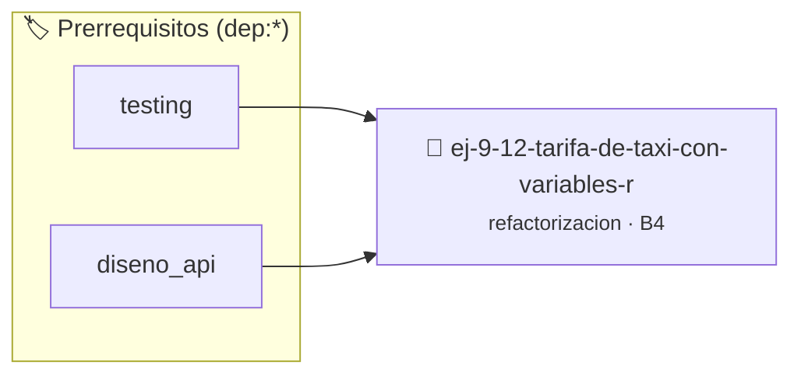

# Tarifa de Taxi con Variables Reutilizadas
> **ID:** `ej-9-12-tarifa-de-taxi-con-variables-r`
 · **Tema:** `refactorizacion`
 · **Bloom:** B4 (Analizar)
 · **Carga:** ~35 min
>
> **🏷️ Prerrequisitos temáticos (tags):** `dep:testing`, `dep:diseno_api`
>
> **Etiquetas conceptuales:** `clean_code`, `reutilizadas`, `refactorizacion`, `variables`, `fundamentos`


::: {admonition} 📦 Paquete de Verificación Local (Ripley)
:class: tip

Para compilar, resolver y autoevaluar tu entrega con pruebas unitarias en tu máquina:

- [📥 **Descargar paquete `ej-9-12-tarifa-de-taxi-con-variables-r.ripkg`**](../../paquetes/ej-9-12-tarifa-de-taxi-con-variables-r.ripkg)

Ejecución con el asistente de cátedra:
```bash
ripley run ej-9-12-tarifa-de-taxi-con-variables-r.ripkg
```
:::


### 🗺️ Itinerario Pedagógico




## 📖 Consigna

### Ejercicio 9.12 - Tarifa de Taxi con Variables Reutilizadas ⭐⭐☆☆☆

:::{exercise}
:label: ej-ref-tarifa-taxi
Analizá qué hace la variable `t` en el siguiente fragmento y refactorizá el
cálculo declarando variables de propósito único y constantes claras:

```{code-block} c
:linenos:
double calc(double k, int n)
{
    double t = 150.0; // Bajada de bandera
    if (k > 0) t += k * 80.0;
    if (n == 1) t = t * 1.20; // Recargo nocturno
    return t;
}

```
<!-- {code-block} c -->

-   **[*plus ultra*]:** Validar que la distancia `k` no sea negativa.
-   **[*plus ultra*]:** Documentar el cálculo con Doxygen.

:::
<!-- {exercise} -->

:::{solution} ej-ref-tarifa-taxi
:class: dropdown
**Código Refactorizado:**
```{code-block} c
:linenos:
#include <assert.h>
#include <stdbool.h>

#define BAJADA_DE_BANDERA 150.0
#define COSTO_POR_KILOMETRO 80.0
#define FACTOR_RECARGO_NOCTURNO 1.20

double calcular_tarifa_taxi(double kilometros, bool es_tarifa_nocturna)
{
    if (kilometros < 0.0)
    {
        return -1.0;
    }
    double costo_distancia = kilometros * COSTO_POR_KILOMETRO;
    double subtotal = BAJADA_DE_BANDERA + costo_distancia;

    if (es_tarifa_nocturna)
    {
        return subtotal * FACTOR_RECARGO_NOCTURNO;
    }
    return subtotal;
}

void test_tarifa_taxi(void)
{
    assert(calcular_tarifa_taxi(10.0, false) == 950.0);
    assert(calcular_tarifa_taxi(10.0, true) == 1140.0);
    assert(calcular_tarifa_taxi(-5.0, false) == -1.0);
}

```
<!-- {code-block} c -->

:::
<!-- {solution} ej-ref-tarifa-taxi -->

---


## 📋 Prototipos y Cabecera (`ej-9-12-tarifa-de-taxi-con-variables-r.h`)

```{code-block} c
#ifndef EJERCICIO_EJ_9_12_TARIFA_DE_TAXI_CON_VARIABLES_R_H
#define EJERCICIO_EJ_9_12_TARIFA_DE_TAXI_CON_VARIABLES_R_H

#include <stddef.h>
#include <stdbool.h>
#include <stdint.h>

/* Operación calc */
double calc(double k, int n);

#endif /* EJERCICIO_EJ_9_12_TARIFA_DE_TAXI_CON_VARIABLES_R_H */
```


## ⚙️ Especificación de Funciones

| Función | Retorno | Parámetros | Descripción |
| :--- | :--- | :--- | :--- |

| `calc` | `double` | `double k, int n` | Operación calc |


## 🧪 Casos de Prueba

| Prueba Unitaria | Función Objetivo | Verificación |
| :--- | :--- | :--- |

| **test_calc_1** | `calc` | `/* Verificación unitaria de calc */ double res = calc(1, 2); (void)res; assert(true);` |


## ✓ Solución Modelo de Cátedra

```{dropdown} 🔍 Revelar solución canónica en C
:open: false

```{code-block} c
double calc(double k, int n)
{
    double t = 150.0; // Bajada de bandera
    if (k > 0) t += k * 80.0;
    if (n == 1) t = t * 1.20; // Recargo nocturno
    return t;
}

int main(void)
{
    return 0;
}
```
```
