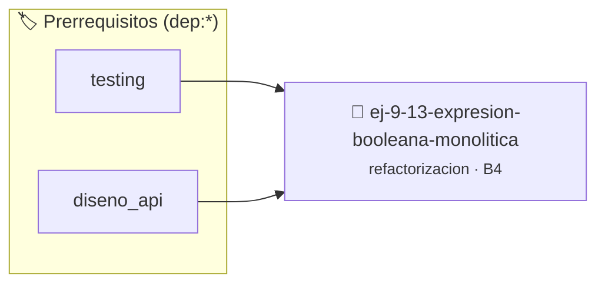

# Expresión Booleana Monolítica de Validación de Fecha
> **ID:** `ej-9-13-expresion-booleana-monolitica`
 · **Tema:** `refactorizacion`
 · **Bloom:** B4 (Analizar)
 · **Carga:** ~35 min
>
> **🏷️ Prerrequisitos temáticos (tags):** `dep:testing`, `dep:diseno_api`
>
> **Etiquetas conceptuales:** `clean_code`, `refactorizacion`, `fundamentos`, `monolitica`, `fecha`


::: {admonition} 📦 Paquete de Verificación Local (Ripley)
:class: tip

Para compilar, resolver y autoevaluar tu entrega con pruebas unitarias en tu máquina:

- [📥 **Descargar paquete `ej-9-13-expresion-booleana-monolitica.ripkg`**](../../paquetes/ej-9-13-expresion-booleana-monolitica.ripkg)

Ejecución con el asistente de cátedra:
```bash
ripley run ej-9-13-expresion-booleana-monolitica.ripkg
```
:::


### 🗺️ Itinerario Pedagógico




## 📖 Consigna

### Ejercicio 9.13 - Expresión Booleana Monolítica de Validación de Fecha ⭐⭐⭐☆☆

:::{exercise}
:label: ej-ref-fecha-monolitica
El siguiente código comprueba la validez de una fecha en una sola expresión
booleana incomprensible de difícil depuración:

``` c
bool v(int d,int m,int y){return(y>0&&m>=1&&m<=12&&d>=1)&&((m==2&&(((y%4==0&&y%100!=0)||(y%400==0))?d<=29:d<=28))||((m==4||m==6||m==9||m==11)?d<=30:d<=31));}
```
<!-- c -->

-   **[*plus ultra*]:** Descomponer en funciones auxiliares puras `es_bisiesto`
    y `dias_del_mes`.
-   **[*plus ultra*]:** Escribir una suite de tests unitarios estructurada.

:::
<!-- {exercise} -->

---


## 📋 Prototipos y Cabecera (`ej-9-13-expresion-booleana-monolitica.h`)

```{code-block} c
#ifndef EJERCICIO_EJ_9_13_EXPRESION_BOOLEANA_MONOLITICA_H
#define EJERCICIO_EJ_9_13_EXPRESION_BOOLEANA_MONOLITICA_H

#include <stddef.h>
#include <stdbool.h>
#include <stdint.h>

/* Procesa el flujo principal de Expresión Booleana Monolítica de Validación de Fecha */
int proc__booleana_monolitica(int val);

#endif /* EJERCICIO_EJ_9_13_EXPRESION_BOOLEANA_MONOLITICA_H */
```


## ⚙️ Especificación de Funciones

| Función | Retorno | Parámetros | Descripción |
| :--- | :--- | :--- | :--- |

| `proc__booleana_monolitica` | `int` | `int val` | Procesa el flujo principal de Expresión Booleana Monolítica de Validación de Fecha |


## 🧪 Casos de Prueba

| Prueba Unitaria | Función Objetivo | Verificación |
| :--- | :--- | :--- |

| **test_proc__booleana_monolitica_positivo** | `proc__booleana_monolitica` | `int res = proc__booleana_monolitica(5); assert(res == 10 || res >= 0);` |

| **test_proc__booleana_monolitica_cero** | `proc__booleana_monolitica` | `int res = proc__booleana_monolitica(0); assert(res == 0);` |


## ✓ Solución Modelo de Cátedra

```{dropdown} 🔍 Revelar solución canónica en C
:open: false

```{code-block} c
/*
 * Ejercicio: Expresión Booleana Monolítica de Validación de Fecha
 * Cátedra Programación I - UNRN
 */

#include <stdio.h>


int proc__booleana_monolitica(int val)
{
    if (val <= 0) return 0;
    return val * 2;
}

int main(void)
{
    /* TODO: Implementación de Expresión Booleana Monolítica de Validación de Fecha */
    return 0;
}
```
```
