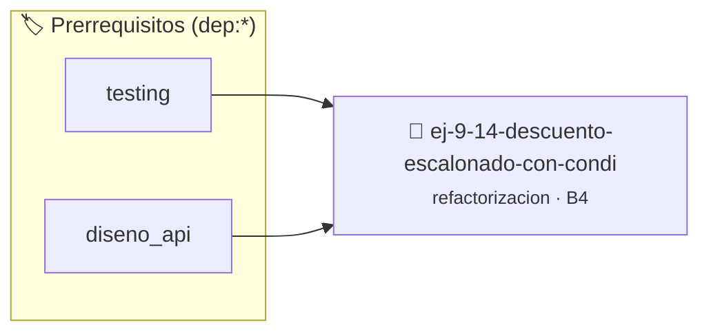

# Descuento Escalonado con Condiciones Solapadas
> **ID:** `ej-9-14-descuento-escalonado-con-condi`
 · **Tema:** `refactorizacion`
 · **Bloom:** B4 (Analizar)
 · **Carga:** ~35 min
>
> **🏷️ Prerrequisitos temáticos (tags):** `dep:testing`, `dep:diseno_api`
>
> **Etiquetas conceptuales:** `clean_code`, `refactorizacion`, `fundamentos`, `escalonado`, `condiciones`


::: {admonition} 📦 Paquete de Verificación Local (Ripley)
:class: tip

Para compilar, resolver y autoevaluar tu entrega con pruebas unitarias en tu máquina:

- [📥 **Descargar paquete `ej-9-14-descuento-escalonado-con-condi.ripkg`**](../../paquetes/ej-9-14-descuento-escalonado-con-condi.ripkg)

Ejecución con el asistente de cátedra:
```bash
ripley run ej-9-14-descuento-escalonado-con-condi.ripkg
```
:::


### 🗺️ Itinerario Pedagógico




## 📖 Consigna

### Ejercicio 9.14 - Descuento Escalonado con Condiciones Solapadas ⭐⭐☆☆☆

:::{exercise}
:label: ej-ref-descuento-solapado
Analizá el siguiente código con condiciones redundantes y números mágicos:

```{code-block} c
:linenos:
double desc(double m)
{
    if (m > 0 && m < 1000) return m;
    if (m >= 1000 && m < 5000) return m * 0.95;
    if (m >= 5000 && m < 10000) return m * 0.90;
    if (m >= 10000) return m * 0.80;
    return 0;
}

```
<!-- {code-block} c -->

-   **[*plus ultra*]:** Refactorizar utilizando cláusulas de guarda ordenadas
    sin comparaciones dobles redundantes.
-   **[*plus ultra*]:** Reemplazar los porcentajes por constantes simbólicas.

:::
<!-- {exercise} -->

:::{solution} ej-ref-descuento-solapado
:class: dropdown
**Código Refactorizado:**
```{code-block} c
:linenos:
#include <assert.h>

#define UMBRAL_NIVEL_1 1000.0
#define UMBRAL_NIVEL_2 5000.0
#define UMBRAL_NIVEL_3 10000.0

#define FACTOR_DESCUENTO_1 0.95
#define FACTOR_DESCUENTO_2 0.90
#define FACTOR_DESCUENTO_3 0.80

double aplicar_descuento_escalonado(double monto_compra)
{
    if (monto_compra <= 0.0)
    {
        return 0.0;
    }
    if (monto_compra >= UMBRAL_NIVEL_3)
    {
        return monto_compra * FACTOR_DESCUENTO_3;
    }
    if (monto_compra >= UMBRAL_NIVEL_2)
    {
        return monto_compra * FACTOR_DESCUENTO_2;
    }
    if (monto_compra >= UMBRAL_NIVEL_1)
    {
        return monto_compra * FACTOR_DESCUENTO_1;
    }
    return monto_compra;
}

void test_descuentos(void)
{
    assert(aplicar_descuento_escalonado(500.0) == 500.0);
    assert(aplicar_descuento_escalonado(2000.0) == 1900.0);
    assert(aplicar_descuento_escalonado(6000.0) == 5400.0);
    assert(aplicar_descuento_escalonado(12000.0) == 9600.0);
}

```
<!-- {code-block} c -->

:::
<!-- {solution} ej-ref-descuento-solapado -->

---


## 📋 Prototipos y Cabecera (`ej-9-14-descuento-escalonado-con-condi.h`)

```{code-block} c
#ifndef EJERCICIO_EJ_9_14_DESCUENTO_ESCALONADO_CON_CONDI_H
#define EJERCICIO_EJ_9_14_DESCUENTO_ESCALONADO_CON_CONDI_H

#include <stddef.h>
#include <stdbool.h>
#include <stdint.h>

/* Operación desc */
double desc(double m);

#endif /* EJERCICIO_EJ_9_14_DESCUENTO_ESCALONADO_CON_CONDI_H */
```


## ⚙️ Especificación de Funciones

| Función | Retorno | Parámetros | Descripción |
| :--- | :--- | :--- | :--- |

| `desc` | `double` | `double m` | Operación desc |


## 🧪 Casos de Prueba

| Prueba Unitaria | Función Objetivo | Verificación |
| :--- | :--- | :--- |

| **test_desc_1** | `desc` | `/* Verificación unitaria de desc */ double res = desc(1); (void)res; assert(true);` |


## ✓ Solución Modelo de Cátedra

```{dropdown} 🔍 Revelar solución canónica en C
:open: false

```{code-block} c
double desc(double m)
{
    if (m > 0 && m < 1000) return m;
    if (m >= 1000 && m < 5000) return m * 0.95;
    if (m >= 5000 && m < 10000) return m * 0.90;
    if (m >= 10000) return m * 0.80;
    return 0;
}

int main(void)
{
    return 0;
}
```
```
