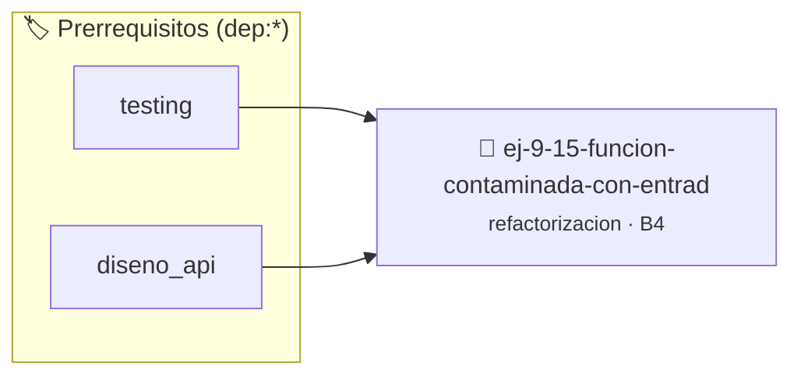

# Función Contaminada con Entrada/Salida
> **ID:** `ej-9-15-funcion-contaminada-con-entrad` · **Unidad:** 5 (Ingeniería de Software y Calidad en C)
 · **Tema:** `refactorizacion` / `clean_code`
 · **Bloom:** B4 (Analizar) · **Dificultad:** Avanzada
 · **Carga:** ~35 min · **Tipo:** Practica Guiada
>
> **🏷️ Prerrequisitos temáticos (tags):** `dep:testing`, `dep:diseno_api`
>
> **Etiquetas conceptuales:** `clean_code`, `refactorizacion`, `fundamentos`, `funcion`, `contaminada`


::: {admonition} 📦 Paquete de Verificación Local (Ripley)
:class: tip

Para compilar, resolver y autoevaluar tu entrega con pruebas unitarias en tu máquina:

- [📥 **Descargar paquete `ej-9-15-funcion-contaminada-con-entrad.ripkg`**](../../paquetes/ej-9-15-funcion-contaminada-con-entrad.ripkg)

Ejecución con el asistente de cátedra:
```bash
ripley run ej-9-15-funcion-contaminada-con-entrad.ripkg
```
:::


### 🗺️ Itinerario Pedagógico




## 📖 Consigna

:::{exercise}
:label: ej-ref-contaminada-io
La siguiente función viola la [Regla
0x2002h](../../reglas/2_funciones.md#0x2002h) porque realiza `printf` adentro
del cálculo. Refactorizala para que sea una función pura y testeable:

```{code-block} c
:linenos:
#include <stdio.h>

void clasificar_temperatura_ambiente(double temp)
{
    if (temp < 10.0)
    {
        printf("Hace frio\n");
    }
    else if (temp <= 25.0)
    {
        printf("Templado\n");
    }
    else
    {
        printf("Caluroso\n");
    }
}

```

-   **[*plus ultra*]:** Retornar un `enum` o código entero descriptivo.
-   **[*plus ultra*]:** Escribir tests unitarios con `assert()`.

:::

:::{solution} ej-ref-contaminada-io
:class: dropdown
**Código Refactorizado:**
```{code-block} c
:linenos:
#include <assert.h>

typedef enum
{
    CLIMA_FRIO,
    CLIMA_TEMPLADO,
    CLIMA_CALUROSO
} tipo_clima_t;

tipo_clima_t clasificar_temperatura(double temperatura_celsius)
{
    if (temperatura_celsius < 10.0)
    {
        return CLIMA_FRIO;
    }
    if (temperatura_celsius <= 25.0)
    {
        return CLIMA_TEMPLADO;
    }
    return CLIMA_CALUROSO;
}

void test_clasificar_clima(void)
{
    assert(clasificar_temperatura(5.0) == CLIMA_FRIO);
    assert(clasificar_temperatura(18.0) == CLIMA_TEMPLADO);
    assert(clasificar_temperatura(30.0) == CLIMA_CALUROSO);
}

```

:::

---

### 📋 Contrato de las Funciones

```c
/*
 * Operación clasificar_temperatura_ambiente
 * Precondiciones: Parámetros dentro del dominio válido de la operación.
 * Postcondiciones: Retorna el valor procesado.
 */
void clasificar_temperatura_ambiente(double temp);

```

### 🧪 Ejemplos de Ejecución

::::{tab-set}
:::{tab-item} Valor positivo
```text
Entrada: 1
Salida / Retorno: 2
```
:::
::::

### ⚠️ Precondiciones y Casos Borde

1. **Valores fuera de rango:** Verificar siempre que los datos de entrada cumplan con los rangos admisibles antes de operar.
6. **Casos vacíos o neutros:** Contemplar adecuadamente entradas con longitud cero o valores neutros según corresponda.

### 🎯 Criterios de Aceptación

- [ ] El código compila limpiamente bajo estándar C11 sin warnings con flags estrictos (`-Wall -Wextra -Werror`).
- [ ] Se satisfacen todas las pruebas unitarias y casos de prueba provistos.
- [ ] Las funciones validan exhaustivamente sus precondiciones y gestionan casos borde de forma robusta.


## 📋 Prototipos y Cabecera (`ej-9-15-funcion-contaminada-con-entrad.h`)

```{code-block} c
#ifndef EJERCICIO_EJ_9_15_FUNCION_CONTAMINADA_CON_ENTRAD_H
#define EJERCICIO_EJ_9_15_FUNCION_CONTAMINADA_CON_ENTRAD_H

#include <stddef.h>
#include <stdbool.h>
#include <stdint.h>

/* Operación clasificar_temperatura_ambiente */
void clasificar_temperatura_ambiente(double temp);

#endif /* EJERCICIO_EJ_9_15_FUNCION_CONTAMINADA_CON_ENTRAD_H */
```


## ⚙️ Especificación de Funciones

| Función | Retorno | Parámetros | Descripción |
| :--- | :--- | :--- | :--- |

| `clasificar_temperatura_ambiente` | `void` | `double temp` | Operación clasificar_temperatura_ambiente |


## 🧪 Casos de Prueba

| Prueba Unitaria | Función Objetivo | Verificación |
| :--- | :--- | :--- |

| **test_clasificar_temperatura_ambiente_1** | `clasificar_temperatura_ambiente` | `/* Verificación unitaria de clasificar_temperatura_ambiente */ clasificar_temperatura_ambiente(1); assert(true);` |


## ✓ Solución Modelo de Cátedra

```{dropdown} 🔍 Revelar solución canónica en C
:open: false

```{code-block} c
#include <stdio.h>

void clasificar_temperatura_ambiente(double temp)
{
    if (temp < 10.0)
    {
        printf("Hace frio\n");
    }
    else if (temp <= 25.0)
    {
        printf("Templado\n");
    }
    else
    {
        printf("Caluroso\n");
    }
}

int main(void)
{
    return 0;
}
```
```
