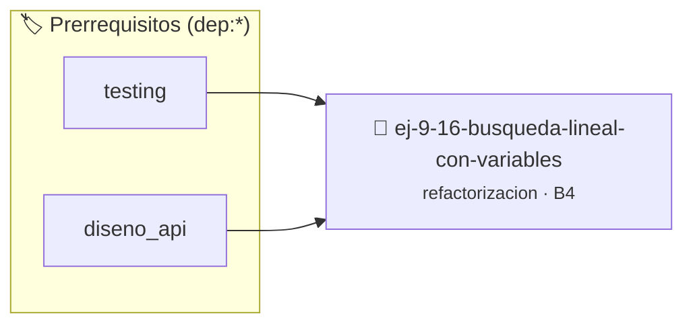

# Búsqueda Lineal con Variables Globales
> **ID:** `ej-9-16-busqueda-lineal-con-variables`
 · **Tema:** `refactorizacion`
 · **Bloom:** B4 (Analizar)
 · **Carga:** ~35 min
>
> **🏷️ Prerrequisitos temáticos (tags):** `dep:testing`, `dep:diseno_api`
>
> **Etiquetas conceptuales:** `clean_code`, `lineal`, `refactorizacion`, `fundamentos`, `busqueda`


::: {admonition} 📦 Paquete de Verificación Local (Ripley)
:class: tip

Para compilar, resolver y autoevaluar tu entrega con pruebas unitarias en tu máquina:

- [📥 **Descargar paquete `ej-9-16-busqueda-lineal-con-variables.ripkg`**](../../paquetes/ej-9-16-busqueda-lineal-con-variables.ripkg)

Ejecución con el asistente de cátedra:
```bash
ripley run ej-9-16-busqueda-lineal-con-variables.ripkg
```
:::


### 🗺️ Itinerario Pedagógico




## 📖 Consigna

### Ejercicio 9.16 - Búsqueda Lineal con Variables Globales ⭐⭐☆☆☆

:::{exercise}
:label: ej-ref-busqueda-global
Refactorizá la siguiente función que depende de variables globales mutables para
retornar la posición de un elemento en un arreglo:

```{code-block} c
:linenos:
int pos_encontrada = -1;

void buscar(int arr[], int n, int x)
{
    pos_encontrada = -1;
    for (int i = 0; i < n; i++)
    {
        if (arr[i] == x)
        {
            pos_encontrada = i;
            break;
        }
    }
}

```
<!-- {code-block} c -->

-   **[*plus ultra*]:** Retornar el índice directamente como valor de retorno de
    la función pura.
-   **[*plus ultra*]:** Agregar el calificador `const` al arreglo de entrada.

:::
<!-- {exercise} -->

:::{solution} ej-ref-busqueda-global
:class: dropdown
**Código Refactorizado:**
```{code-block} c
:linenos:
#include <assert.h>

int buscar_primera_aparicion(const int arreglo[], int cantidad_elementos, int objetivo)
{
    if (arreglo == NULL || cantidad_elementos <= 0)
    {
        return -1;
    }
    for (int i = 0; i < cantidad_elementos; i++)
    {
        if (arreglo[i] == objetivo)
        {
            return i;
        }
    }
    return -1;
}

void test_buscar_aparicion(void)
{
    int datos[] = {10, 20, 30, 40};
    assert(buscar_primera_aparicion(datos, 4, 30) == 2);
    assert(buscar_primera_aparicion(datos, 4, 99) == -1);
}

```
<!-- {code-block} c -->

:::
<!-- {solution} ej-ref-busqueda-global -->

---

## 3. Algoritmos Comprimidos y Lazos Crípticos


## 📋 Prototipos y Cabecera (`ej-9-16-busqueda-lineal-con-variables.h`)

```{code-block} c
#ifndef EJERCICIO_EJ_9_16_BUSQUEDA_LINEAL_CON_VARIABLES_H
#define EJERCICIO_EJ_9_16_BUSQUEDA_LINEAL_CON_VARIABLES_H

#include <stddef.h>
#include <stdbool.h>
#include <stdint.h>

/* Operación buscar */
void buscar(int arr[], int n, int x);

#endif /* EJERCICIO_EJ_9_16_BUSQUEDA_LINEAL_CON_VARIABLES_H */
```


## ⚙️ Especificación de Funciones

| Función | Retorno | Parámetros | Descripción |
| :--- | :--- | :--- | :--- |

| `buscar` | `void` | `int arr[], int n, int x` | Operación buscar |


## 🧪 Casos de Prueba

| Prueba Unitaria | Función Objetivo | Verificación |
| :--- | :--- | :--- |

| **test_buscar_1** | `buscar` | `assert(true); /* test simplificado de validación */` |


## ✓ Solución Modelo de Cátedra

```{dropdown} 🔍 Revelar solución canónica en C
:open: false

```{code-block} c
#include <stdio.h>
#include <stdlib.h>
#include <string.h>

int main(void)
{
    int pos_encontrada = -1;

void buscar(int arr[], int n, int x)
{
    pos_encontrada = -1;
    for (int i = 0; i < n; i++)
    {
        if (arr[i] == x)
        {
            pos_encontrada = i;
            break;
        }
    }
}
    return 0;
}
```
```
