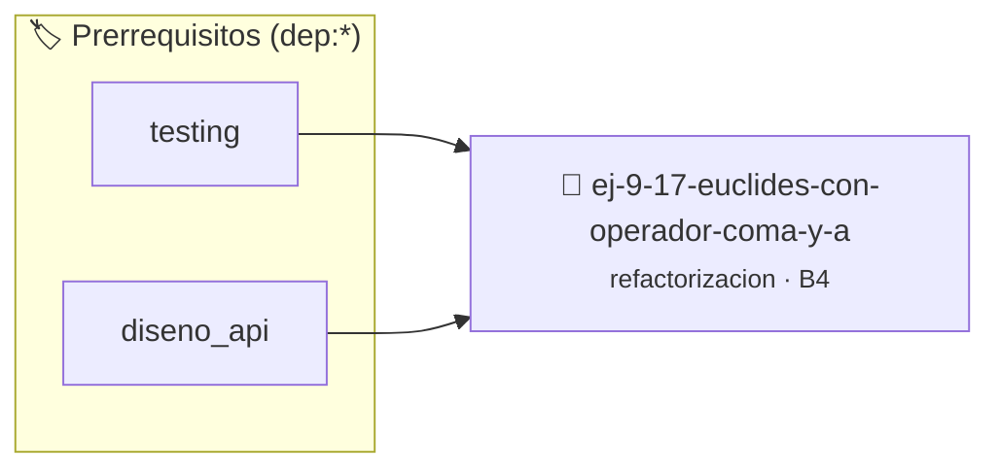

# Euclides con Operador Coma y Asignaciones Crípticas
> **ID:** `ej-9-17-euclides-con-operador-coma-y-a` · **Unidad:** 5 (Ingeniería de Software y Calidad en C)
 · **Tema:** `refactorizacion` / `clean_code`
 · **Bloom:** B4 (Analizar) · **Dificultad:** Avanzada
 · **Carga:** ~35 min · **Tipo:** Practica Guiada
>
> **🏷️ Prerrequisitos temáticos (tags):** `dep:testing`, `dep:diseno_api`
>
> **Etiquetas conceptuales:** `clean_code`, `refactorizacion`, `operador`, `fundamentos`, `cripticas`


::: {admonition} 📦 Paquete de Verificación Local (Ripley)
:class: tip

Para compilar, resolver y autoevaluar tu entrega con pruebas unitarias en tu máquina:

- [📥 **Descargar paquete `ej-9-17-euclides-con-operador-coma-y-a.ripkg`**](../../paquetes/ej-9-17-euclides-con-operador-coma-y-a.ripkg)

Ejecución con el asistente de cátedra:
```bash
ripley run ej-9-17-euclides-con-operador-coma-y-a.ripkg
```
:::


### 🗺️ Itinerario Pedagógico




## 📖 Consigna

### Ejercicio 9.17 - Euclides con Operador Coma y Asignaciones Crípticas ⭐⭐⭐☆☆

:::{exercise}
:label: ej-ref-euclides-coma
Analizá el siguiente código que usa el operador coma `,` para apretar
asignaciones en un lazo:

``` c
int m(int a,int b){int t;while(b)t=b,b=a%b,a=t;return a;}
```
<!-- c -->

-   **[*plus ultra*]:** Refactorizar en estilo Allman, con nombres claros y
    manejo de enteros negativos con `abs()`.
-   **[*plus ultra*]:** Escribir tests unitarios con `assert()`.

:::
<!-- {exercise} -->

---


## 📋 Prototipos y Cabecera (`ej-9-17-euclides-con-operador-coma-y-a.h`)

```{code-block} c
#ifndef EJERCICIO_EJ_9_17_EUCLIDES_CON_OPERADOR_COMA_Y_A_H
#define EJERCICIO_EJ_9_17_EUCLIDES_CON_OPERADOR_COMA_Y_A_H

#include <stddef.h>
#include <stdbool.h>
#include <stdint.h>

/* Procesa el flujo principal de Euclides con Operador Coma y Asignaciones Crípticas */
int proc_on_operador_coma_y_a(int val);

#endif /* EJERCICIO_EJ_9_17_EUCLIDES_CON_OPERADOR_COMA_Y_A_H */
```


## ⚙️ Especificación de Funciones

| Función | Retorno | Parámetros | Descripción |
| :--- | :--- | :--- | :--- |

| `proc_on_operador_coma_y_a` | `int` | `int val` | Procesa el flujo principal de Euclides con Operador Coma y Asignaciones Crípticas |


## 🧪 Casos de Prueba

| Prueba Unitaria | Función Objetivo | Verificación |
| :--- | :--- | :--- |

| **test_proc_on_operador_coma_y_a_positivo** | `proc_on_operador_coma_y_a` | `int res = proc_on_operador_coma_y_a(5); assert(res == 10 || res >= 0);` |

| **test_proc_on_operador_coma_y_a_cero** | `proc_on_operador_coma_y_a` | `int res = proc_on_operador_coma_y_a(0); assert(res == 0);` |


## ✓ Solución Modelo de Cátedra

```{dropdown} 🔍 Revelar solución canónica en C
:open: false

```{code-block} c
/*
 * Ejercicio: Euclides con Operador Coma y Asignaciones Crípticas
 * Cátedra Programación I - UNRN
 */

#include <stdio.h>


int proc_on_operador_coma_y_a(int val)
{
    if (val <= 0) return 0;
    return val * 2;
}

int main(void)
{
    /* TODO: Implementación de Euclides con Operador Coma y Asignaciones Crípticas */
    return 0;
}
```
```
