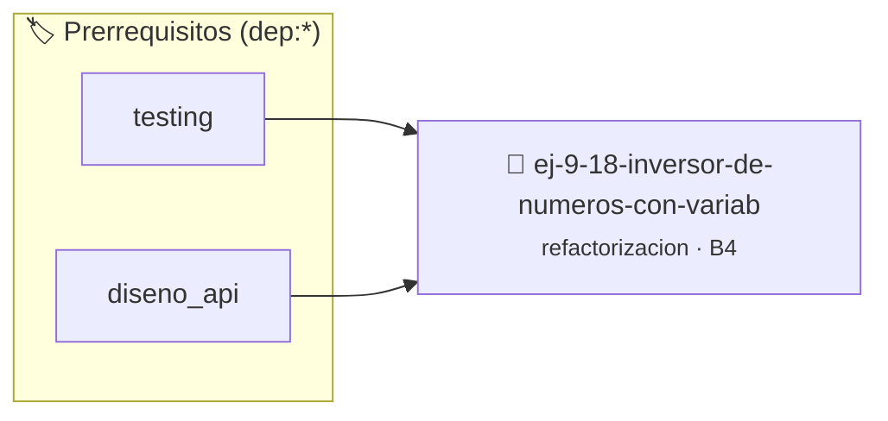

# Inversor de Números con Variables Reutilizadas
> **ID:** `ej-9-18-inversor-de-numeros-con-variab`
 · **Tema:** `refactorizacion`
 · **Bloom:** B4 (Analizar)
 · **Carga:** ~35 min
>
> **🏷️ Prerrequisitos temáticos (tags):** `dep:testing`, `dep:diseno_api`
>
> **Etiquetas conceptuales:** `clean_code`, `reutilizadas`, `refactorizacion`, `fundamentos`, `variables`


::: {admonition} 📦 Paquete de Verificación Local (Ripley)
:class: tip

Para compilar, resolver y autoevaluar tu entrega con pruebas unitarias en tu máquina:

- [📥 **Descargar paquete `ej-9-18-inversor-de-numeros-con-variab.ripkg`**](../../paquetes/ej-9-18-inversor-de-numeros-con-variab.ripkg)

Ejecución con el asistente de cátedra:
```bash
ripley run ej-9-18-inversor-de-numeros-con-variab.ripkg
```
:::


### 🗺️ Itinerario Pedagógico




## 📖 Consigna

### Ejercicio 9.18 - Inversor de Números con Variables Reutilizadas ⭐⭐☆☆☆

:::{exercise}
:label: ej-ref-inversor-reutilizado
Descubrí el algoritmo y refactorizalo:

``` c
int inv(int x){int r=0;while(x>0){r=r*10+x%10;x=x/10;}return r;}
```
<!-- c -->

-   **[*plus ultra*]:** Manejar números negativos conservando su signo.
-   **[*plus ultra*]:** Comprobar palíndromos numéricos reutilizando esta
    función.

:::
<!-- {exercise} -->

:::{solution} ej-ref-inversor-reutilizado
:class: dropdown
**Código Refactorizado:**
```{code-block} c
:linenos:
#include <assert.h>
#include <stdlib.h>

int invertir_numero_entero(int numero)
{
    int signo = (numero < 0) ? -1 : 1;
    int n = abs(numero);
    int invertido = 0;

    while (n > 0)
    {
        invertido = (invertido * 10) + (n % 10);
        n /= 10;
    }
    return invertido * signo;
}

void test_invertir_numero(void)
{
    assert(invertir_numero_entero(1234) == 4321);
    assert(invertir_numero_entero(-580) == -85);
    assert(invertir_numero_entero(0) == 0);
}

```
<!-- {code-block} c -->

:::
<!-- {solution} ej-ref-inversor-reutilizado -->

---


## 📋 Prototipos y Cabecera (`ej-9-18-inversor-de-numeros-con-variab.h`)

```{code-block} c
#ifndef EJERCICIO_EJ_9_18_INVERSOR_DE_NUMEROS_CON_VARIAB_H
#define EJERCICIO_EJ_9_18_INVERSOR_DE_NUMEROS_CON_VARIAB_H

#include <stddef.h>
#include <stdbool.h>
#include <stdint.h>

/* Operación invertir_numero_entero */
int invertir_numero_entero(int numero);
/* Operación test_invertir_numero */
void test_invertir_numero(void);

#endif /* EJERCICIO_EJ_9_18_INVERSOR_DE_NUMEROS_CON_VARIAB_H */
```


## ⚙️ Especificación de Funciones

| Función | Retorno | Parámetros | Descripción |
| :--- | :--- | :--- | :--- |

| `invertir_numero_entero` | `int` | `int numero` | Operación invertir_numero_entero |

| `test_invertir_numero` | `void` | `void` | Operación test_invertir_numero |


## 🧪 Casos de Prueba

| Prueba Unitaria | Función Objetivo | Verificación |
| :--- | :--- | :--- |

| **test_invertir_numero_entero_1** | `invertir_numero_entero` | `/* Verificación unitaria de invertir_numero_entero */ int res = invertir_numero_entero(1); (void)res; assert(true);` |

| **test_test_invertir_numero_2** | `test_invertir_numero` | `/* Verificación unitaria de test_invertir_numero */ test_invertir_numero(); assert(true);` |


## ✓ Solución Modelo de Cátedra

```{dropdown} 🔍 Revelar solución canónica en C
:open: false

```{code-block} c
#include <assert.h>
#include <stdlib.h>

int invertir_numero_entero(int numero)
{
    int signo = (numero < 0) ? -1 : 1;
    int n = abs(numero);
    int invertido = 0;

    while (n > 0)
    {
        invertido = (invertido * 10) + (n % 10);
        n /= 10;
    }
    return invertido * signo;
}

void test_invertir_numero(void)
{
    assert(invertir_numero_entero(1234) == 4321);
    assert(invertir_numero_entero(-580) == -85);
    assert(invertir_numero_entero(0) == 0);
}

int main(void)
{
    return 0;
}
```
```
