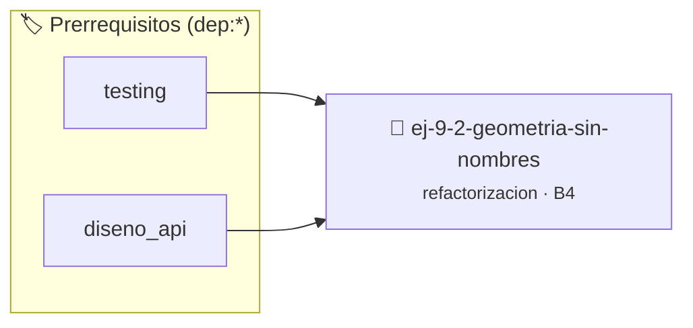

# Geometría sin Nombres
> **ID:** `ej-9-2-geometria-sin-nombres` · **Unidad:** 5 (Ingeniería de Software y Calidad en C)
 · **Tema:** `refactorizacion` / `clean_code`
 · **Bloom:** B4 (Analizar) · **Dificultad:** Avanzada
 · **Carga:** ~35 min · **Tipo:** Practica Guiada
>
> **🏷️ Prerrequisitos temáticos (tags):** `dep:testing`, `dep:diseno_api`
>
> **Etiquetas conceptuales:** `clean_code`, `nombres`, `refactorizacion`, `geometria`, `fundamentos`


::: {admonition} 📦 Paquete de Verificación Local (Ripley)
:class: tip

Para compilar, resolver y autoevaluar tu entrega con pruebas unitarias en tu máquina:

- [📥 **Descargar paquete `ej-9-2-geometria-sin-nombres.ripkg`**](../../paquetes/ej-9-2-geometria-sin-nombres.ripkg)

Ejecución con el asistente de cátedra:
```bash
ripley run ej-9-2-geometria-sin-nombres.ripkg
```
:::


### 🗺️ Itinerario Pedagógico




## 📖 Consigna

### Ejercicio 9.2 - Geometría sin Nombres ⭐☆☆☆☆

:::{exercise}
:label: ej-ref-area-triangulo
Descifrá el propósito geométrico del siguiente fragmento y refactorizalo:

``` c
double x(double a,double b){return a*b/2.0;}
```
<!-- c -->

-   **[*plus ultra*]:** Validar que las dimensiones sean estrictamente positivas
    retornando `-1.0` si son inválidas.
-   **[*plus ultra*]:** Documentar con etiquetas Doxygen (`@param`, `@pre`,
    `@returns`).

:::
<!-- {exercise} -->

:::{solution} ej-ref-area-triangulo
:class: dropdown
**Diagnóstico:** Calcula el área de un triángulo con base `a` y altura `b`. No
valida dimensiones no positivas.

**Código Refactorizado:**
```{code-block} c
:linenos:
#include <assert.h>

double calcular_area_triangulo(double base, double altura)
{
    if (base <= 0.0 || altura <= 0.0)
    {
        return -1.0;
    }
    return (base * altura) / 2.0;
}

void test_area_triangulo(void)
{
    assert(calcular_area_triangulo(10.0, 5.0) == 25.0);
    assert(calcular_area_triangulo(-2.0, 5.0) == -1.0);
}

```
<!-- {code-block} c -->

:::
<!-- {solution} ej-ref-area-triangulo -->

---


## 📋 Prototipos y Cabecera (`ej-9-2-geometria-sin-nombres.h`)

```{code-block} c
#ifndef EJERCICIO_EJ_9_2_GEOMETRIA_SIN_NOMBRES_H
#define EJERCICIO_EJ_9_2_GEOMETRIA_SIN_NOMBRES_H

#include <stddef.h>
#include <stdbool.h>
#include <stdint.h>

/* Operación calcular_area_triangulo */
double calcular_area_triangulo(double base, double altura);
/* Operación test_area_triangulo */
void test_area_triangulo(void);

#endif /* EJERCICIO_EJ_9_2_GEOMETRIA_SIN_NOMBRES_H */
```


## ⚙️ Especificación de Funciones

| Función | Retorno | Parámetros | Descripción |
| :--- | :--- | :--- | :--- |

| `calcular_area_triangulo` | `double` | `double base, double altura` | Operación calcular_area_triangulo |

| `test_area_triangulo` | `void` | `void` | Operación test_area_triangulo |


## 🧪 Casos de Prueba

| Prueba Unitaria | Función Objetivo | Verificación |
| :--- | :--- | :--- |

| **test_calcular_area_triangulo_1** | `calcular_area_triangulo` | `/* Verificación unitaria de calcular_area_triangulo */ double res = calcular_area_triangulo(1, 2); (void)res; assert(true);` |

| **test_test_area_triangulo_2** | `test_area_triangulo` | `/* Verificación unitaria de test_area_triangulo */ test_area_triangulo(); assert(true);` |


## ✓ Solución Modelo de Cátedra

```{dropdown} 🔍 Revelar solución canónica en C
:open: false

```{code-block} c
#include <assert.h>

double calcular_area_triangulo(double base, double altura)
{
    if (base <= 0.0 || altura <= 0.0)
    {
        return -1.0;
    }
    return (base * altura) / 2.0;
}

void test_area_triangulo(void)
{
    assert(calcular_area_triangulo(10.0, 5.0) == 25.0);
    assert(calcular_area_triangulo(-2.0, 5.0) == -1.0);
}

int main(void)
{
    return 0;
}
```
```
