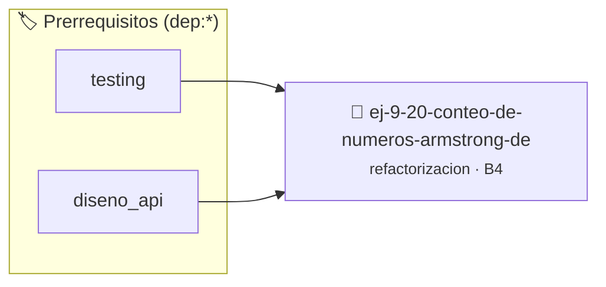

# Conteo de Números Armstrong Desordenado
> **ID:** `ej-9-20-conteo-de-numeros-armstrong-de` · **Unidad:** 5 (Ingeniería de Software y Calidad en C)
 · **Tema:** `refactorizacion` / `clean_code`
 · **Bloom:** B4 (Analizar) · **Dificultad:** Avanzada
 · **Carga:** ~35 min · **Tipo:** Practica Guiada
>
> **🏷️ Prerrequisitos temáticos (tags):** `dep:testing`, `dep:diseno_api`
>
> **Etiquetas conceptuales:** `clean_code`, `refactorizacion`, `fundamentos`, `armstrong`, `conteo`


::: {admonition} 📦 Paquete de Verificación Local (Ripley)
:class: tip

Para compilar, resolver y autoevaluar tu entrega con pruebas unitarias en tu máquina:

- [📥 **Descargar paquete `ej-9-20-conteo-de-numeros-armstrong-de.ripkg`**](../../paquetes/ej-9-20-conteo-de-numeros-armstrong-de.ripkg)

Ejecución con el asistente de cátedra:
```bash
ripley run ej-9-20-conteo-de-numeros-armstrong-de.ripkg
```
:::


### 🗺️ Itinerario Pedagógico




## 📖 Consigna

### Ejercicio 9.20 - Conteo de Números Armstrong Desordenado ⭐⭐⭐☆☆

:::{exercise}
:label: ej-ref-armstrong-desordenado
El siguiente código verifica si un número de 3 dígitos es igual a la suma del
cubo de sus dígitos, pero está escrito de forma ilegible:

``` c
int arm(int x){int a=x/100,b=(x/10)%10,c=x%10;return(a*a*a+b*b*b+c*c*c==x)?1:0;}
```
<!-- c -->

-   **[*plus ultra*]:** Eliminar el ternario `?:` y retornar un `bool`.
-   **[*plus ultra*]:** Generalizar para cualquier cantidad de dígitos mediante
    funciones auxiliares.

:::
<!-- {exercise} -->

---


## 📋 Prototipos y Cabecera (`ej-9-20-conteo-de-numeros-armstrong-de.h`)

```{code-block} c
#ifndef EJERCICIO_EJ_9_20_CONTEO_DE_NUMEROS_ARMSTRONG_DE_H
#define EJERCICIO_EJ_9_20_CONTEO_DE_NUMEROS_ARMSTRONG_DE_H

#include <stddef.h>
#include <stdbool.h>
#include <stdint.h>

/* Procesa el flujo principal de Conteo de Números Armstrong Desordenado */
int proc_numeros_armstrong_de(int val);

#endif /* EJERCICIO_EJ_9_20_CONTEO_DE_NUMEROS_ARMSTRONG_DE_H */
```


## ⚙️ Especificación de Funciones

| Función | Retorno | Parámetros | Descripción |
| :--- | :--- | :--- | :--- |

| `proc_numeros_armstrong_de` | `int` | `int val` | Procesa el flujo principal de Conteo de Números Armstrong Desordenado |


## 🧪 Casos de Prueba

| Prueba Unitaria | Función Objetivo | Verificación |
| :--- | :--- | :--- |

| **test_proc_numeros_armstrong_de_positivo** | `proc_numeros_armstrong_de` | `int res = proc_numeros_armstrong_de(5); assert(res == 10 || res >= 0);` |

| **test_proc_numeros_armstrong_de_cero** | `proc_numeros_armstrong_de` | `int res = proc_numeros_armstrong_de(0); assert(res == 0);` |


## ✓ Solución Modelo de Cátedra

```{dropdown} 🔍 Revelar solución canónica en C
:open: false

```{code-block} c
/*
 * Ejercicio: Conteo de Números Armstrong Desordenado
 * Cátedra Programación I - UNRN
 */

#include <stdio.h>


int proc_numeros_armstrong_de(int val)
{
    if (val <= 0) return 0;
    return val * 2;
}

int main(void)
{
    /* TODO: Implementación de Conteo de Números Armstrong Desordenado */
    return 0;
}
```
```
