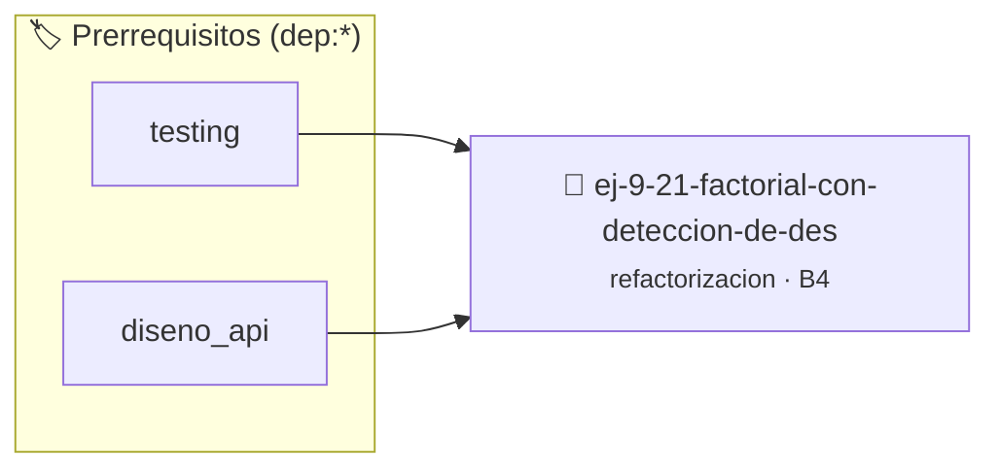

# Factorial con Detección de Desbordamiento Oculto
> **ID:** `ej-9-21-factorial-con-deteccion-de-des`
 · **Tema:** `refactorizacion`
 · **Bloom:** B4 (Analizar)
 · **Carga:** ~35 min
>
> **🏷️ Prerrequisitos temáticos (tags):** `dep:testing`, `dep:diseno_api`
>
> **Etiquetas conceptuales:** `clean_code`, `refactorizacion`, `fundamentos`, `oculto`, `desbordamiento`


::: {admonition} 📦 Paquete de Verificación Local (Ripley)
:class: tip

Para compilar, resolver y autoevaluar tu entrega con pruebas unitarias en tu máquina:

- [📥 **Descargar paquete `ej-9-21-factorial-con-deteccion-de-des.ripkg`**](../../paquetes/ej-9-21-factorial-con-deteccion-de-des.ripkg)

Ejecución con el asistente de cátedra:
```bash
ripley run ej-9-21-factorial-con-deteccion-de-des.ripkg
```
:::


### 🗺️ Itinerario Pedagógico




## 📖 Consigna

### Ejercicio 9.21 - Factorial con Detección de Desbordamiento Oculto ⭐⭐☆☆☆

:::{exercise}
:label: ej-ref-fact-desborde
Refactorizá la siguiente función de factorial:

``` c
long f(int n){if(n<0||n>20)return -1;long r=1;for(int i=2;i<=n;i++)r*=i;return r;}
```
<!-- c -->

-   **[*plus ultra*]:** Reemplazar el número mágico `20` por una constante
    descriptiva `#define MAX_FACTORIAL_LONG 20`.
-   **[*plus ultra*]:** Escribir tests unitarios con `assert()`.

:::
<!-- {exercise} -->

:::{solution} ej-ref-fact-desborde
:class: dropdown
**Código Refactorizado:**
```{code-block} c
:linenos:
#include <assert.h>

#define MAX_N_FACTORIAL_64BITS 20

long long calcular_factorial(int n)
{
    if (n < 0 || n > MAX_N_FACTORIAL_64BITS)
    {
        return -1;
    }
    long long resultado = 1;
    for (int factor = 2; factor <= n; factor++)
    {
        resultado *= factor;
    }
    return resultado;
}

void test_factorial(void)
{
    assert(calcular_factorial(0) == 1);
    assert(calcular_factorial(5) == 120);
    assert(calcular_factorial(21) == -1); // Error de desbordamiento
}

```
<!-- {code-block} c -->

:::
<!-- {solution} ej-ref-fact-desborde -->

---


## 📋 Prototipos y Cabecera (`ej-9-21-factorial-con-deteccion-de-des.h`)

```{code-block} c
#ifndef EJERCICIO_EJ_9_21_FACTORIAL_CON_DETECCION_DE_DES_H
#define EJERCICIO_EJ_9_21_FACTORIAL_CON_DETECCION_DE_DES_H

#include <stddef.h>
#include <stdbool.h>
#include <stdint.h>

/* Operación calcular_factorial */
long long calcular_factorial(int n);
/* Operación test_factorial */
void test_factorial(void);

#endif /* EJERCICIO_EJ_9_21_FACTORIAL_CON_DETECCION_DE_DES_H */
```


## ⚙️ Especificación de Funciones

| Función | Retorno | Parámetros | Descripción |
| :--- | :--- | :--- | :--- |

| `calcular_factorial` | `long long` | `int n` | Operación calcular_factorial |

| `test_factorial` | `void` | `void` | Operación test_factorial |


## 🧪 Casos de Prueba

| Prueba Unitaria | Función Objetivo | Verificación |
| :--- | :--- | :--- |

| **test_calcular_factorial_1** | `calcular_factorial` | `/* Verificación unitaria de calcular_factorial */ long long res = calcular_factorial(1); (void)res; assert(true);` |

| **test_test_factorial_2** | `test_factorial` | `/* Verificación unitaria de test_factorial */ test_factorial(); assert(true);` |


## ✓ Solución Modelo de Cátedra

```{dropdown} 🔍 Revelar solución canónica en C
:open: false

```{code-block} c
#include <assert.h>

#define MAX_N_FACTORIAL_64BITS 20

long long calcular_factorial(int n)
{
    if (n < 0 || n > MAX_N_FACTORIAL_64BITS)
    {
        return -1;
    }
    long long resultado = 1;
    for (int factor = 2; factor <= n; factor++)
    {
        resultado *= factor;
    }
    return resultado;
}

void test_factorial(void)
{
    assert(calcular_factorial(0) == 1);
    assert(calcular_factorial(5) == 120);
    assert(calcular_factorial(21) == -1); // Error de desbordamiento
}

int main(void)
{
    return 0;
}
```
```
