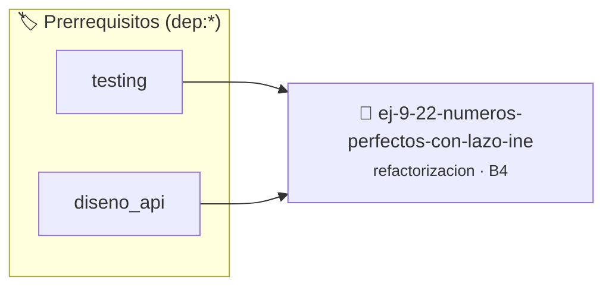

# Números Perfectos con Lazo Ineficiente
> **ID:** `ej-9-22-numeros-perfectos-con-lazo-ine` · **Unidad:** 5 (Ingeniería de Software y Calidad en C)
 · **Tema:** `refactorizacion` / `clean_code`
 · **Bloom:** B4 (Analizar) · **Dificultad:** Avanzada
 · **Carga:** ~35 min · **Tipo:** Practica Guiada
>
> **🏷️ Prerrequisitos temáticos (tags):** `dep:testing`, `dep:diseno_api`
>
> **Etiquetas conceptuales:** `clean_code`, `ineficiente`, `refactorizacion`, `fundamentos`, `numeros`


::: {admonition} 📦 Paquete de Verificación Local (Ripley)
:class: tip

Para compilar, resolver y autoevaluar tu entrega con pruebas unitarias en tu máquina:

- [📥 **Descargar paquete `ej-9-22-numeros-perfectos-con-lazo-ine.ripkg`**](../../paquetes/ej-9-22-numeros-perfectos-con-lazo-ine.ripkg)

Ejecución con el asistente de cátedra:
```bash
ripley run ej-9-22-numeros-perfectos-con-lazo-ine.ripkg
```
:::


### 🗺️ Itinerario Pedagógico




## 📖 Consigna

### Ejercicio 9.22 - Números Perfectos con Lazo Ineficiente ⭐⭐⭐☆☆

:::{exercise}
:label: ej-ref-perfecto-ineficiente
Refactorizá la siguiente función que verifica números perfectos (donde la suma
de divisores propios es igual al número):

``` c
int perf(int n){int s=0;for(int i=1;i<n;i++){if(n%i==0)s+=i;}return s==n;}
```
<!-- c -->

-   **[*plus ultra*]:** Optimizar sumando divisores en pares hasta $\sqrt{n}$.
-   **[*plus ultra*]:** Retornar un `bool` claro y documentar precondiciones.

:::
<!-- {exercise} -->

---


## 📋 Prototipos y Cabecera (`ej-9-22-numeros-perfectos-con-lazo-ine.h`)

```{code-block} c
#ifndef EJERCICIO_EJ_9_22_NUMEROS_PERFECTOS_CON_LAZO_INE_H
#define EJERCICIO_EJ_9_22_NUMEROS_PERFECTOS_CON_LAZO_INE_H

#include <stddef.h>
#include <stdbool.h>
#include <stdint.h>

/* Procesa el flujo principal de Números Perfectos con Lazo Ineficiente */
int proc_rfectos_con_lazo_ine(int val);

#endif /* EJERCICIO_EJ_9_22_NUMEROS_PERFECTOS_CON_LAZO_INE_H */
```


## ⚙️ Especificación de Funciones

| Función | Retorno | Parámetros | Descripción |
| :--- | :--- | :--- | :--- |

| `proc_rfectos_con_lazo_ine` | `int` | `int val` | Procesa el flujo principal de Números Perfectos con Lazo Ineficiente |


## 🧪 Casos de Prueba

| Prueba Unitaria | Función Objetivo | Verificación |
| :--- | :--- | :--- |

| **test_proc_rfectos_con_lazo_ine_positivo** | `proc_rfectos_con_lazo_ine` | `int res = proc_rfectos_con_lazo_ine(5); assert(res == 10 || res >= 0);` |

| **test_proc_rfectos_con_lazo_ine_cero** | `proc_rfectos_con_lazo_ine` | `int res = proc_rfectos_con_lazo_ine(0); assert(res == 0);` |


## ✓ Solución Modelo de Cátedra

```{dropdown} 🔍 Revelar solución canónica en C
:open: false

```{code-block} c
/*
 * Ejercicio: Números Perfectos con Lazo Ineficiente
 * Cátedra Programación I - UNRN
 */

#include <stdio.h>


int proc_rfectos_con_lazo_ine(int val)
{
    if (val <= 0) return 0;
    return val * 2;
}

int main(void)
{
    /* TODO: Implementación de Números Perfectos con Lazo Ineficiente */
    return 0;
}
```
```
