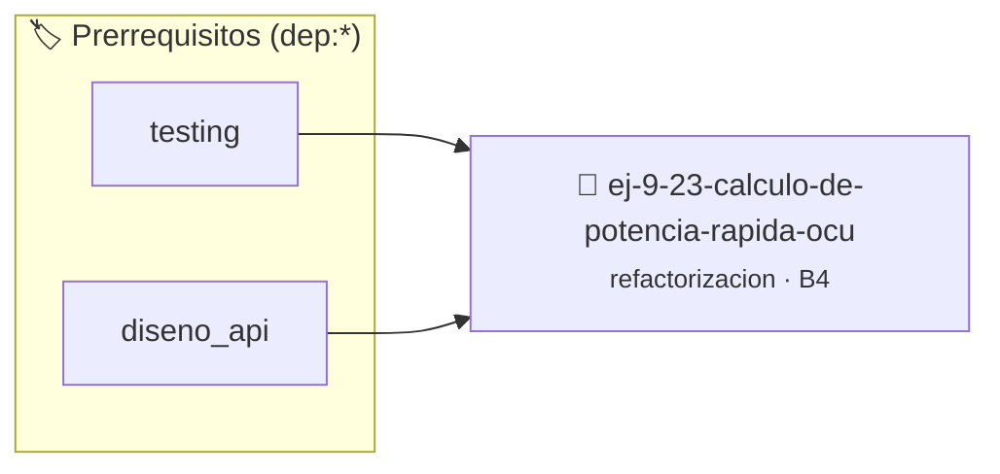

# Cálculo de Potencia Rápida Oculto
> **ID:** `ej-9-23-calculo-de-potencia-rapida-ocu`
 · **Tema:** `refactorizacion`
 · **Bloom:** B4 (Analizar)
 · **Carga:** ~35 min
>
> **🏷️ Prerrequisitos temáticos (tags):** `dep:testing`, `dep:diseno_api`
>
> **Etiquetas conceptuales:** `clean_code`, `refactorizacion`, `potencia`, `fundamentos`, `calculo`


::: {admonition} 📦 Paquete de Verificación Local (Ripley)
:class: tip

Para compilar, resolver y autoevaluar tu entrega con pruebas unitarias en tu máquina:

- [📥 **Descargar paquete `ej-9-23-calculo-de-potencia-rapida-ocu.ripkg`**](../../paquetes/ej-9-23-calculo-de-potencia-rapida-ocu.ripkg)

Ejecución con el asistente de cátedra:
```bash
ripley run ej-9-23-calculo-de-potencia-rapida-ocu.ripkg
```
:::


### 🗺️ Itinerario Pedagógico




## 📖 Consigna

### Ejercicio 9.23 - Cálculo de Potencia Rápida Oculto ⭐⭐⭐☆☆

:::{exercise}
:label: ej-ref-potencia-rapida
Descifrá el algoritmo y refactorizalo a código limpio:

``` c
double p(double b,int e){double r=1.0;int n=(e<0)?-e:e;while(n){if(n%2)r*=b;b*=b;n/=2;}return(e<0)?1.0/r:r;}
```
<!-- c -->

-   **[*plus ultra*]:** Eliminar los operadores ternarios y usar cláusulas de
    guarda.
-   **[*plus ultra*]:** Escribir tests unitarios para exponentes positivos,
    negativos y cero.

:::
<!-- {exercise} -->

---


## 📋 Prototipos y Cabecera (`ej-9-23-calculo-de-potencia-rapida-ocu.h`)

```{code-block} c
#ifndef EJERCICIO_EJ_9_23_CALCULO_DE_POTENCIA_RAPIDA_OCU_H
#define EJERCICIO_EJ_9_23_CALCULO_DE_POTENCIA_RAPIDA_OCU_H

#include <stddef.h>
#include <stdbool.h>
#include <stdint.h>

/* Procesa el flujo principal de Cálculo de Potencia Rápida Oculto */
int proc__potencia_rapida_ocu(int val);

#endif /* EJERCICIO_EJ_9_23_CALCULO_DE_POTENCIA_RAPIDA_OCU_H */
```


## ⚙️ Especificación de Funciones

| Función | Retorno | Parámetros | Descripción |
| :--- | :--- | :--- | :--- |

| `proc__potencia_rapida_ocu` | `int` | `int val` | Procesa el flujo principal de Cálculo de Potencia Rápida Oculto |


## 🧪 Casos de Prueba

| Prueba Unitaria | Función Objetivo | Verificación |
| :--- | :--- | :--- |

| **test_proc__potencia_rapida_ocu_positivo** | `proc__potencia_rapida_ocu` | `int res = proc__potencia_rapida_ocu(5); assert(res == 10 || res >= 0);` |

| **test_proc__potencia_rapida_ocu_cero** | `proc__potencia_rapida_ocu` | `int res = proc__potencia_rapida_ocu(0); assert(res == 0);` |


## ✓ Solución Modelo de Cátedra

```{dropdown} 🔍 Revelar solución canónica en C
:open: false

```{code-block} c
/*
 * Ejercicio: Cálculo de Potencia Rápida Oculto
 * Cátedra Programación I - UNRN
 */

#include <stdio.h>


int proc__potencia_rapida_ocu(int val)
{
    if (val <= 0) return 0;
    return val * 2;
}

int main(void)
{
    /* TODO: Implementación de Cálculo de Potencia Rápida Oculto */
    return 0;
}
```
```
