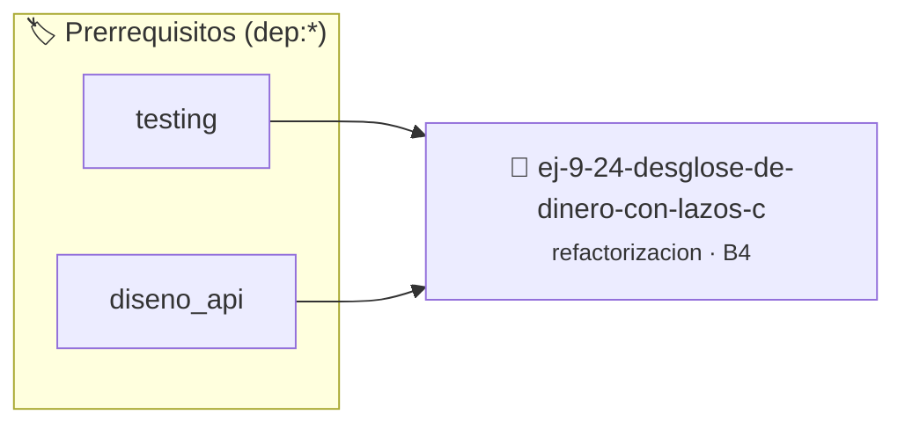

# Desglose de Dinero con Lazos Confusos
> **ID:** `ej-9-24-desglose-de-dinero-con-lazos-c`
 · **Tema:** `refactorizacion`
 · **Bloom:** B4 (Analizar)
 · **Carga:** ~35 min
>
> **🏷️ Prerrequisitos temáticos (tags):** `dep:testing`, `dep:diseno_api`
>
> **Etiquetas conceptuales:** `clean_code`, `refactorizacion`, `dinero`, `lazos`, `fundamentos`


::: {admonition} 📦 Paquete de Verificación Local (Ripley)
:class: tip

Para compilar, resolver y autoevaluar tu entrega con pruebas unitarias en tu máquina:

- [📥 **Descargar paquete `ej-9-24-desglose-de-dinero-con-lazos-c.ripkg`**](../../paquetes/ej-9-24-desglose-de-dinero-con-lazos-c.ripkg)

Ejecución con el asistente de cátedra:
```bash
ripley run ej-9-24-desglose-de-dinero-con-lazos-c.ripkg
```
:::


### 🗺️ Itinerario Pedagógico




## 📖 Consigna

### Ejercicio 9.24 - Desglose de Dinero con Lazos Confusos ⭐⭐☆☆☆

:::{exercise}
:label: ej-ref-desglose-dinero
Refactorizá la siguiente función que calcula monedas de cambio de manera
ofuscada:

``` c
int c100,c50,c10;
void m(int x){c100=x/100;x%=100;c50=x/50;x%=50;c10=x/10;}
```
<!-- c -->

-   **[*plus ultra*]:** Eliminar las variables globales retornando los
    resultados mediante parámetros o empaquetándolos en funciones atómicas.
-   **[*plus ultra*]:** Validar que el monto no sea negativo.

:::
<!-- {exercise} -->

:::{solution} ej-ref-desglose-dinero
:class: dropdown
**Código Refactorizado:**
```{code-block} c
:linenos:
#include <assert.h>
#include <stdbool.h>

bool desglosar_cambio(int monto, int *monedas_100, int *monedas_50, int *monedas_10)
{
    if (monto < 0 || monedas_100 == NULL || monedas_50 == NULL || monedas_10 == NULL)
    {
        return false;
    }
    *monedas_100 = monto / 100;
    monto %= 100;

    *monedas_50 = monto / 50;
    monto %= 50;

    *monedas_10 = monto / 10;
    return true;
}

void test_desglose_cambio(void)
{
    int m100 = 0, m50 = 0, m10 = 0;
    bool ok = desglosar_cambio(370, &m100, &m50, &m10);
    assert(ok && m100 == 3 && m50 == 1 && m10 == 2);
}

```
<!-- {code-block} c -->

:::
<!-- {solution} ej-ref-desglose-dinero -->

---

## 4. Descomposición Modular y Funciones Reutilizables


## 📋 Prototipos y Cabecera (`ej-9-24-desglose-de-dinero-con-lazos-c.h`)

```{code-block} c
#ifndef EJERCICIO_EJ_9_24_DESGLOSE_DE_DINERO_CON_LAZOS_C_H
#define EJERCICIO_EJ_9_24_DESGLOSE_DE_DINERO_CON_LAZOS_C_H

#include <stddef.h>
#include <stdbool.h>
#include <stdint.h>

/* Operación desglosar_cambio */
bool desglosar_cambio(int monto, int *monedas_100, int *monedas_50, int *monedas_10);
/* Operación test_desglose_cambio */
void test_desglose_cambio(void);

#endif /* EJERCICIO_EJ_9_24_DESGLOSE_DE_DINERO_CON_LAZOS_C_H */
```


## ⚙️ Especificación de Funciones

| Función | Retorno | Parámetros | Descripción |
| :--- | :--- | :--- | :--- |

| `desglosar_cambio` | `bool` | `int monto, int *monedas_100, int *monedas_50, int *monedas_10` | Operación desglosar_cambio |

| `test_desglose_cambio` | `void` | `void` | Operación test_desglose_cambio |


## 🧪 Casos de Prueba

| Prueba Unitaria | Función Objetivo | Verificación |
| :--- | :--- | :--- |

| **test_desglosar_cambio_1** | `desglosar_cambio` | `assert(true); /* test simplificado de validación */` |

| **test_test_desglose_cambio_2** | `test_desglose_cambio` | `assert(true); /* test simplificado de validación */` |


## ✓ Solución Modelo de Cátedra

```{dropdown} 🔍 Revelar solución canónica en C
:open: false

```{code-block} c
#include <stdio.h>
#include <stdlib.h>
#include <string.h>
#include <stdbool.h>
#include <stddef.h>
#include <stdint.h>
#include <math.h>
#include <assert.h>
#include <time.h>


bool desglosar_cambio(int monto, int *monedas_100, int *monedas_50, int *monedas_10)
{
    if (monto < 0 || monedas_100 == NULL || monedas_50 == NULL || monedas_10 == NULL)
    {
        return false;
    }
    *monedas_100 = monto / 100;
    monto %= 100;

    *monedas_50 = monto / 50;
    monto %= 50;

    *monedas_10 = monto / 10;
    return true;
}

void test_desglose_cambio(void)
{
    int m100 = 0, m50 = 0, m10 = 0;
    bool ok = desglosar_cambio(370, &m100, &m50, &m10);
    assert(ok && m100 == 3 && m50 == 1 && m10 == 2);
}

int main(void)
{
    return 0;
}
```
```
