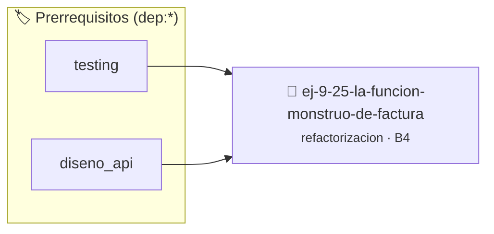

# La Función Monstruo de Facturación
> **ID:** `ej-9-25-la-funcion-monstruo-de-factura` · **Unidad:** 5 (Ingeniería de Software y Calidad en C)
 · **Tema:** `refactorizacion` / `clean_code`
 · **Bloom:** B4 (Analizar) · **Dificultad:** Avanzada
 · **Carga:** ~35 min · **Tipo:** Practica Guiada
>
> **🏷️ Prerrequisitos temáticos (tags):** `dep:testing`, `dep:diseno_api`
>
> **Etiquetas conceptuales:** `clean_code`, `refactorizacion`, `fundamentos`, `funcion`, `facturacion`


::: {admonition} 📦 Paquete de Verificación Local (Ripley)
:class: tip

Para compilar, resolver y autoevaluar tu entrega con pruebas unitarias en tu máquina:

- [📥 **Descargar paquete `ej-9-25-la-funcion-monstruo-de-factura.ripkg`**](../../paquetes/ej-9-25-la-funcion-monstruo-de-factura.ripkg)

Ejecución con el asistente de cátedra:
```bash
ripley run ej-9-25-la-funcion-monstruo-de-factura.ripkg
```
:::


### 🗺️ Itinerario Pedagógico




## 📖 Consigna

:::{exercise}
:label: ej-ref-funcion-monstruo
La siguiente función viola el Principio de Responsabilidad Única ([Regla
0x2005h](../../reglas/2_funciones.md#0x2005h)) y mezcla E/S con cálculos.
Descomponela en al menos 3 funciones atómicas puras y un `main` interactivo:

```{code-block} c
:linenos:
#include <stdio.h>

void facturar(double p, int cant, int tipo, double saldo)
{
    double sub = p * cant;
    double desc = 0;
    if (tipo == 1) desc = sub * 0.10;
    else if (tipo == 2) desc = sub * 0.20;
    double iva = (sub - desc) * 0.21;
    double total = (sub - desc) + iva;
    printf("Total: %.2f\n", total);
    if (saldo >= total) {
        printf("Pago exitoso. Saldo restante: %.2f\n", saldo - total);
    } else {
        printf("Saldo insuficiente\n");
    }
}

```

-   **[*plus ultra*]:** Crear `calcular_subtotal`, `calcular_descuento`,
    `calcular_iva` y `verificar_saldo`.
-   **[*plus ultra*]:** Escribir pruebas unitarias con `assert()` para cada
    función pura.

:::

---

### 📋 Contrato de las Funciones

```c
/*
 * Operación facturar
 * Precondiciones: Parámetros dentro del dominio válido de la operación.
 * Postcondiciones: Retorna el valor procesado.
 */
void facturar(double p, int cant, int tipo, double saldo);

```

### 🧪 Ejemplos de Ejecución

::::{tab-set}
:::{tab-item} Caso general
```text
val = 10
Retorno esperado calculado
```
:::
:::{tab-item} Caso límite
```text
val = 0
Retorno 0 o manejo de borde
```
:::
::::

### ⚠️ Precondiciones y Casos Borde

1. **Valores fuera de rango:** Verificar siempre que los datos de entrada cumplan con los rangos admisibles antes de operar.
6. **Casos vacíos o neutros:** Contemplar adecuadamente entradas con longitud cero o valores neutros según corresponda.

### 🎯 Criterios de Aceptación

- [ ] El código compila limpiamente bajo estándar C11 sin warnings con flags estrictos (`-Wall -Wextra -Werror`).
- [ ] Se satisfacen todas las pruebas unitarias y casos de prueba provistos.
- [ ] Las funciones validan exhaustivamente sus precondiciones y gestionan casos borde de forma robusta.


## 📋 Prototipos y Cabecera (`ej-9-25-la-funcion-monstruo-de-factura.h`)

```{code-block} c
#ifndef EJERCICIO_EJ_9_25_LA_FUNCION_MONSTRUO_DE_FACTURA_H
#define EJERCICIO_EJ_9_25_LA_FUNCION_MONSTRUO_DE_FACTURA_H

#include <stddef.h>
#include <stdbool.h>
#include <stdint.h>

/* Operación facturar */
void facturar(double p, int cant, int tipo, double saldo);

#endif /* EJERCICIO_EJ_9_25_LA_FUNCION_MONSTRUO_DE_FACTURA_H */
```


## ⚙️ Especificación de Funciones

| Función | Retorno | Parámetros | Descripción |
| :--- | :--- | :--- | :--- |

| `facturar` | `void` | `double p, int cant, int tipo, double saldo` | Operación facturar |


## 🧪 Casos de Prueba

| Prueba Unitaria | Función Objetivo | Verificación |
| :--- | :--- | :--- |

| **test_facturar_1** | `facturar` | `/* Verificación unitaria de facturar */ facturar(1, 2, 3, 4); assert(true);` |


## ✓ Solución Modelo de Cátedra

```{dropdown} 🔍 Revelar solución canónica en C
:open: false

```{code-block} c
#include <stdio.h>

void facturar(double p, int cant, int tipo, double saldo)
{
    double sub = p * cant;
    double desc = 0;
    if (tipo == 1) desc = sub * 0.10;
    else if (tipo == 2) desc = sub * 0.20;
    double iva = (sub - desc) * 0.21;
    double total = (sub - desc) + iva;
    printf("Total: %.2f\n", total);
    if (saldo >= total) {
        printf("Pago exitoso. Saldo restante: %.2f\n", saldo - total);
    } else {
        printf("Saldo insuficiente\n");
    }
}

int main(void)
{
    return 0;
}
```
```
