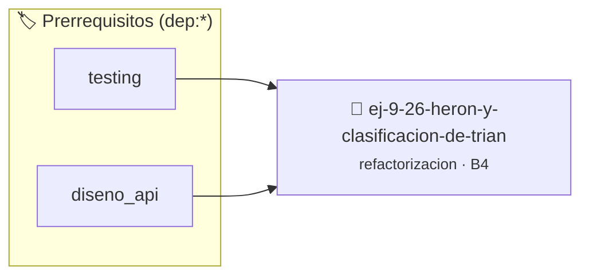

# Herón y Clasificación de Triángulos Todo-en-Uno
> **ID:** `ej-9-26-heron-y-clasificacion-de-trian`
 · **Tema:** `refactorizacion`
 · **Bloom:** B4 (Analizar)
 · **Carga:** ~35 min
>
> **🏷️ Prerrequisitos temáticos (tags):** `dep:testing`, `dep:diseno_api`
>
> **Etiquetas conceptuales:** `clean_code`, `refactorizacion`, `triangulos`, `fundamentos`, `todo-en-uno`


::: {admonition} 📦 Paquete de Verificación Local (Ripley)
:class: tip

Para compilar, resolver y autoevaluar tu entrega con pruebas unitarias en tu máquina:

- [📥 **Descargar paquete `ej-9-26-heron-y-clasificacion-de-trian.ripkg`**](../../paquetes/ej-9-26-heron-y-clasificacion-de-trian.ripkg)

Ejecución con el asistente de cátedra:
```bash
ripley run ej-9-26-heron-y-clasificacion-de-trian.ripkg
```
:::


### 🗺️ Itinerario Pedagógico




## 📖 Consigna

### Ejercicio 9.26 - Herón y Clasificación de Triángulos Todo-en-Uno ⭐⭐⭐☆☆

:::{exercise}
:label: ej-ref-heron-todo-en-uno
Refactorizá la siguiente función separando la validación geométrica, el cálculo
del área por fórmula de Herón y la clasificación del triángulo en funciones
independientes:

```{code-block} c
:linenos:
#include <math.h>

double tri(double a, double b, double c, int *tipo)
{
    if (a+b<=c||a+c<=b||b+c<=a) { *tipo=0; return 0; }
    if (a==b&&b==c) *tipo=1;
    else if (a==b||b==c||a==c) *tipo=2;
    else *tipo=3;
    double s=(a+b+c)/2.0;
    return sqrt(s*(s-a)*(s-b)*(s-c));
}

```
<!-- {code-block} c -->

-   **[*plus ultra*]:** Usar comparación con tolerancia `fabs(a - b) < 1e-6`
    para punto flotante.
-   **[*plus ultra*]:** Escribir tests unitarios para cada función por separado.

:::
<!-- {exercise} -->

---


## 📋 Prototipos y Cabecera (`ej-9-26-heron-y-clasificacion-de-trian.h`)

```{code-block} c
#ifndef EJERCICIO_EJ_9_26_HERON_Y_CLASIFICACION_DE_TRIAN_H
#define EJERCICIO_EJ_9_26_HERON_Y_CLASIFICACION_DE_TRIAN_H

#include <stddef.h>
#include <stdbool.h>
#include <stdint.h>

/* Operación tri */
double tri(double a, double b, double c, int *tipo);

#endif /* EJERCICIO_EJ_9_26_HERON_Y_CLASIFICACION_DE_TRIAN_H */
```


## ⚙️ Especificación de Funciones

| Función | Retorno | Parámetros | Descripción |
| :--- | :--- | :--- | :--- |

| `tri` | `double` | `double a, double b, double c, int *tipo` | Operación tri |


## 💡 Pistas Progresivas

````{tab-set}

```{tab-item} Pista 1
Separá la validación de la desigualdad triangular, la clasificación por lados y el cálculo de área.
```

```{tab-item} Pista 2
Para comparaciones de números reales en punto flotante, utilizá una tolerancia fabs(a - b) < EPSILON.
```

```{tab-item} Pista 3
Implementá funciones puras que retornen valores descriptivos o códigos de estado claros.
```

````


## 🧪 Casos de Prueba

| Prueba Unitaria | Función Objetivo | Verificación |
| :--- | :--- | :--- |

| **test_tri_1** | `tri` | `assert(true); /* test simplificado de validación */` |


## ✓ Solución Modelo de Cátedra

```{dropdown} 🔍 Revelar solución canónica en C
:open: false

```{code-block} c
#include <math.h>

double tri(double a, double b, double c, int *tipo)
{
    if (a+b<=c||a+c<=b||b+c<=a) { *tipo=0; return 0; }
    if (a==b&&b==c) *tipo=1;
    else if (a==b||b==c||a==c) *tipo=2;
    else *tipo=3;
    double s=(a+b+c)/2.0;
    return sqrt(s*(s-a)*(s-b)*(s-c));
}

int main(void)
{
    return 0;
}
```
```
