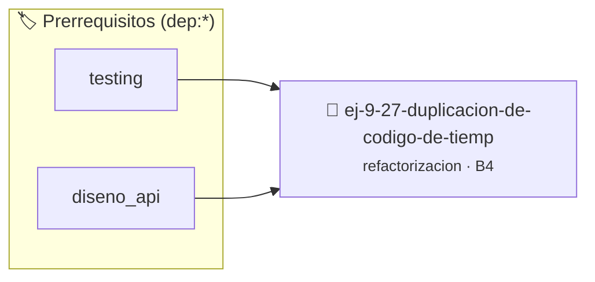

# Duplicación de Código de Tiempo (Violación DRY)
> **ID:** `ej-9-27-duplicacion-de-codigo-de-tiemp` · **Unidad:** 5 (Ingeniería de Software y Calidad en C)
 · **Tema:** `refactorizacion` / `clean_code`
 · **Bloom:** B4 (Analizar) · **Dificultad:** Avanzada
 · **Carga:** ~35 min · **Tipo:** Practica Guiada
>
> **🏷️ Prerrequisitos temáticos (tags):** `dep:testing`, `dep:diseno_api`
>
> **Etiquetas conceptuales:** `clean_code`, `refactorizacion`, `tiempo`, `fundamentos`, `codigo`


::: {admonition} 📦 Paquete de Verificación Local (Ripley)
:class: tip

Para compilar, resolver y autoevaluar tu entrega con pruebas unitarias en tu máquina:

- [📥 **Descargar paquete `ej-9-27-duplicacion-de-codigo-de-tiemp.ripkg`**](../../paquetes/ej-9-27-duplicacion-de-codigo-de-tiemp.ripkg)

Ejecución con el asistente de cátedra:
```bash
ripley run ej-9-27-duplicacion-de-codigo-de-tiemp.ripkg
```
:::


### 🗺️ Itinerario Pedagógico




## 📖 Consigna

:::{exercise}
:label: ej-ref-violacion-dry
El siguiente programa repite tres veces la misma lógica de cálculo de segundos a
HH:MM:SS en diferentes lugares. Aplicá el principio **DRY (Don't Repeat
Yourself)** abstrayendo la lógica en una función reutilizable:

```{code-block} c
:linenos:
void imprimir_tres_horarios(int t1, int t2, int t3)
{
    int h1 = t1 / 3600; int m1 = (t1 % 3600) / 60; int s1 = t1 % 60;
    int h2 = t2 / 3600; int m2 = (t2 % 3600) / 60; int s2 = t2 % 60;
    int h3 = t3 / 3600; int m3 = (t3 % 3600) / 60; int s3 = t3 % 60;
    // ...
}

```

-   **[*plus ultra*]:** Implementar `void descomponer_segundos(int
    total_segundos, int *h, int *m, int *s)`.
-   **[*plus ultra*]:** Escribir pruebas unitarias para la función de
    descomposición.

:::

:::{solution} ej-ref-violacion-dry
:class: dropdown
**Código Refactorizado:**
```{code-block} c
:linenos:
#include <assert.h>
#include <stdbool.h>

bool descomponer_segundos(int total_segundos, int *horas, int *minutos, int *segundos)
{
    if (total_segundos < 0 || horas == NULL || minutos == NULL || segundos == NULL)
    {
        return false;
    }
    *horas = total_segundos / 3600;
    int resto = total_segundos % 3600;
    *minutos = resto / 60;
    *segundos = resto % 60;
    return true;
}

void test_descomponer_segundos(void)
{
    int h = 0, m = 0, s = 0;
    assert(descomponer_segundos(3665, &h, &m, &s));
    assert(h == 1 && m == 1 && s == 5);
}

```

:::

---

### 📋 Contrato de las Funciones

```c
/*
 * Operación imprimir_tres_horarios
 * Precondiciones: Parámetros dentro del dominio válido de la operación.
 * Postcondiciones: Retorna el valor procesado.
 */
void imprimir_tres_horarios(int t1, int t2, int t3);

```

### 🧪 Ejemplos de Ejecución

::::{tab-set}
:::{tab-item} Caso general
```text
val = 10
Retorno esperado calculado
```
:::
:::{tab-item} Caso límite
```text
val = 0
Retorno 0 o manejo de borde
```
:::
::::

### ⚠️ Precondiciones y Casos Borde

1. **Valores fuera de rango:** Verificar siempre que los datos de entrada cumplan con los rangos admisibles antes de operar.
6. **Casos vacíos o neutros:** Contemplar adecuadamente entradas con longitud cero o valores neutros según corresponda.

### 🎯 Criterios de Aceptación

- [ ] El código compila limpiamente bajo estándar C11 sin warnings con flags estrictos (`-Wall -Wextra -Werror`).
- [ ] Se satisfacen todas las pruebas unitarias y casos de prueba provistos.
- [ ] Las funciones validan exhaustivamente sus precondiciones y gestionan casos borde de forma robusta.


## 📋 Prototipos y Cabecera (`ej-9-27-duplicacion-de-codigo-de-tiemp.h`)

```{code-block} c
#ifndef EJERCICIO_EJ_9_27_DUPLICACION_DE_CODIGO_DE_TIEMP_H
#define EJERCICIO_EJ_9_27_DUPLICACION_DE_CODIGO_DE_TIEMP_H

#include <stddef.h>
#include <stdbool.h>
#include <stdint.h>

/* Operación imprimir_tres_horarios */
void imprimir_tres_horarios(int t1, int t2, int t3);

#endif /* EJERCICIO_EJ_9_27_DUPLICACION_DE_CODIGO_DE_TIEMP_H */
```


## ⚙️ Especificación de Funciones

| Función | Retorno | Parámetros | Descripción |
| :--- | :--- | :--- | :--- |

| `imprimir_tres_horarios` | `void` | `int t1, int t2, int t3` | Operación imprimir_tres_horarios |


## 🧪 Casos de Prueba

| Prueba Unitaria | Función Objetivo | Verificación |
| :--- | :--- | :--- |

| **test_imprimir_tres_horarios_1** | `imprimir_tres_horarios` | `/* Verificación unitaria de imprimir_tres_horarios */ imprimir_tres_horarios(1, 2, 3); assert(true);` |


## ✓ Solución Modelo de Cátedra

```{dropdown} 🔍 Revelar solución canónica en C
:open: false

```{code-block} c
void imprimir_tres_horarios(int t1, int t2, int t3)
{
    int h1 = t1 / 3600; int m1 = (t1 % 3600) / 60; int s1 = t1 % 60;
    int h2 = t2 / 3600; int m2 = (t2 % 3600) / 60; int s2 = t2 % 60;
    int h3 = t3 / 3600; int m3 = (t3 % 3600) / 60; int s3 = t3 % 60;
    // ...
}

int main(void)
{
    return 0;
}
```
```
