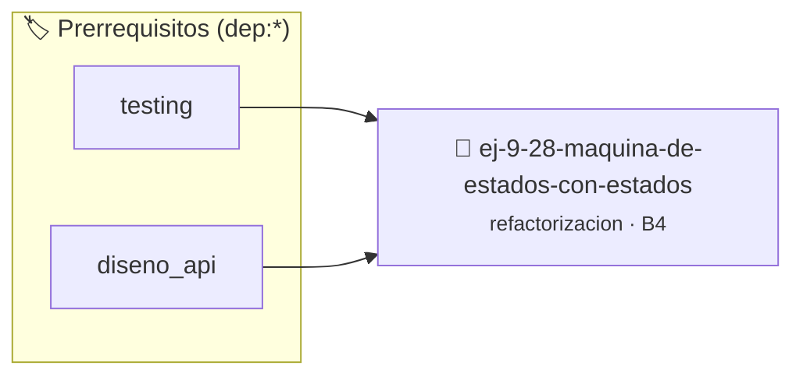

# Máquina de Estados con Estados Mágicos
> **ID:** `ej-9-28-maquina-de-estados-con-estados`
 · **Tema:** `refactorizacion`
 · **Bloom:** B4 (Analizar)
 · **Carga:** ~35 min
>
> **🏷️ Prerrequisitos temáticos (tags):** `dep:testing`, `dep:diseno_api`
>
> **Etiquetas conceptuales:** `maquina`, `clean_code`, `refactorizacion`, `fundamentos`, `magicos`


::: {admonition} 📦 Paquete de Verificación Local (Ripley)
:class: tip

Para compilar, resolver y autoevaluar tu entrega con pruebas unitarias en tu máquina:

- [📥 **Descargar paquete `ej-9-28-maquina-de-estados-con-estados.ripkg`**](../../paquetes/ej-9-28-maquina-de-estados-con-estados.ripkg)

Ejecución con el asistente de cátedra:
```bash
ripley run ej-9-28-maquina-de-estados-con-estados.ripkg
```
:::


### 🗺️ Itinerario Pedagógico




## 📖 Consigna

### Ejercicio 9.28 - Máquina de Estados con Estados Mágicos ⭐⭐⭐☆☆

:::{exercise}
:label: ej-ref-fsm-estados-magicos
Refactorizá la siguiente máquina de estados que usa números enteros mágicos (`0,
1, 2, 3`) para procesar palabras, sustituyéndolos por un `enum` autoexplicativo
y funciones de transición puras:

```{code-block} c
:linenos:
int st = 0;

void step(char c)
{
    if (st == 0 && c != ' ') st = 1;
    else if (st == 1 && c == ' ') st = 2;
    else if (st == 2 && c != ' ') st = 1;
    else if (c == '\n') st = 3;
}

```
<!-- {code-block} c -->

-   **[*plus ultra*]:** Eliminar la variable global `st`.
-   **[*plus ultra*]:** Escribir una suite de pruebas de transición de estados.

:::
<!-- {exercise} -->

---


## 📋 Prototipos y Cabecera (`ej-9-28-maquina-de-estados-con-estados.h`)

```{code-block} c
#ifndef EJERCICIO_EJ_9_28_MAQUINA_DE_ESTADOS_CON_ESTADOS_H
#define EJERCICIO_EJ_9_28_MAQUINA_DE_ESTADOS_CON_ESTADOS_H

#include <stddef.h>
#include <stdbool.h>
#include <stdint.h>

/* Operación step */
void step(char c);

#endif /* EJERCICIO_EJ_9_28_MAQUINA_DE_ESTADOS_CON_ESTADOS_H */
```


## ⚙️ Especificación de Funciones

| Función | Retorno | Parámetros | Descripción |
| :--- | :--- | :--- | :--- |

| `step` | `void` | `char c` | Operación step |


## 🧪 Casos de Prueba

| Prueba Unitaria | Función Objetivo | Verificación |
| :--- | :--- | :--- |

| **test_step_1** | `step` | `assert(true); /* test simplificado de validación */` |


## ✓ Solución Modelo de Cátedra

```{dropdown} 🔍 Revelar solución canónica en C
:open: false

```{code-block} c
#include <stdio.h>
#include <stdlib.h>
#include <string.h>

int main(void)
{
    int st = 0;

void step(char c)
{
    if (st == 0 && c != ' ') st = 1;
    else if (st == 1 && c == ' ') st = 2;
    else if (st == 2 && c != ' ') st = 1;
    else if (c == '\n') st = 3;
}
    return 0;
}
```
```
