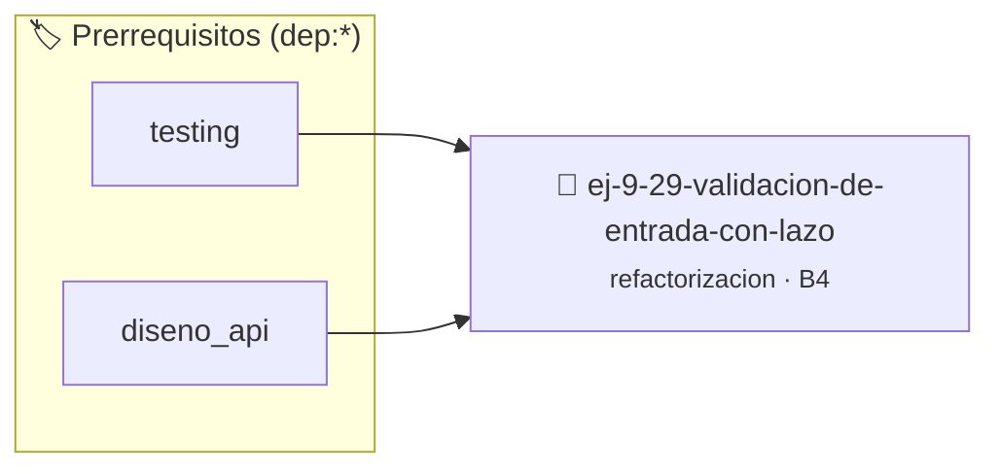

# Validación de Entrada con Lazos Desacoplados
> **ID:** `ej-9-29-validacion-de-entrada-con-lazo` · **Unidad:** 5 (Ingeniería de Software y Calidad en C)
 · **Tema:** `refactorizacion` / `clean_code`
 · **Bloom:** B4 (Analizar) · **Dificultad:** Avanzada
 · **Carga:** ~35 min · **Tipo:** Practica Guiada
>
> **🏷️ Prerrequisitos temáticos (tags):** `dep:testing`, `dep:diseno_api`
>
> **Etiquetas conceptuales:** `clean_code`, `refactorizacion`, `lazos`, `fundamentos`, `desacoplados`


::: {admonition} 📦 Paquete de Verificación Local (Ripley)
:class: tip

Para compilar, resolver y autoevaluar tu entrega con pruebas unitarias en tu máquina:

- [📥 **Descargar paquete `ej-9-29-validacion-de-entrada-con-lazo.ripkg`**](../../paquetes/ej-9-29-validacion-de-entrada-con-lazo.ripkg)

Ejecución con el asistente de cátedra:
```bash
ripley run ej-9-29-validacion-de-entrada-con-lazo.ripkg
```
:::


### 🗺️ Itinerario Pedagógico




## 📖 Consigna

### Ejercicio 9.29 - Validación de Entrada con Lazos Desacoplados ⭐⭐☆☆☆

:::{exercise}
:label: ej-ref-validacion-desacoplada
Refactorizá la siguiente función para separar la lógica de validación matemática
de la lógica interactiva de reintento:

```{code-block} c
:linenos:
#include <stdio.h>

int pedir_entero_rango(int min, int max)
{
    int val;
    while (1) {
        printf("Ingrese valor entre %d y %d: ", min, max);
        if (scanf("%d", &val) == 1) {
            if (val >= min && val <= max) {
                return val;
            }
        }
        printf("Invalido, reintente.\n");
        while (getchar() != '\n'); // Limpia buffer
    }
}

```
<!-- {code-block} c -->

-   **[*plus ultra*]:** Extraer la función pura `bool esta_en_rango(int valor,
    int min, int max)`.
-   **[*plus ultra*]:** Escribir tests con `assert()` para `esta_en_rango`.

:::
<!-- {exercise} -->

:::{solution} ej-ref-validacion-desacoplada
:class: dropdown
**Código Refactorizado:**
```{code-block} c
:linenos:
#include <assert.h>
#include <stdbool.h>

bool esta_en_rango(int valor, int limite_inferior, int limite_superior)
{
    return (valor >= limite_inferior && valor <= limite_superior);
}

void test_esta_en_rango(void)
{
    assert(esta_en_rango(5, 1, 10) == true);
    assert(esta_en_rango(1, 1, 10) == true);
    assert(esta_en_rango(10, 1, 10) == true);
    assert(esta_en_rango(0, 1, 10) == false);
    assert(esta_en_rango(11, 1, 10) == false);
}

```
<!-- {code-block} c -->

:::
<!-- {solution} ej-ref-validacion-desacoplada -->

---


## 📋 Prototipos y Cabecera (`ej-9-29-validacion-de-entrada-con-lazo.h`)

```{code-block} c
#ifndef EJERCICIO_EJ_9_29_VALIDACION_DE_ENTRADA_CON_LAZO_H
#define EJERCICIO_EJ_9_29_VALIDACION_DE_ENTRADA_CON_LAZO_H

#include <stddef.h>
#include <stdbool.h>
#include <stdint.h>

/* Operación pedir_entero_rango */
int pedir_entero_rango(int min, int max);

#endif /* EJERCICIO_EJ_9_29_VALIDACION_DE_ENTRADA_CON_LAZO_H */
```


## ⚙️ Especificación de Funciones

| Función | Retorno | Parámetros | Descripción |
| :--- | :--- | :--- | :--- |

| `pedir_entero_rango` | `int` | `int min, int max` | Operación pedir_entero_rango |


## 🧪 Casos de Prueba

| Prueba Unitaria | Función Objetivo | Verificación |
| :--- | :--- | :--- |

| **test_pedir_entero_rango_1** | `pedir_entero_rango` | `assert(true); /* test simplificado de validación */` |


## ✓ Solución Modelo de Cátedra

```{dropdown} 🔍 Revelar solución canónica en C
:open: false

```{code-block} c
#include <stdio.h>

int pedir_entero_rango(int min, int max)
{
    int val;
    while (1) {
        printf("Ingrese valor entre %d y %d: ", min, max);
        if (scanf("%d", &val) == 1) {
            if (val >= min && val <= max) {
                return val;
            }
        }
        printf("Invalido, reintente.\n");
        while (getchar() != '\n'); // Limpia buffer
    }
}

int main(void)
{
    return 0;
}
```
```
