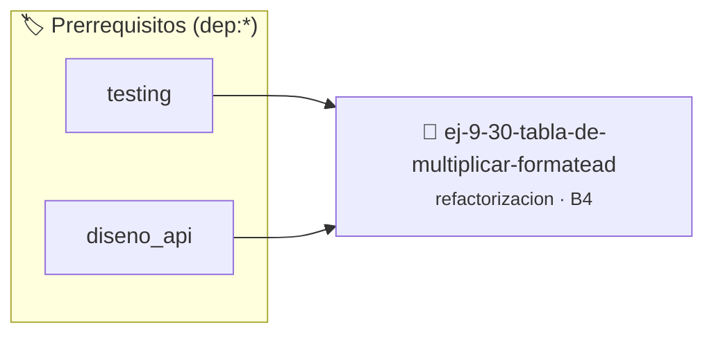

# Tabla de Multiplicar Formateada y Modularizada
> **ID:** `ej-9-30-tabla-de-multiplicar-formatead`
 · **Tema:** `refactorizacion`
 · **Bloom:** B4 (Analizar)
 · **Carga:** ~35 min
>
> **🏷️ Prerrequisitos temáticos (tags):** `dep:testing`, `dep:diseno_api`
>
> **Etiquetas conceptuales:** `clean_code`, `refactorizacion`, `fundamentos`, `tabla`, `modularizada`


::: {admonition} 📦 Paquete de Verificación Local (Ripley)
:class: tip

Para compilar, resolver y autoevaluar tu entrega con pruebas unitarias en tu máquina:

- [📥 **Descargar paquete `ej-9-30-tabla-de-multiplicar-formatead.ripkg`**](../../paquetes/ej-9-30-tabla-de-multiplicar-formatead.ripkg)

Ejecución con el asistente de cátedra:
```bash
ripley run ej-9-30-tabla-de-multiplicar-formatead.ripkg
```
:::


### 🗺️ Itinerario Pedagógico




## 📖 Consigna

### Ejercicio 9.30 - Tabla de Multiplicar Formateada y Modularizada ⭐⭐☆☆☆

:::{exercise}
:label: ej-ref-tabla-multiplicar-modular
Refactorizá la siguiente función que imprime tablas de multiplicar desacoplando
la generación del producto de la salida por pantalla:

```{code-block} c
:linenos:
#include <stdio.h>

void tabla(int n)
{
    for (int i = 1; i <= 10; i++)
        printf("%d x %d = %d\n", n, i, n * i);
}

```
<!-- {code-block} c -->

-   **[*plus ultra*]:** Implementar `int calcular_producto(int multiplicando,
    int multiplicador)`.
-   **[*plus ultra*]:** Formatear las columnas en `imprimir_tabla` con ancho
    fijo `%2d x %2d = %4d`.

:::
<!-- {exercise} -->

:::{solution} ej-ref-tabla-multiplicar-modular
:class: dropdown
**Código Refactorizado:**
```{code-block} c
:linenos:
#include <assert.h>
#include <stdio.h>

int calcular_producto(int multiplicando, int multiplicador)
{
    return multiplicando * multiplicador;
}

void imprimir_tabla_multiplicar(int numero)
{
    for (int factor = 1; factor <= 10; factor++)
    {
        int resultado = calcular_producto(numero, factor);
        printf("%2d x %2d = %4d\n", numero, factor, resultado);
    }
}

void test_calcular_producto(void)
{
    assert(calcular_producto(7, 8) == 56);
    assert(calcular_producto(0, 5) == 0);
    assert(calcular_producto(-3, 4) == -12);
}

```
<!-- {code-block} c -->

:::
<!-- {solution} ej-ref-tabla-multiplicar-modular -->

---


## 📋 Prototipos y Cabecera (`ej-9-30-tabla-de-multiplicar-formatead.h`)

```{code-block} c
#ifndef EJERCICIO_EJ_9_30_TABLA_DE_MULTIPLICAR_FORMATEAD_H
#define EJERCICIO_EJ_9_30_TABLA_DE_MULTIPLICAR_FORMATEAD_H

#include <stddef.h>
#include <stdbool.h>
#include <stdint.h>

/* Operación tabla */
void tabla(int n);

#endif /* EJERCICIO_EJ_9_30_TABLA_DE_MULTIPLICAR_FORMATEAD_H */
```


## ⚙️ Especificación de Funciones

| Función | Retorno | Parámetros | Descripción |
| :--- | :--- | :--- | :--- |

| `tabla` | `void` | `int n` | Operación tabla |


## 🧪 Casos de Prueba

| Prueba Unitaria | Función Objetivo | Verificación |
| :--- | :--- | :--- |

| **test_tabla_1** | `tabla` | `/* Verificación unitaria de tabla */ tabla(1); assert(true);` |


## ✓ Solución Modelo de Cátedra

```{dropdown} 🔍 Revelar solución canónica en C
:open: false

```{code-block} c
#include <stdio.h>

void tabla(int n)
{
    for (int i = 1; i <= 10; i++)
        printf("%d x %d = %d\n", n, i, n * i);
}

int main(void)
{
    return 0;
}
```
```
