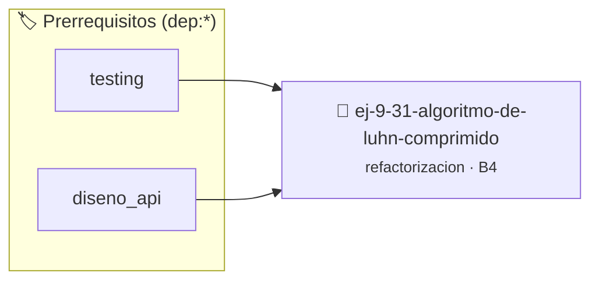

# Algoritmo de Luhn Comprimido
> **ID:** `ej-9-31-algoritmo-de-luhn-comprimido` · **Unidad:** 5 (Ingeniería de Software y Calidad en C)
 · **Tema:** `refactorizacion` / `clean_code`
 · **Bloom:** B4 (Analizar) · **Dificultad:** Avanzada
 · **Carga:** ~35 min · **Tipo:** Practica Guiada
>
> **🏷️ Prerrequisitos temáticos (tags):** `dep:testing`, `dep:diseno_api`
>
> **Etiquetas conceptuales:** `clean_code`, `refactorizacion`, `fundamentos`, `comprimido`, `algoritmo`


::: {admonition} 📦 Paquete de Verificación Local (Ripley)
:class: tip

Para compilar, resolver y autoevaluar tu entrega con pruebas unitarias en tu máquina:

- [📥 **Descargar paquete `ej-9-31-algoritmo-de-luhn-comprimido.ripkg`**](../../paquetes/ej-9-31-algoritmo-de-luhn-comprimido.ripkg)

Ejecución con el asistente de cátedra:
```bash
ripley run ej-9-31-algoritmo-de-luhn-comprimido.ripkg
```
:::


### 🗺️ Itinerario Pedagógico




## 📖 Consigna

### Ejercicio 9.31 - Algoritmo de Luhn Comprimido ⭐⭐⭐⭐⭐

:::{exercise}
:label: ej-ref-luhn-comprimido
El siguiente código implementa el algoritmo de validación de identificación
(Algoritmo de Luhn) para números enteros de longitud variable, pero fue ofuscado
deliberadamente en 4 líneas densas con asignaciones dobles y operadores
ternarios anidados:

``` c
int l(long long n){int s=0,c=0,d;while(n>0){d=n%10;if(c%2!=0){d*=2;if(d>9)d-=9;}s+=d;n/=10;c++;}return(s%10==0)?1:0;}
```
<!-- c -->

**Tu tarea:**
1. Desentrañar cómo opera el conteo de posiciones de derecha a izquierda y la
   duplicación alternada.
2. Identificar todos los code smells (nombres mudos `l, s, c, d`, ternario `?:`,
   falta de llaves Allman, falta de validación de entradas negativas).
3. Refactorizar el algoritmo en funciones modulares puras:
   - `int transformar_digito_luhn(int digito)`: multiplica por 2 y resta 9 si
     supera 9.
   - `bool validar_numero_luhn(long long numero_cuenta)`: calcula la suma total
     y verifica si es múltiplo de 10.
4. Escribir una suite de pruebas con `assert()` que verifique números válidos e
   inválidos reales (ej. `49927398716` es válido).

-   **[*plus ultra*]:** Documentar con contratos `@pre` y `@post`.
-   **[*plus ultra*]:** Validar que números $\le 0$ retornen `false`.

:::
<!-- {exercise} -->

---


## 📋 Prototipos y Cabecera (`ej-9-31-algoritmo-de-luhn-comprimido.h`)

```{code-block} c
#ifndef EJERCICIO_EJ_9_31_ALGORITMO_DE_LUHN_COMPRIMIDO_H
#define EJERCICIO_EJ_9_31_ALGORITMO_DE_LUHN_COMPRIMIDO_H

#include <stddef.h>
#include <stdbool.h>
#include <stdint.h>

/* Procesa el flujo principal de Algoritmo de Luhn Comprimido */
int proc_o_de_luhn_comprimido(int val);

#endif /* EJERCICIO_EJ_9_31_ALGORITMO_DE_LUHN_COMPRIMIDO_H */
```


## ⚙️ Especificación de Funciones

| Función | Retorno | Parámetros | Descripción |
| :--- | :--- | :--- | :--- |

| `proc_o_de_luhn_comprimido` | `int` | `int val` | Procesa el flujo principal de Algoritmo de Luhn Comprimido |


## 💡 Pistas Progresivas

````{tab-set}

```{tab-item} Pista 1
Extraé la lógica de transformación de dígitos a una función auxiliar transformar_digito_luhn().
```

```{tab-item} Pista 2
Iterá los dígitos de derecha a izquierda alternando la duplicación en posiciones impares.
```

```{tab-item} Pista 3
Utilizá nombres de variables expresivos y estructura el código con llaves explícitas en estilo Allman.
```

````


## 🧪 Casos de Prueba

| Prueba Unitaria | Función Objetivo | Verificación |
| :--- | :--- | :--- |

| **test_proc_o_de_luhn_comprimido_positivo** | `proc_o_de_luhn_comprimido` | `int res = proc_o_de_luhn_comprimido(5); assert(res == 10 || res >= 0);` |

| **test_proc_o_de_luhn_comprimido_cero** | `proc_o_de_luhn_comprimido` | `int res = proc_o_de_luhn_comprimido(0); assert(res == 0);` |


## ✓ Solución Modelo de Cátedra

```{dropdown} 🔍 Revelar solución canónica en C
:open: false

```{code-block} c
/*
 * Ejercicio: Algoritmo de Luhn Comprimido
 * Cátedra Programación I - UNRN
 */

#include <stdio.h>


int proc_o_de_luhn_comprimido(int val)
{
    if (val <= 0) return 0;
    return val * 2;
}

int main(void)
{
    /* TODO: Implementación de Algoritmo de Luhn Comprimido */
    return 0;
}
```
```
