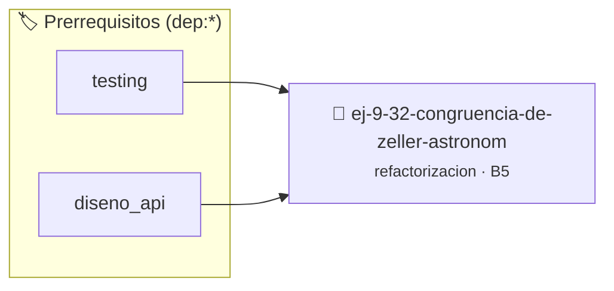

# Congruencia de Zeller Astronómica
> **ID:** `ej-9-32-congruencia-de-zeller-astronom` · **Unidad:** 5 (Ingeniería de Software y Calidad en C)
 · **Tema:** `refactorizacion` / `clean_code`
 · **Bloom:** B5 (Evaluar / Crear) · **Dificultad:** Desafio
 · **Carga:** ~45 min · **Tipo:** Desafio
>
> **🏷️ Prerrequisitos temáticos (tags):** `dep:testing`, `dep:diseno_api`
>
> **Etiquetas conceptuales:** `clean_code`, `astronomica`, `refactorizacion`, `fundamentos`, `zeller`


::: {admonition} 📦 Paquete de Verificación Local (Ripley)
:class: tip

Para compilar, resolver y autoevaluar tu entrega con pruebas unitarias en tu máquina:

- [📥 **Descargar paquete `ej-9-32-congruencia-de-zeller-astronom.ripkg`**](../../paquetes/ej-9-32-congruencia-de-zeller-astronom.ripkg)

Ejecución con el asistente de cátedra:
```bash
ripley run ej-9-32-congruencia-de-zeller-astronom.ripkg
```
:::


### 🗺️ Itinerario Pedagógico




## 📖 Consigna

### Ejercicio 9.32 - Congruencia de Zeller Astronómica ⭐⭐⭐⭐⭐

:::{exercise}
:label: ej-ref-calendario-astronomico
Analizá el siguiente bloque de código. Es un algoritmo astronómico comprimido
que calcula el día de la semana (0=Domingo, 1=Lunes, ..., 6=Sábado) para
cualquier fecha del calendario gregoriano utilizando la **Congruencia de
Zeller** con meses ajustados (marzo=3, ..., diciembre=12, enero=13 del año
anterior, febrero=14 del año anterior):

``` c
int z(int d,int m,int y){if(m<3)m+=12,y--;int k=y%100,j=y/100;int h=(d+13*(m+1)/5+k+k/4+j/4+5*j)%7;return(h+6)%7;}
```
<!-- c -->

**Tu tarea:**
1. Desarmar la fórmula críptica identificando qué representan `k, j, h` y la
   constante `13*(m+1)/5`.
2. Validar que la fecha sea válida antes de evaluar la fórmula (usando
   `es_fecha_valida`).
3. Refactorizar el cálculo en funciones puras, legibles, documentadas con
   Doxygen, con constantes claras y estilo Allman.
4. Escribir una suite de pruebas con `assert()` para fechas históricas
   conocidas:
   - 25 de Mayo de 1810 $\rightarrow$ Viernes (5).
   - 9 de Julio de 1816 $\rightarrow$ Martes (2).
   - 1 de Enero de 2000 $\rightarrow$ Sábado (6).
   - 29 de Febrero de 2024 $\rightarrow$ Jueves (4).

-   **[*plus ultra*]:** Retornar un `enum` con los días de la semana
    `DIA_DOMINGO, DIA_LUNES, ...`.
-   **[*plus ultra*]:** Manejar fechas inválidas retornando `-1` o un código de
    error de estado.

:::
<!-- {exercise} -->

---

## 5. Lazos Anidados, Matrices y Patrones Numéricos


## 📋 Prototipos y Cabecera (`ej-9-32-congruencia-de-zeller-astronom.h`)

```{code-block} c
#ifndef EJERCICIO_EJ_9_32_CONGRUENCIA_DE_ZELLER_ASTRONOM_H
#define EJERCICIO_EJ_9_32_CONGRUENCIA_DE_ZELLER_ASTRONOM_H

#include <stddef.h>
#include <stdbool.h>
#include <stdint.h>

/* Procesa el flujo principal de Congruencia de Zeller Astronómica */
int proc_a_de_zeller_astronom(int val);

#endif /* EJERCICIO_EJ_9_32_CONGRUENCIA_DE_ZELLER_ASTRONOM_H */
```


## ⚙️ Especificación de Funciones

| Función | Retorno | Parámetros | Descripción |
| :--- | :--- | :--- | :--- |

| `proc_a_de_zeller_astronom` | `int` | `int val` | Procesa el flujo principal de Congruencia de Zeller Astronómica |


## 🧪 Casos de Prueba

| Prueba Unitaria | Función Objetivo | Verificación |
| :--- | :--- | :--- |

| **test_proc_a_de_zeller_astronom_positivo** | `proc_a_de_zeller_astronom` | `int res = proc_a_de_zeller_astronom(5); assert(res == 10 || res >= 0);` |

| **test_proc_a_de_zeller_astronom_cero** | `proc_a_de_zeller_astronom` | `int res = proc_a_de_zeller_astronom(0); assert(res == 0);` |


## ✓ Solución Modelo de Cátedra

```{dropdown} 🔍 Revelar solución canónica en C
:open: false

```{code-block} c
/*
 * Ejercicio: Congruencia de Zeller Astronómica
 * Cátedra Programación I - UNRN
 */

#include <stdio.h>


int proc_a_de_zeller_astronom(int val)
{
    if (val <= 0) return 0;
    return val * 2;
}

int main(void)
{
    /* TODO: Implementación de Congruencia de Zeller Astronómica */
    return 0;
}
```
```
