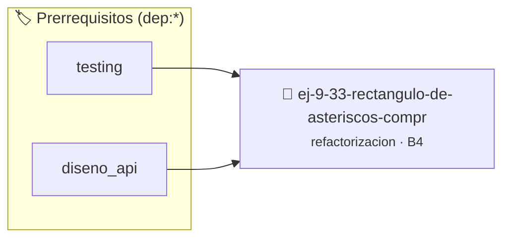

# Rectángulo de Asteriscos Comprimido
> **ID:** `ej-9-33-rectangulo-de-asteriscos-compr` · **Unidad:** 5 (Ingeniería de Software y Calidad en C)
 · **Tema:** `refactorizacion` / `asteriscos`
 · **Bloom:** B4 (Analizar) · **Dificultad:** Avanzada
 · **Carga:** ~35 min · **Tipo:** Practica Guiada
>
> **🏷️ Prerrequisitos temáticos (tags):** `dep:testing`, `dep:diseno_api`
>
> **Etiquetas conceptuales:** `asteriscos`, `clean_code`, `refactorizacion`, `rectangulo`, `fundamentos`


::: {admonition} 📦 Paquete de Verificación Local (Ripley)
:class: tip

Para compilar, resolver y autoevaluar tu entrega con pruebas unitarias en tu máquina:

- [📥 **Descargar paquete `ej-9-33-rectangulo-de-asteriscos-compr.ripkg`**](../../paquetes/ej-9-33-rectangulo-de-asteriscos-compr.ripkg)

Ejecución con el asistente de cátedra:
```bash
ripley run ej-9-33-rectangulo-de-asteriscos-compr.ripkg
```
:::


### 🗺️ Itinerario Pedagógico




## 📖 Consigna

### Ejercicio 9.33 - Rectángulo de Asteriscos Comprimido ⭐☆☆☆☆

:::{exercise}
:label: ej-ref-rectangulo-asteriscos
Analizá el siguiente código que imprime un rectángulo en consola mediante lazos
anidados en una sola línea y refactorizalo:

``` c
void r(int w,int h){for(int i=0;i<h;i++){for(int j=0;j<w;j++)printf("*");printf("\n");}}
```
<!-- c -->

-   **[*plus ultra*]:** Validar que ancho y alto sean mayores a cero.
-   **[*plus ultra*]:** Modularizar la impresión de una fila de caracteres en
    una función auxiliar `void imprimir_fila(char c, int longitud)`.

:::
<!-- {exercise} -->

:::{solution} ej-ref-rectangulo-asteriscos
:class: dropdown
**Código Refactorizado:**
```{code-block} c
:linenos:
#include <stdio.h>

void imprimir_fila_caracter(char caracter, int longitud)
{
    for (int columna = 0; columna < longitud; columna++)
    {
        putchar(caracter);
    }
    putchar('\n');
}

void imprimir_rectangulo(int ancho, int alto)
{
    if (ancho <= 0 || alto <= 0)
    {
        return;
    }
    for (int fila = 0; fila < alto; fila++)
    {
        imprimir_fila_caracter('*', ancho);
    }
}

```
<!-- {code-block} c -->

:::
<!-- {solution} ej-ref-rectangulo-asteriscos -->

---


## 📋 Prototipos y Cabecera (`ej-9-33-rectangulo-de-asteriscos-compr.h`)

```{code-block} c
#ifndef EJERCICIO_EJ_9_33_RECTANGULO_DE_ASTERISCOS_COMPR_H
#define EJERCICIO_EJ_9_33_RECTANGULO_DE_ASTERISCOS_COMPR_H

#include <stddef.h>
#include <stdbool.h>
#include <stdint.h>

/* Operación imprimir_fila_caracter */
void imprimir_fila_caracter(char caracter, int longitud);
/* Operación imprimir_rectangulo */
void imprimir_rectangulo(int ancho, int alto);

#endif /* EJERCICIO_EJ_9_33_RECTANGULO_DE_ASTERISCOS_COMPR_H */
```


## ⚙️ Especificación de Funciones

| Función | Retorno | Parámetros | Descripción |
| :--- | :--- | :--- | :--- |

| `imprimir_fila_caracter` | `void` | `char caracter, int longitud` | Operación imprimir_fila_caracter |

| `imprimir_rectangulo` | `void` | `int ancho, int alto` | Operación imprimir_rectangulo |


## 🧪 Casos de Prueba

| Prueba Unitaria | Función Objetivo | Verificación |
| :--- | :--- | :--- |

| **test_imprimir_fila_caracter_1** | `imprimir_fila_caracter` | `/* Verificación unitaria de imprimir_fila_caracter */ imprimir_fila_caracter(1, 2); assert(true);` |

| **test_imprimir_rectangulo_2** | `imprimir_rectangulo` | `/* Verificación unitaria de imprimir_rectangulo */ imprimir_rectangulo(1, 2); assert(true);` |


## ✓ Solución Modelo de Cátedra

```{dropdown} 🔍 Revelar solución canónica en C
:open: false

```{code-block} c
#include <stdio.h>

void imprimir_fila_caracter(char caracter, int longitud)
{
    for (int columna = 0; columna < longitud; columna++)
    {
        putchar(caracter);
    }
    putchar('\n');
}

void imprimir_rectangulo(int ancho, int alto)
{
    if (ancho <= 0 || alto <= 0)
    {
        return;
    }
    for (int fila = 0; fila < alto; fila++)
    {
        imprimir_fila_caracter('*', ancho);
    }
}

int main(void)
{
    return 0;
}
```
```
